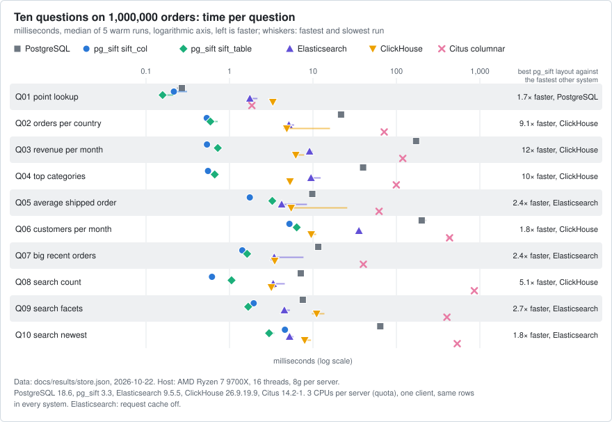
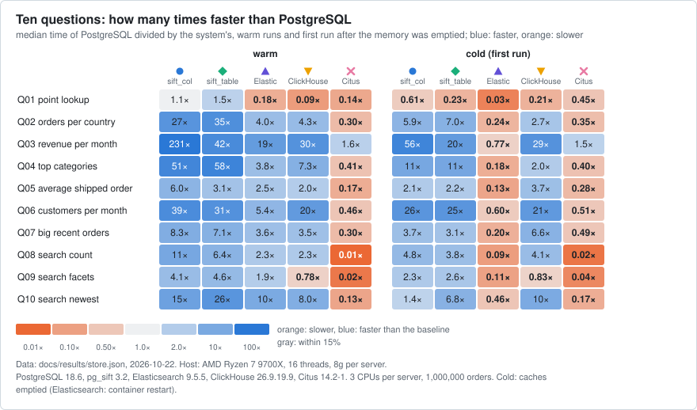
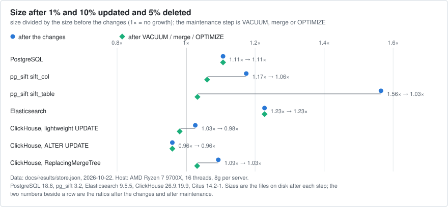
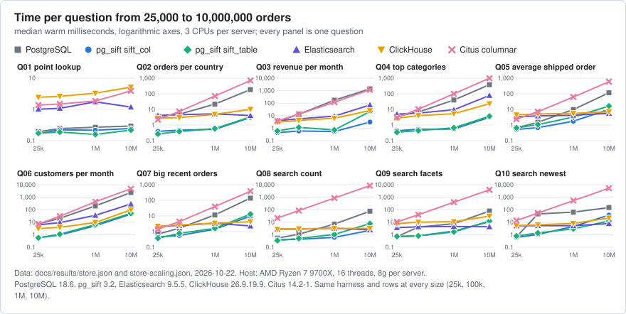
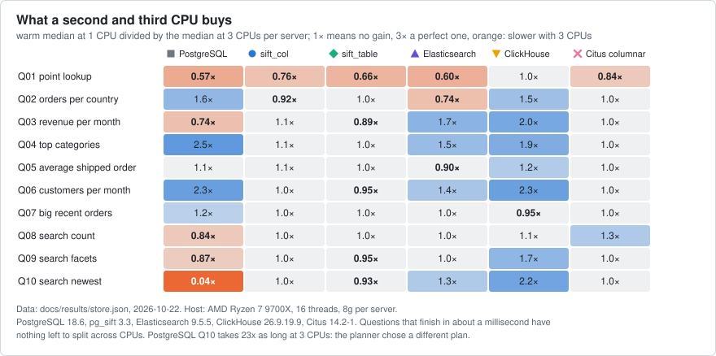
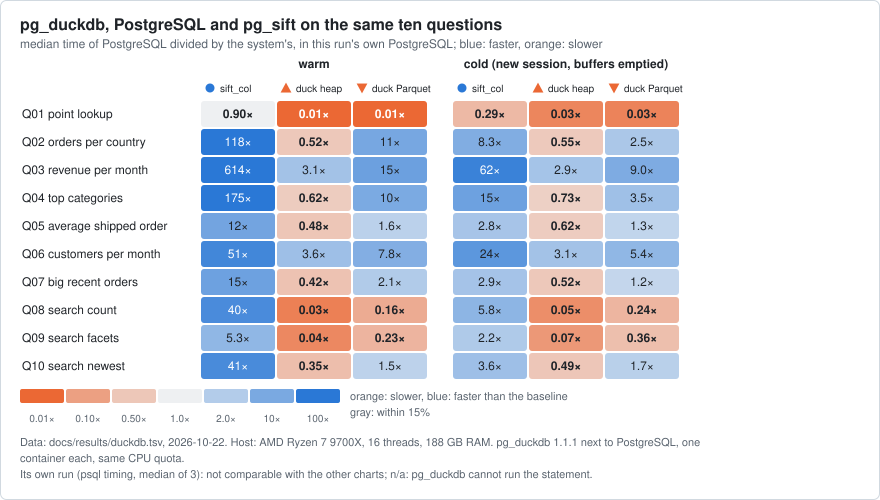
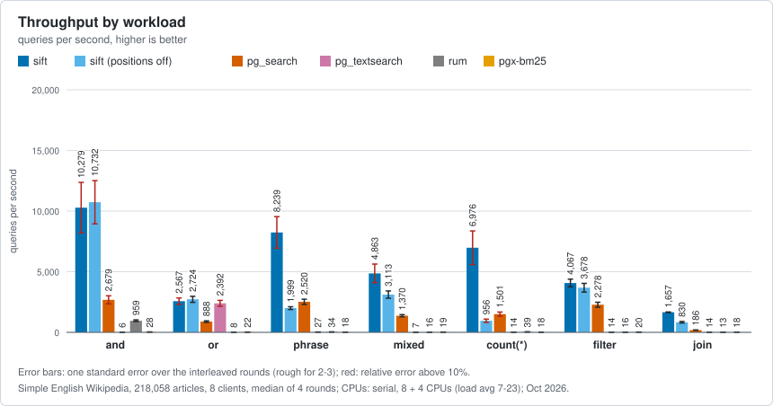
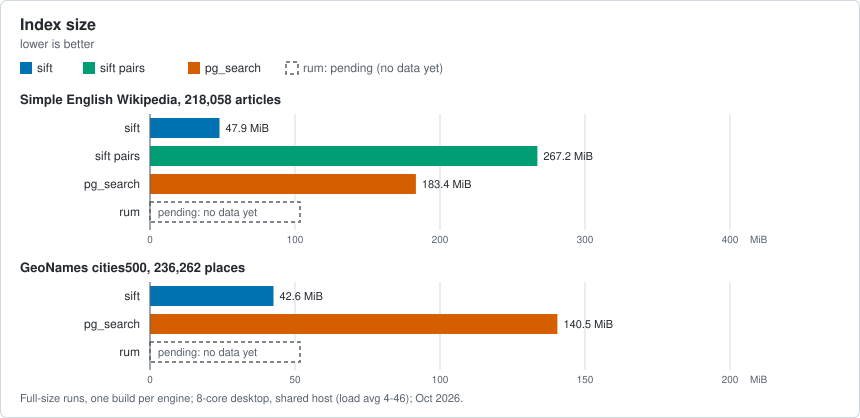
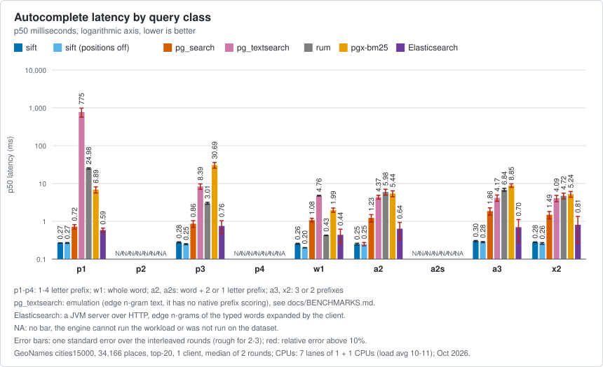

# pg_sift

[](https://github.com/brauliobo/pg_sift/actions/workflows/ci.yml) [](https://github.com/brauliobo/pg_sift/actions/workflows/release.yml) [](https://github.com/brauliobo/pg_sift/releases/latest) [](#install) [](LICENSE)

pg_sift adds fast full-text search and column-store analytics to PostgreSQL with one `CREATE EXTENSION pg_sift`. No external search
server, no separate analytics database, no `shared_preload_libraries`. The search engine also runs as a SQLite extension and a MariaDB library.

## Performance highlights

<!-- bench:highlights:begin (generated by `bench/steps/highlights.py` from docs/results; do not edit by hand) -->
BM25 search and column-store aggregates for PostgreSQL 17 and 18 in one
extension. Measured 2026-10-22 on AMD Ryzen 7 9700X (16 threads), PostgreSQL
18.6, 3 CPUs per server, one client, warm medians; every result is checked
against PostgreSQL's.

- Aggregates on 1,000,000 orders, 10 questions (count, sum, distinct, top-N,
  text search with filters); the faster of sift_col and sift_table against:
  - PostgreSQL 18.6: faster on 10 of 10 (1.7x to 321x)
  - ClickHouse 26.9: faster on 10 of 10 (1.8x to 21x)
  - Elasticsearch 9.5: faster on 10 of 10 (1.8x to 17x)
  - Citus 14.2 columnar: faster on 10 of 10 (12x to 1392x)
  - pg_duckdb 1.1.1 (its own run, best of its modes): faster on 10 of 10
    (6.5x to 253x)
- Search on 50,000 Wikipedia articles, 8 clients: 2.2x to 6.6x the queries
  per second of pg_search on every query class; ahead of Elasticsearch on 5
  of 7 classes (0.5x to 2.2x across all); the index is 30 MiB with phrase
  support (1.4x smaller than pg_search).
- Size on 1,000,000 orders: sift_col adds 18.9 MiB to the table
  (PostgreSQL's btrees and GIN: 34.6 MiB); sift_table holds the table in 46
  MiB (ClickHouse 38, Citus 46, Elasticsearch 111). Load from one CSV:
  sift_col 1.4 s, PostgreSQL 2.2 s, ClickHouse 0.8 s, Elasticsearch 11 s.
- Updates: 10% of the rows updated at 157,905 rows/s (PostgreSQL 88,281);
  revenue per month under 10,000 updated rows/s: 35 ms on sift_col, 162 ms
  on PostgreSQL.
- Scale, 25k to 10M orders (400x the rows): the median question takes 12x as
  long on sift_col, 159x on PostgreSQL, 4x on ClickHouse; at 10,000,000
  orders pg_sift is fastest or within 5% on 6 of 10 questions.
- Partitions, 1 to 4,096: the speed-up over PostgreSQL on 3 aggregate
  questions (median) goes from 2.0x to 1.1x slower (4,096 partitions).
- Real query shapes (joins, lookups, top-N, distinct, time buckets, UNION
  ALL arms; 29 cases on 1.2M orders, one backend): faster than the
  PostgreSQL heap on 18 (1.3x to 277x, median 3.2x), slower on 7 (1.1x to
  1.9x; 6 of them with the smallest filter set).
- 3.3 optimizations on 200,000 orders, one backend, against PostgreSQL on
  the same rows (sift.enable_agg = off): A page of rows with the total of
  its set (11x); ORDER BY coalesce(column, constant) LIMIT n (14x);
  count(DISTINCT key) of a whole table from the key presence of its units
  (67x); COPY into a sift_table, written as column groups, against a heap
  COPY (4.1x less WAL); ORDER BY an unsorted integer column LIMIT n from the
  sorted run of each unit (order_columns) (7.4x).
- Where it does not win:
  - Cold (caches emptied), not the fastest on 3 of 10 questions: point
    lookup (PostgreSQL, 1.4x), average shipped order (ClickHouse, 1.3x), big
    recent orders (ClickHouse, 2.2x).
  - ClickHouse loads faster (0.8 s) and its table is smaller (38 MiB against
    143 MiB for sift_col, whose heap stays).
  - 3.3 cases that are slower than PostgreSQL: bulk_copy_wal ms (2.3x),
    bulk_copy_wal CPU ms (2.3x), spine_array_key ms (1.3x).

Results, charts and method:
https://github.com/brauliobo/pg_sift/blob/main/docs/perf/AGGREGATES.md
<!-- bench:highlights:end -->

[Features](#features) · [Install](#install) · [Homebrew](#install-with-homebrew) · [Search](#search) · [Analytics](#analytics) · [Benchmarks](#benchmarks) · [Compared with](#compared-with) · [What is covered](#what-is-covered) · [SQLite](#sqlite) · [MariaDB](#mariadb) · [Operations](#operations) · [Limits](#limits) · [Vulkan (experimental)](#vulkan-experimental) · [Docs](#docs)

## Features

- **BM25 search index** (`USING sift`): boolean, phrase, prefix, wildcard, regex and fuzzy queries, exact BM25 ranking, top-k with filters applied inside the scan, counts from the index, facets, autocomplete.
- **Column engine** (`USING sift_col`, `USING sift_table`): `count`, `count(DISTINCT ...)`, `sum`, `avg`, `min`, `max` with filters and `GROUP BY` run on compressed columns as `Custom Scan (SiftAgg)`; `sift_table` stores the table itself in column format.
- **Vulkan (experimental, opt-in, 3.1):** `make VULKAN=1` and `SET sift.gpu = auto|on` run grouped and filtered integer counts and sums of a `sift_col` index on a GPU; off by default, the CPU path unchanged ([Vulkan](#vulkan-experimental), [docs/GPU.md](docs/GPU.md)).
- **Plain PostgreSQL:** MVCC, VACUUM, `CREATE INDEX CONCURRENTLY`, partitions, generic WAL (crash and replica safe), `pg_dump`; a query the planner cannot prove equal keeps its normal plan.
- **Ports:** [SQLite](#sqlite) and [MariaDB](#mariadb) run the same search core.

## Install

Supports PostgreSQL 17, 18 and 19 on Linux (19 tested on its release candidate) and PostgreSQL 17 and 18 on macOS arm64. Linux packages for Arch (AUR), Debian, Ubuntu and RHEL-family systems: [docs/USAGE.md](docs/USAGE.md#install).

Try it in five minutes with Docker: [docs/QUICKSTART.md](docs/QUICKSTART.md). Container image recipes (PostgreSQL 17 and 18, Docker Compose, a CloudNativePG extension image): [docs/CONTAINERS.md](docs/CONTAINERS.md). Supported versions, upgrade paths and the licence: [docs/SUPPORT.md](docs/SUPPORT.md).

### Install with Homebrew

On macOS, the [formula](Formula/pg_sift.rb) in this repository builds for Homebrew PostgreSQL 17 and 18:

```sh
brew tap brauliobo/pg_sift https://github.com/brauliobo/pg_sift.git
brew install --HEAD brauliobo/pg_sift/pg_sift
brew test brauliobo/pg_sift/pg_sift
```

The HEAD-only formula builds `main` and supports macOS arm64. CI builds it and runs `brew test` (a BM25 smoke, an extension upgrade and a `sift_col` aggregate) on macOS arm64 with PostgreSQL 17 and 18; earlier it was tried by hand on Apple Silicon with 17.11 and 18.6.
`make check` also needs bash 4 or newer (`brew install bash`); the stock macOS bash 3.2 stops with a message. CI runs a few of its regression tests on macOS; the rest of the suite runs on Linux.
With your PostgreSQL server running, connect as a superuser:

```sh
"$(brew --prefix postgresql@18)/bin/psql" -d mydb -c 'CREATE EXTENSION pg_sift;'
```

Replace `mydb` with your database name; use `postgresql@17` for a PostgreSQL 17 server.

### Build from source

Needs server headers with `pg_config` on `PATH` and a C compiler.

```sh
make USE_PGXS=1 && sudo make USE_PGXS=1 install     # PG_CONFIG=/path/to/pg_config picks another installation
psql -d mydb -c 'CREATE EXTENSION pg_sift'          # as a superuser; after an upgrade: ALTER EXTENSION pg_sift UPDATE
```

## Search

```sql
CREATE TABLE docs (id int PRIMARY KEY, title text, body text, published date, category int);
INSERT INTO docs VALUES
  (1, 'Wireless headphones', 'Battery was great and the support was friendly. The case was squeaky.', '2026-01-10', 1),
  (2, 'Charger', 'Friendly support, no battery, but a sturdy case and clip.', '2026-02-11', 1),
  (3, 'Resume tips', 'A good résumé is short. Cafés near the office help.', '2026-03-12', 2),
  (4, 'Running', 'Runners were running; she runs every day.', '2026-04-13', 2),
  (5, 'Squeaky headphones', 'The headphones were squeaky at night, squeak everywhere. Friendly support though.', '2026-05-14', 1);
CREATE INDEX docs_body ON docs USING sift (body);

SELECT id FROM docs WHERE body @@> 'battery friendly';                     -- all terms: 1, 2
SELECT id, sift.score(ctid) FROM docs WHERE body @@> 'case OR clip' ORDER BY sift.score(ctid) DESC LIMIT 10;   -- BM25 top-10
SELECT count(*) FROM docs WHERE body @@> 'friendly';                        -- 3, from the index
```

Words are `AND`ed; `OR`, `NOT`, `"phrases"`, `batt*`, `sq?eaky`, `/regex/`, `frendly~1` and `^3` boosts combine them: [docs/USAGE.md](docs/USAGE.md#queries).

## Analytics

```sql
CREATE TABLE orders (id bigint PRIMARY KEY, customer_id int, country text, category text, status text, amount numeric(10,2), created_at timestamp);
CREATE INDEX orders_col ON orders USING sift_col (customer_id, country, category, status, amount, created_at);

SELECT category, count(*), sum(amount) FROM orders
WHERE country = 'DE' AND created_at >= '2025-06-01' GROUP BY category;          -- Custom Scan (SiftAgg) on orders_col
CREATE TABLE events (id bigint, kind text, price numeric(10,2), at timestamp) USING sift_table;   -- the table itself in column format
```

`SET sift.enable_agg = off` gives the plan PostgreSQL has without sift. Types, options and limits: [docs/USAGE.md](docs/USAGE.md#column-indexes-aggregates-and-sift_table).

<!-- sift-reference:start -->
## SQL reference

Schema `sift` has 47 functions, 4 views, 1 table, 2 operator classes, 1 operator. Signatures, results, the release that added each and a line on what it does are in [docs/REFERENCE.md](docs/REFERENCE.md), generated from the SQL scripts.

- **[Search and ranking](docs/REFERENCE.md#search-and-ranking)**: `@@>`, `cluster_advice`, `facet_counts`, `facet_sql`, `facets`, `field_query`, `highlight`, `index_info`, `match`, `match_idx`, `max_score`, `parse_query`, `score`, `sections`, `segment_postings`, `segments`, `text_ops`, `tokenize`, `verify`
- **[Column index](docs/REFERENCE.md#column-index)**: `col_*_ops`, `col_clustering`, `col_index_info`, `col_leaves`, `col_ops`, `col_sections`, `col_segments`, `col_unit_agg`, `col_unit_hist`, `col_verify`
- **[Tables](docs/REFERENCE.md#tables)**: `table_paths`, `table_paths_maintained`, `table_segments`, `table_set_paths`, `table_space`
- **[Maintenance and workers](docs/REFERENCE.md#maintenance-and-workers)**: `col_maintain`, `col_maintenance_due`, `col_merge`, `col_promote`, `col_refresh`, `col_rollup_counters`, `col_rollup_queue`, `col_rollup_refresh`, `col_rollup_requests`, `col_rollup_state`, `merge`, `promote`, `table_maintain`, `worker_state`, `workers`
- **[Diagnostics and upgrade](docs/REFERENCE.md#diagnostics-and-upgrade)**: `col_rollup_misses`, `explain_why`, `refusal_slugs`, `stats`, `stats_reset`, `upgrade_commands`, `version`

Settings (`sift.*`) are in the [settings table](docs/USAGE.md#maintenance-and-operations), fixed limits in [docs/LIMITS.md](docs/LIMITS.md).
<!-- sift-reference:end -->

<!-- sift-options:start -->
## Options at a glance

Every index option (`WITH (...)`) and every `sift.*` setting, generated by `scripts/gen-options.sh` from the C sources: the defaults are the ones the library is compiled with.
The full tables, with range, context and description, are in [docs/USAGE.md](docs/USAGE.md#maintenance-and-operations).

| Option | Applies to | Type and values | Default | What it buys | Cost | Read more |
|---|---|---|---|---|---|---|
| `k1` | BM25 | real 0..1000 | 1.2 | term-frequency saturation of the BM25 score | REINDEX to change; no size effect | [SIZING](docs/SIZING.md#features-and-their-costs) |
| `b` | BM25 | real 0..1 | 0.75 | length normalization of the BM25 score | REINDEX to change; no size effect | [SIZING](docs/SIZING.md#features-and-their-costs) |
| `analyzer` | BM25 | enum: text, keyword | text | keyword indexes each whole value as one term, for facets and exact keys | REINDEX to change | [FIELDS-FACETS](docs/FIELDS-FACETS.md#facets-siftfacet_counts) |
| `stemmer` | BM25 | none or en | '' | Snowball English stemming: word forms match | REINDEX to change | [SIZING](docs/SIZING.md#features-and-their-costs) |
| `case_folding` | BM25 | bool | true | matches regardless of case | REINDEX to change | [SIZING](docs/SIZING.md#features-and-their-costs) |
| `accent_folding` | BM25 | bool | true | matches regardless of accents | REINDEX to change | [SIZING](docs/SIZING.md#features-and-their-costs) |
| `positions` | BM25 | bool | true | phrase queries are decided by the index, not rechecked in the heap | index about 2.5x the size of positions=false in the 3.0 series (130.9 against 52.5 MiB on 218,058 articles); REINDEX to change | [SIZING](docs/SIZING.md#disk) |
| `prefix_index` | BM25 | int 0..15 | 0 | prefix queries of up to n characters need no term expansion (autocomplete) | a larger index (more terms, growing with n); REINDEX to change | [USAGE](docs/USAGE.md#queries) |
| `fields` | BM25 | names of the leading sections of the text, as name:word | '' | weights and queries over named sections of the indexed text | REINDEX to change | [FIELDS-FACETS](docs/FIELDS-FACETS.md#fields-siftsections-and-siftfield_query) |
| `write_buffer_limit` | BM25 | int 64..1048576 | 4096 | size at which the write buffer is sealed; the base of the merge tiers | 1024 against 4096 kB (100,000 documents): promotion 37 to 13 ms but 3.7x as often, 16-client INSERT 107k to 87k rows/s, index 72 to 98 MB | [USAGE](docs/USAGE.md#maintenance-and-operations) |
| `vacuum_segments` | BM25 | int 1..128 | 2 | segments VACUUM leaves the index with: fewer segments, faster queries | 2 against 16 (60 segments of 50,000 documents): VACUUM 0.19 s against 0.10 s, count(*) 0.08 against 0.35 ms | [USAGE](docs/USAGE.md#maintenance-and-operations) |
| `merge_fanin` | BM25 | int 2..32 | 8 | segments of one size tier that trigger a merge: lower keeps fewer segments | lower merges more often (more write work), higher keeps up to merge_fanin - 1 segments a tier | [USAGE](docs/USAGE.md#maintenance-and-operations) |
| `build_segments` | BM25 | int 0..64 | 0 | forces N segments at build and turns the parallel build off | a serial build | [USAGE](docs/USAGE.md#maintenance-and-operations) |
| `dead_rewrite_pct` | BM25 | int 1..100 | 50 | a lone segment is rewritten to drop dead documents above this percent | 5 against 50 (400,000 documents, 10 update rounds): VACUUM 37.8 s against 20.2 s, index 133 against 92 MB; 100 never rewrites | [USAGE](docs/USAGE.md#maintenance-and-operations) |
| `vacuum_truncate` | BM25 | bool | true | VACUUM gives the free blocks at the end of the file back to the operating system | a brief exclusive lock when it is free; a standby cancels queries that hold the index | [USAGE](docs/USAGE.md#maintenance-and-operations) |
| `write_buffer_limit` | sift_col | int 64..1048576 | 4096 | size at which the write buffer is sealed; the base of the merge tiers | the trade-off measured for the sift index (1024 against 4096 kB: 3.7x as many promotions); ALTER INDEX applies from the next seal | [USAGE](docs/USAGE.md#maintenance-and-operations) |
| `dead_rewrite_pct` | sift_col | int 1..100 | 10 | a lone segment is rewritten above this percent of dead rows, so that its units answer from pre-aggregates again | a rewrite writes the whole segment; 100 never rewrites | [USAGE](docs/USAGE.md#maintenance-and-operations) |
| `vacuum_truncate` | sift_col | bool | true | VACUUM gives the free blocks at the end of the file back to the operating system | a brief exclusive lock when it is free; a standby cancels queries that hold the index | [USAGE](docs/USAGE.md#maintenance-and-operations) |
| `paths` | sift_col | attname: a.b type, a.b[]{f type}, *:type; ... | '' | jsonb leaves are shredded into typed columns that filters and aggregates read like any column | the declared leaves are stored once more; REINDEX to change | [COL-SHRED](docs/COL-SHRED.md#declaring-paths-reloption-paths) |
| `compression` | sift_col | auto, none, lz4[:N], zstd[:N], encodings; per column 'auto; col=zstd:9' | '' | smaller chunks: zstd -4.0%, lz4 -2.8% of the index against auto | zstd builds 30% slower (13 columns, 200,000 rows); zstd decodes 3-10x slower on scanned streams; REINDEX to apply | [COMPRESSION 5.3](docs/perf/COMPRESSION.md#53-per-column-control-the-compression-option) |
| `preagg` | sift_col | default, off, or cube(dim: measure, ...; ...) | '' | GROUP BY sums and counts answered from pre-aggregates stored with every unit | the default takes at most 2% of the encoded bytes of a unit (at least 2 kB); off keeps leaf sums only; applies to segments written afterwards | [COL-PREAGG 2](docs/COL-PREAGG.md#2-what-is-precomputed-written-when-a-unit-is-built-merged-promoted-rewritten-by-vacuums-merge-and-by-every-worker-of-a-parallel-build) |
| `rollup` | sift_col | leaf, leaf, ... or off | '' | names the leaves of array elements and map values a rollup groups by | explicit names hold up to 4096 tuples a unit with no byte budget; the default rule has a budget of 2% of the unit per list | [COL-PREAGG 2](docs/COL-PREAGG.md#2-what-is-precomputed-written-when-a-unit-is-built-merged-promoted-rewritten-by-vacuums-merge-and-by-every-worker-of-a-parallel-build) |
| `rollup_on_demand` | sift_col | bool | true | a scan that reads units for lack of their rollups asks the worker to rebuild them | a background rewrite of the segment; the query itself writes nothing | [COL-PREAGG 7](docs/COL-PREAGG.md#7-on-demand-refresh-of-the-rollups-srccolrollupc) |
| `cluster_advice` | sift_col | bool | true (new in 3.3) | sift.cluster_advice() may recommend a physical order of the table | none; maintenance only, not part of the format | [USAGE](docs/USAGE.md#is-the-index-clustered-and-what-did-the-scans-do) |
| `dict_lookup` | sift_col | bool | true (new in 3.3) | equality, IN and prefix tests read a dictionary of 1,024 strings or more in place, without parsing it whole | format minor 14; a 3.2 library cannot read it; such a dictionary also stores 4 bytes a string for its codes in byte order | [COL 2.15](docs/COL.md#215-dictionary-stored-for-a-lookup-in-place-column-format-minor-14-33) |
| `cube_minmax` | sift_col | bool | true (new in 3.3) | min and max per group read from the cube: GROUP BY kind with min/max of an integer 5.5 to 0.34 ms (200,000 rows) | format minor 7; a 3.2 library cannot read it; +0.17% of the index alone, about +1.5% with superunit 16; insert, promotion and merge CPU inside the noise | [COL-PREAGG 2](docs/COL-PREAGG.md#2-what-is-precomputed-written-when-a-unit-is-built-merged-promoted-rewritten-by-vacuums-merge-and-by-every-worker-of-a-parallel-build) |
| `rollup_dims` | sift_col | col, col or col, col: measure, ... | '' (new in 3.3) | GROUP BY of the named scalar columns read from the rollup of each unit: 1.25 to 0.72 ms (200,000 rows) | format minor 9; a 3.2 library cannot read it; +5.3% of the index, build +25% (two columns) | [COL-PREAGG 2](docs/COL-PREAGG.md#2-what-is-precomputed-written-when-a-unit-is-built-merged-promoted-rewritten-by-vacuums-merge-and-by-every-worker-of-a-parallel-build) |
| `calendar_columns` | sift_col | col, col, all or off; empty: every date, timestamp and timestamptz column | '' (new in 3.3) | GROUP BY date_trunc('month', d) and date ranges from calendar cells: 2.4 to 0.54 ms (200,000 rows) | format minor 8; a 3.2 library cannot read it; +1.0% of the index for one column, +1.8% for two (superunits no longer merge the cells); not for an index with JSON paths; the cube holds at most 16 dimensions with the default dims: a list that does not fit is refused, `all` keeps the columns that fit and the build names the ones it left out | [COL-PREAGG 2](docs/COL-PREAGG.md#2-what-is-precomputed-written-when-a-unit-is-built-merged-promoted-rewritten-by-vacuums-merge-and-by-every-worker-of-a-parallel-build) |
| `set_columns` | sift_col | integer, text or uuid columns | '' (new in 3.3) | an equality or IN test skips the units that lack the key: integer equality 0.82 to 0.41 ms; no gain on random keys, which every unit holds | format minor 10; a 3.2 library cannot read it; +10.8% of the index and build +30% (three columns) | [COL 2.13](docs/COL.md#213-small-set-summary-of-a-leaf-in-a-unit-column-format-minor-10-33-opt-in) |
| `key_presence` | sift_col | int2, int4 or date columns | '' (new in 3.3) | count(DISTINCT col) over whole units reads no key chunk | format minor 15; a 3.2 library cannot read it; 2.5% of the index at 8,130 rows a unit, 1.0% at 20,000; a unit whose bitmap would take over 3% of its bytes gets none | [KEY-PRESENCE](docs/perf/KEY-PRESENCE.md#measured) |
| `point_columns` | sift_col | integer, text or uuid columns | '' (new in 3.3) | an equality, IN list or short range on a column of many distinct keys reads only the units that hold the rows, which the heap then checks again: integer equality 0.119 to 0.020 ms (200,000 rows; a b-tree 0.006) | format minor 14; a 3.2 library cannot read it; 4 bytes a row for keys that repeat (0.8 MB for 200,000 rows), 4.2 MB for a unique key; a leaf with overflow values or inline strings gets no table | [COL 2.17](docs/COL.md#217-point-directory-of-a-leaf-in-a-segment-column-format-minor-14-33-opt-in) |
| `order_columns` | sift_col | integer, date, timestamp, numeric or float columns | '' (new in 3.3) | ORDER BY col LIMIT n reads the first rows of each unit only | format minor 13; a 3.2 library cannot read it; the row ordinals per column: 1 B a row (units up to 256 rows), 2 B (to 65,536), else 4 B; 16 B a unit for a column loaded in order | [COL 2.14](docs/COL.md#214-sorted-run-of-a-leaf-in-a-unit-column-format-minor-13-33-opt-in) |
| `return_columns` | sift_col | text, varchar or uuid columns | '' (new in 3.3) | an index-only scan returns these columns from the dictionary of the segment, not the heap | no extra storage: the strings are the dictionary the index keeps | [COL-SCAN](docs/COL-SCAN.md#how-it-works) |
| `set_limit` | sift_col | int 2..1024 | 32 (new in 3.3) | distinct values a unit keeps exactly for set_columns before it keeps a bloom filter | a higher limit keeps more sets exact and takes more bytes per unit | [COL 2.13](docs/COL.md#213-small-set-summary-of-a-leaf-in-a-unit-column-format-minor-10-33-opt-in) |
| `superunit` | sift_col | int 0..256 | 16 (new in 3.3) | a scan no predicate cuts through reads one summary per group of units: whole-table count/sum 0.26-0.37 to 0.05-0.08 ms, flat as units grow | format minor 12; a 3.2 library cannot read it; +1.0% of the index (groups of 64: +0.8%, of 4 to 8: +1.3% to +1.5%); a range query on a 2-unit table 0.10 to 0.13-0.15 ms | [COL-PREAGG 10](docs/COL-PREAGG.md#10-superunits-one-summary-for-a-group-of-units-column-format-minor-12-reloption-superunit-default-16) |
| `sift.{max_expansions,prefix_cache_size}` | BM25 |  | max_expansions=512, prefix_cache_size=8192 kB | bounds the terms a wildcard, regex, fuzzy or prefix leaf expands to | above it a prefix matches all its terms but scores as one term | [USAGE](docs/USAGE.md#queries) |
| `sift.{enable_scan,enable_count,filter_pushdown,prefetch}` | BM25 |  | enable_scan=on, enable_count=on, filter_pushdown=on, prefetch=on | switches of the ranked scan, the count(*) pushdown, the bitmap of the other quals and the read-ahead | none; off gives the plan PostgreSQL has without them | [USAGE](docs/USAGE.md#filter-pushdown) |
| `sift.parallel_scan` | BM25 | bool | off | parallel SiftScan and SiftCount plans | off because a Gather costs milliseconds: only an unordered scan with a heavy residual qual gained (1.8x on 218,058 articles) | [USAGE](docs/USAGE.md#parallel-scan) |
| `sift.rls_scores` | BM25 | bool | off (new in 3.3) | a ranked scan for a role under row-level security | scores use the statistics of the whole index, hidden rows included | [USAGE](docs/USAGE.md#row-level-security) |
| `sift.standby_conflicts` | all | bool | on (was off in 3.2) | a standby without hot_standby_feedback waits for or cancels the queries that may read reused blocks, instead of failing them | replay can wait up to max_standby_streaming_delay | [SIZING](docs/SIZING.md#settings-that-matter) |
| `sift.log_min_duration` | all | int -1..max ms | 1000 ms | logs promotions, merges and worker runs of at least that long | none; a log line | [SIZING](docs/SIZING.md#settings-that-matter) |
| `sift.simd` | all | enum: scalar, avx2, avx512, auto | avx512 | caps the SIMD level of every kernel; every level returns the same results bit for bit | none; a lower level only slows the kernels (auto is the best level of the CPU, shown as avx512) | [USAGE](docs/USAGE.md#maintenance-and-operations) |
| `sift.{async_maintenance,maintenance_naptime,maintenance_cost_delay,maintenance_wal_rate}` | all |  | async_maintenance=on, maintenance_naptime=2000 ms, maintenance_cost_delay=0, maintenance_wal_rate=0 (new in 3.3) | promotion and merges run in a background worker that the settings below throttle | a merge of a 10 MB index took 0.27 s at cost delay 0 and 5.3 s at 20 ms (at most 6.4 MB/s of I/O) | [USAGE](docs/USAGE.md#maintenance-and-operations) |
| `sift.vacuum_rewrite_limit` | sift_col, sift_table | int 0..1048576 MB | 128 MB | bounds the megabytes a column VACUUM rewrites to merge, and moves from the end of the file | the VACUUM that moves the end of the file holds the table or index under an exclusive lock | [USAGE](docs/USAGE.md#maintenance-and-operations) |
| `sift.enable_col` | sift_col | bool | on | the column scans over sift_col indexes | none; off gives the plan PostgreSQL has without them | [USAGE](docs/USAGE.md#column-indexes-aggregates-and-sift_table) |
| `sift.enable_col_scan` | sift_col | bool | off (new in 3.3) | a sift_col index with the sift.col_*_ops classes as a bitmap index scan that returns rows | off because the bitmap scan is 40-2000x slower than a btree for point lookups on random, text and uuid keys | [COL-SCAN](docs/COL-SCAN.md#how-it-works) |
| `sift.col_rollup_{on_demand,worker}` | sift_col |  | on_demand=on, worker=on | the rebuild of missing rollups by the worker, and the worker that makes them | background rewrites of segments; off leaves the units as they are until a merge or REINDEX | [COL-PREAGG 7](docs/COL-PREAGG.md#7-on-demand-refresh-of-the-rollups-srccolrollupc) |
| `sift.cluster_advice` | sift_col | bool | on (new in 3.3) | sift.cluster_advice() may recommend a physical order for the tables | none; maintenance only | [USAGE](docs/USAGE.md#is-the-index-clustered-and-what-did-the-scans-do) |
| `sift.col_format_minor` | sift_col, sift_table | int 3..15 | 15 (was 6 in 3.2) | the newest column format the segments written use; 6 keeps them readable by a 3.2 library, 4 by 3.1 | the options that write a minor above the setting are ignored; a 3.2 library refuses segments of minor 7 and above | [FORMATS 4](docs/FORMATS.md#4-column-segments-siftsegentryformat-of-access-methods-sift_col-and-sift_table) |
| `sift.col_auto_{merge,merge_dirty_pct,merge_fragmentation,merge_buffer_pct,merge_min_churn_pct,merge_max_active,merge_partition_kb,merge_max_workers}` | sift_col |  | merge=off, merge_dirty_pct=30, merge_fragmentation=2, merge_buffer_pct=1, merge_min_churn_pct=0 (new in 3.3), merge_max_active=0 (new in 3.3), merge_partition_kb=0 (new in 3.3), merge_max_workers=0 (new in 3.3) | after churn a worker merges the segments into one so that units answer from pre-aggregates again: 0-3 of 54 units answerable become 54 of 54, a grouped sum 12-18 ms becomes 0.05-0.07 ms | the whole index is rewritten each time: WAL per round 10.6-16.5 MB against 4.2-4.7 MB on a 5 MB index; the file is about twice its live size until later VACUUMs | [USAGE](docs/USAGE.md#maintenance-and-operations) |
| `sift.col_auto_{vacuum,vacuum_churn_pct}` | sift_col |  | vacuum=off (new in 3.3), vacuum_churn_pct=0.1 (new in 3.3) | after churn spread over a table a worker vacuums it, so that a scan stops checking every row in the heap: the grouped sum after 16% churn 18.7 ms becomes 1.2 ms (0.6 ms with sift.col_auto_merge; 0.2 ms fresh) | a VACUUM every five naptimes while 0.1% of the rows keep changing, as autovacuum does at 20%: the WAL of the VACUUM moves into the churn (16-17 MB against 11.7 MB, 16.8 MB with the VACUUM after it) | [USAGE](docs/USAGE.md#maintenance-and-operations) |
| `sift.enable_agg` | sift_col, sift_table | bool | on | GROUP BY aggregates run as Custom Scan (SiftAgg) over the column index | none; off gives the plan PostgreSQL has without sift | [USAGE](docs/USAGE.md#column-indexes-aggregates-and-sift_table) |
| `sift.agg_{preagg,preagg_distinct,super}` | sift_col, sift_table |  | preagg=on, preagg_distinct=on (new in 3.3), super=on (new in 3.3) | units whose rows are all visible are answered from the pre-aggregates stored with them, the exact count/sum/min/max, and groups of units from their superunit summary | none on the index; off scans every unit | [COL-PREAGG 4](docs/COL-PREAGG.md#4-when-a-units-pre-aggregate-may-answer) |
| `sift.{enable_topn,topn_walk,topn_zone_keys,topn_runs}` | sift_col, sift_table |  | enable_topn=on, topn_walk=on, topn_zone_keys=on (new in 3.3), topn_runs=on (new in 3.3) | ORDER BY .. LIMIT n from the units, bounded by their zones and sorted runs | none; off gives the normal plan, topn_walk and topn_zone_keys narrow the walk, topn_runs needs order_columns | [COL-SEARCH](docs/COL-SEARCH.md#facets-and-top-n) |
| `sift.agg_{lookup_pushdown,lookup_cache_kb,lookup_shared_kb,lookup_max_kb,lookup_max_rows,share_lookups}` | sift_col, sift_table |  | lookup_pushdown=on, lookup_cache_kb=262144 kB, lookup_shared_kb=-1 (new in 3.3), lookup_max_kb=262144 kB (new in 3.3), lookup_max_rows=-1 (was 1000000 in 3.2), share_lookups=on | the table of a lookup join loads only the rows its own conditions can match, and keeps its rows between queries (backend cache, shared memory) | memory: up to 256 MB a backend, and shared memory of 5% of shared_buffers by default; the memory limits stop a larger table from being loaded | [SET-FILTERS 4](docs/SET-FILTERS.md#4-the-lookup-table-loads-only-the-rows-it-can-match-siftagg_lookup_pushdown) |
| `sift.agg_semi_{lut,lut_size}` | sift_col, sift_table |  | lut=on, lut_size=4096 kB | a semi or anti join (IN, EXISTS, NOT EXISTS) on an integer or date leaf is answered from a byte table over the keys of the joined table | memory of that table, 4096 kB by default per scan and per worker; keys that span more keep the generic join | [SET-FILTERS 3](docs/SET-FILTERS.md#3-the-set-as-a-table-in-select--exists-not-exists-siftagg_semi_lut) |
| `sift.agg_param_set_size` | sift_col, sift_table | int 0..100000000 | 1000 | the planner costs a set filter (col = ANY($1)) in a generic plan against the aggregate scan with this many elements | none; planning only (0 keeps the planner's guess of 10) | [SET-FILTERS 2](docs/SET-FILTERS.md#2-the-set-as-one-array-parameter-col--any1int4) |
| `sift.agg_key_skew` | sift_col, sift_table | bool | on | the probes of a lookup join are priced by the rows of the most common keys, not the mean | none; planning only | [SET-FILTERS 4](docs/SET-FILTERS.md#4-the-lookup-table-loads-only-the-rows-it-can-match-siftagg_lookup_pushdown) |
| `sift.agg_rollup_cost` | sift_col, sift_table | real 0..1000 | 1 | a unit is answered from its rollup only when that costs less than scanning its elements | none; planning only (0 always, large never) | [COL-PREAGG 6](docs/COL-PREAGG.md#6-consumption-in-siftagg-built) |
| `sift.agg_{dense,two_level,fuse,join_filter,rows}` | sift_col, sift_table |  | dense=on, two_level=on, fuse=on, join_filter=on, rows=on | one switch for each execution shortcut of the aggregate scan: dense chunks, one scan for aggregates over per-row aggregates, UNION ALL arms in one pass, key filters on lookup joins, exact count(DISTINCT) without a sort | none on the index; off gives the generic path with the same rows | [COL-PLAN](docs/COL-PLAN.md#executor) |
| `sift.agg_combo_cache` | sift_col, sift_table | int 16..16777216 | 1048576 | the distinct value combinations of an expression PostgreSQL evaluates are cached across the rows of a scan | memory grows with the combinations kept before the cache starts again | [COL-PLAN](docs/COL-PLAN.md#expressions-postgresql-evaluates) |
| `sift.{explain_refusals,count_refusals}` | sift_col, sift_table |  | explain_refusals=off (new in 3.3), count_refusals=off (new in 3.3) | a notice says why a query kept the normal plan instead of SiftAgg | none when off; the plans are the same on or off | [USAGE](docs/USAGE.md#why-a-query-kept-the-normal-plan) |
| `sift.{gpu,gpu_min_rows,gpu_device,gpu_cache_mb}` | sift_col, sift_table |  | gpu=off, gpu_min_rows=5000000, gpu_device='', gpu_cache_mb=256 MB | the integer aggregates of a scan run on a Vulkan device | needs a build with VULKAN=1 and a device; without them the CPU runs whatever this says | [GPU](docs/GPU.md#settings) |
| `sift.table_write_buffer_limit` | sift_table | int 2048..8192 kB | 4096 kB | size of the row-format write buffer before it is closed and promoted into columns | rounded down to 2 MB; a row must fit one unless table_wide_rows is on | [COL-TAM 2.3](docs/COL-TAM.md#23-write-buffer-row-format-the-write-buffer) |
| `sift.table_wide_rows` | sift_table | bool | on (new in 3.3) | a row that does not fit a write buffer is written (up to 1 GB) instead of refused | none for rows that fit; the buffer that takes a wide row is directory format 11, which a build that does not know it cannot write to | [COL-TAM 2.3](docs/COL-TAM.md#23-write-buffer-row-format-the-write-buffer) |
| `sift.table_inline_promote` | sift_table | bool | on | the writer promotes closed write buffers into columns while rows are inserted | off leaves the promotion to VACUUM and autovacuum | [COL-TAM 7](docs/COL-TAM.md#7-maintenance) |
| `sift.table_async_promote` | sift_table | bool | off (new in 3.3) | the writer asks a worker to promote a closed buffer, taking the 25 ms pass out of its statement | off by default: 4 clients of single-row INSERT, tps and p99 equal within noise | [COL-TAM 7](docs/COL-TAM.md#7-maintenance) |
| `sift.table_bulk_groups` | sift_table | bool | on (new in 3.3) | COPY, CREATE TABLE AS and REFRESH MATERIALIZED VIEW write straight into column groups: COPY of 200,000 rows CPU 0.52 to 0.39 s, WAL 44.2 to 1.1 MB | a table with a unique or exclusion index, a trigger or foreign key, or a published table keeps the write buffers | [COL-TAM 7](docs/COL-TAM.md#7-maintenance) |
| `sift.table_backpressure` | sift_table | int 0..99 | 0 (new in 3.3) | a writer that needs a new write buffer first waits for the maintenance lock and merges, when the directory passes this percent | the wait; 0 waits only when the directory is nearly full | [COL-TAM 7](docs/COL-TAM.md#7-maintenance) |
| `sift.table_compression` | sift_table | auto, none, lz4[:N], zstd[:N], encodings; per column 'auto; col=zstd:9' | '' | chunk compression of the column segments the table writes | the sift_col trade-off: zstd -4.0% size, build +30%, scans slower to decode | [COL-TAM 8](docs/COL-TAM.md#8-compression-options-defaults) |
| `sift.table_dead_rewrite_pct` | sift_table | int 1..100 | 30 | VACUUM rewrites a column segment alone above this percent of dead rows | 100 never rewrites | [COL-TAM 7](docs/COL-TAM.md#7-maintenance) |
| `sift.table_auto_{defrag,defrag_indexes,defrag_free_pct,defrag_delay,defrag_dead_pct,defrag_max_active,defrag_wal_rate,defrag_coalesce,defrag_budget}` | sift_table |  | defrag=on (was off in 3.2), defrag_indexes=on, defrag_free_pct=25, defrag_delay=10 ms, defrag_dead_pct=5 (new in 3.3), defrag_max_active=0 (new in 3.3), defrag_wal_rate=0 (new in 3.3), defrag_coalesce=on (new in 3.3), defrag_budget=128 MB (new in 3.3) | a worker clears dead rows, rewrites mostly dead segments and returns free space without VACUUM | background WAL and I/O, bounded by the budget, the cost delay, the WAL rate and the active-backend check below; at dead_pct 5 a read after 16% churn takes 7.6 ms, not 35.8 (0.5 fresh) | [COL-TAM 7](docs/COL-TAM.md#7-maintenance) |
<!-- sift-options:end -->

## Benchmarks

Every number comes from a results file in [docs/results](docs/results) through `scripts/gen-docs.py`; a nightly run can reproduce each one (`bench/bench`, see [bench/README.md](bench/README.md)). What each part answers:

| You want to know | Where |
|---|---|
| How fast are aggregates, and against what? | [Aggregates](#aggregates-an-online-store) |
| What does a change of data cost: updates, deletes, space? | [Updates and deletes](#updates-and-deletes) |
| Does it hold with more rows, more partitions, more CPUs? | [Scale](docs/perf/AGGREGATES.md#scale-rows-partitions-workers-cpus) |
| What about joins, lookups, top-N, time buckets, `UNION ALL`? | [Shapes](docs/perf/AGGREGATES.md#shapes-of-real-queries) |
| How does it compare with DuckDB inside PostgreSQL? | [pg_duckdb](#against-pg_duckdb) |
| Which 3.3 optimizations changed a number, and where does pg_sift lose? | [What got faster in 3.3](#what-got-faster-in-33) |
| How fast is full-text search? | [Search](#search-benchmark) |
| Every table, cold runs, losses, method | [docs/BENCHMARKS.md](docs/BENCHMARKS.md), [docs/perf/AGGREGATES.md](docs/perf/AGGREGATES.md) |

### Aggregates: an online store

`bench/bench kit` runs these ten questions with docker on a laptop at 100,000 orders and compares every answer with the plan PostgreSQL has without sift ([docs/QUICKSTART.md](docs/QUICKSTART.md#check-the-numbers-on-your-machine)).

Each row is a query on the `orders` table; `month` is `date_trunc('month', created_at)` and `...` stands for the other filters of the query (the full queries are in `bench/sql/store/queries/`).

<!-- bench:store:begin (generated by `bench/bench store`; do not edit by hand) -->
1,000,000 orders (country, category, status, amount, date, a product title) and ten questions, the same seeded rows in every system, each alone in a docker container with 3 CPUs (a quota, no pinning) and 8g of memory and the same thread budget ([method](docs/BENCHMARKS.md#configuration)), one client over a local connection. Median of 5 warm runs in milliseconds, lower is better, the fastest of a row and anything within 5% of it in bold. Measured 2026-10-22 on AMD Ryzen 7 9700X 8-Core Processor (16 threads), PostgreSQL 18.6, pg_sift 3.3, Citus 14.2-1 columnar, Elasticsearch 9.5.5, ClickHouse 26.9.19.9. Host at the start of the warm runs: pressure cpu=0.53%/2.54% io=0.00%/0.01% (some avg10/avg60).

<picture><source media="(prefers-color-scheme: dark)" srcset="docs/img/store-latency-dark.svg"></picture>

| query | PostgreSQL | pg_sift `sift_col` | pg_sift `sift_table` | Elasticsearch | ClickHouse | Citus columnar |
|---|---:|---:|---:|---:|---:|---:|
| `* WHERE id = 42` | 0.269 | 0.215 | **0.158** | 1.75 | 3.3 | 1.85 |
| `count(*) GROUP BY country` | 21.7 | **0.534** | 0.59 | 5.15 | 4.86 | 71.4 |
| `sum(amount) GROUP BY month` | 172 | **0.537** | 0.724 | 9.1 | 6.22 | 119 |
| `sum(amount) GROUP BY category` top 10 | 39.9 | **0.553** | 0.665 | 9.47 | 5.31 | 99.8 |
| `avg(amount) WHERE status='shipped', ...` | 9.81 | **1.75** | 3.26 | 4.21 | 5.49 | 61.9 |
| `count(DISTINCT customer_id) GROUP BY month` | 201 | **5.23** | 6.38 | 35.6 | 9.54 | 433 |
| `count(*) WHERE amount > 100, created_at >= ...` | 11.6 | **1.42** | 1.63 | 3.43 | 3.48 | 40.1 |
| `count(*) WHERE title @@> 'a b'` | 7.15 | **0.617** | 1.06 | 3.33 | 3.18 | 859 |
| `count(*) WHERE title @@> 'a b', ... GROUP BY category` | 7.56 | 1.95 | **1.67** | 4.54 | 11.1 | 403 |
| `title @@> 'a b', ... ORDER BY created_at DESC LIMIT 10` | 64 | 4.61 | **2.98** | 5.25 | 7.96 | 536 |
| load time (data, indexes, merge) | 2.2 s | 1.4 s | 3.1 s | 11 s | **0.8 s** | 1.4 s |
| size: index or columnar data | 34.6 MiB (+ heap 124.2) | **18.9 MiB (+ heap 124.2, same as PostgreSQL)** | 25.1 MiB (+ primary key 21.4) | 111.4 MiB | 37.6 MiB | 24.7 MiB (+ primary key 21.4) |
| size on disk, total | 159 MiB | 143 MiB | 46 MiB | 111 MiB | **38 MiB** | 46 MiB |

**Takeaway:** the faster layout of pg_sift is the fastest system, or within 5% of it, on 10 of 10 questions warm and 7 of 10 cold; against PostgreSQL it is 1.7x to 321x faster.

<picture><source media="(prefers-color-scheme: dark)" srcset="docs/img/store-speedup-dark.svg"></picture>

**Caveats**

- **Cold (the first run after the server's memory was emptied), not the fastest on** Q01 (PostgreSQL 1.4x faster), Q05 (ClickHouse 1.3x faster), Q07 (ClickHouse 2.2x faster).
- Elasticsearch runs with its shard request cache off (a repeated aggregation would otherwise be answered from memory); with it on it is not faster than pg_sift on any question.
- Every result is compared with PostgreSQL's before it is timed and the run stops on a difference; Elasticsearch counts distinct customers approximately (HyperLogLog++, off by at most 0.02% here), every other result matched exactly or within rounding.
- **The size rows.** *Index or columnar data* is what a system keeps beside the table: PostgreSQL its secondary indexes (the btrees on the date and on country and status, the GIN on the title), `sift_col` the column index and the BM25 title index; the heap in parentheses is the table with its primary key btree, the same heap for PostgreSQL and `sift_col`, which indexes the ordinary table. pg_sift `sift_table`, Elasticsearch, ClickHouse and Citus columnar store the data themselves, so there that row is the data, not an index in the PostgreSQL sense (`sift_table` and Citus add a primary key btree beside it). The total is the file sizes, the one number that compares across systems.
- Citus 14.2-1 (PostgreSQL 18.4) is measured as one node with the table in its `columnar` access method and its default settings (chunk_group_row_limit=10000, stripe_row_limit=150000, compression=zstd, compression_level=3), a primary key and no other index (columnar tables take btree and hash indexes only, so the three searches scan the title column). Columnar tables are append-only, so Citus is not in the update table.

Raw results: [docs/results/store.json](docs/results/store.json); every table, the cold runs and the configuration: [docs/BENCHMARKS.md](docs/BENCHMARKS.md#aggregates-an-online-store); reproduce with `bench/bench store all`.
<!-- bench:store:end -->

### Updates and deletes

<!-- bench:store-updates:begin (generated by `bench/bench store`; do not edit by hand) -->
On the 1,000,000-order table, after the read tests, each system changes its rows the way its documentation recommends for the job (below); the state after each step is compared with PostgreSQL's. Query: revenue per month, timed while a second connection updates rows at the rate shown. Medians; the best of a row in bold.

| 1,000,000 orders | PostgreSQL | pg_sift `sift_col` | pg_sift `sift_col`, maintenance on | pg_sift `sift_table` | pg_sift `sift_table`, maintenance on | Elasticsearch | ClickHouse, lightweight UPDATE | ClickHouse, ALTER UPDATE | ClickHouse, ReplacingMergeTree + FINAL |
|---|---:|---:|---:|---:|---:|---:|---:|---:|---:|
| update 10% of the rows (rows/s) | 88,281 | **157,905** | **161,457** | 132,845 | 129,980 | 28,188 | 20,695 | 22,486 | 15,818 |
| delete 5% of the rows (rows/s) | 391,367 | **427,667** | **413,764** | 314,464 | 289,045 | 62,316 | 149 | 7,005 | 12,681 |
| single-row change: seen by the next query (ms after the acknowledgement) | **0.173** | 7.88 | 7.76 | 16.6 | 16.5 | 1,006 | 5.98 | 2,566 | 18.5 |
| revenue per month while 0 rows/s are updated: p50 (ms) | 160 | 33.1 | 32.6 | 52.9 | 52.7 | 6.7 | **6** | n/a | 21.4 |
| revenue per month while 10,000 rows/s are updated: p50 (ms) | 162 | 35.4 | 35.4 | 45.3 | 43.1 | **7.69** | 47 | n/a | 76.6 |
| size on disk after the changes, against before | 1.11x | 1.17x | 1.18x | 1.58x | 1.37x | 1.24x | 1.03x | **0.96x** | 1.10x |
| size after VACUUM / merge / OPTIMIZE, against before | 1.11x | 1.06x | 1.15x | 1.04x | 1.21x | 1.24x | **0.98x** | **0.96x** | 1.03x |

**Takeaway:** Updating 10% of the rows, in rows per second: pg_sift `sift_col`, maintenance on 161,457, pg_sift `sift_col` 157,905, pg_sift `sift_table` 132,845, pg_sift `sift_table`, maintenance on 129,980, PostgreSQL 88,281, Elasticsearch 28,188, ClickHouse, ALTER UPDATE 22,486, ClickHouse, lightweight UPDATE 20,695, ClickHouse, ReplacingMergeTree + FINAL 15,818.

<picture><source media="(prefers-color-scheme: dark)" srcset="docs/img/store-updates-dark.svg"></picture>

**Caveats**

- Read-after-write (median of the single-row changes): Elasticsearch showed a change to a query 1,006 ms after the acknowledgement with the default refresh; a ClickHouse `ALTER UPDATE` 2,566 ms after it returned; PostgreSQL and pg_sift 0.173-16.6 ms.

Raw results: [docs/results/store.json](docs/results/store.json); every row, the update path of each system and the official pages: [docs/BENCHMARKS.md](docs/BENCHMARKS.md#updates-and-deletes).
<!-- bench:store-updates:end -->

### Scale

<!-- bench:scale:begin (generated by `bench/steps/aggregates_page.py` from docs/results; do not edit by hand) -->
<picture><source media="(prefers-color-scheme: dark)" srcset="docs/img/store-scaling-dark.svg"></picture>

<picture><source media="(prefers-color-scheme: dark)" srcset="docs/img/store-cpus-dark.svg"></picture>

The tables behind these charts, the partition and worker sweeps and what each says: [docs/perf/AGGREGATES.md](docs/perf/AGGREGATES.md#scale-rows-partitions-workers-cpus).
<!-- bench:scale:end -->

### Against pg_duckdb

<!-- bench:duckdb:begin (generated by `bench/bench duckdb`; do not edit by hand) -->
pg_duckdb 1.1.1 (DuckDB reading the heap, and a Parquet file it writes) on the 1,000,000 orders and ten questions of the store benchmark above, in a container with the same CPU and memory budget as pg_sift, median of 3 warm runs, 2026-10-22.

<picture><source media="(prefers-color-scheme: dark)" srcset="docs/img/duckdb-speedup-dark.svg"></picture>

**Takeaway:** fastest system: pg_sift on 9 (Q02, Q03, Q04, Q05, Q06, Q07, Q08, Q09, Q10); PostgreSQL on 1 (Q01). pg_duckdb against pg_sift: faster on 0 (none), slower on 10 (Q01, Q02, Q03, Q04, Q05, Q06, Q07, Q08, Q09, Q10).

**Caveats**

- pg_duckdb (the better of heap and Parquet) against the PostgreSQL executor: faster on 7 (Q02, Q03, Q04, Q05, Q06, Q07, Q10), by up to 15.1× (Q03, Parquet), slower on 3 (Q01, Q08, Q09).
- The full-text questions (Q08 to Q10) run in DuckDB as a substring match, not an index; Q01 to Q10 are the questions of the store table above.

Raw results: [docs/results/duckdb.tsv](docs/results/duckdb.tsv); every question, both pg_duckdb modes, the cold runs and the method: [docs/BENCHMARKS.md](docs/BENCHMARKS.md#pg_duckdb).
<!-- bench:duckdb:end -->

### What got faster in 3.3

<!-- bench:faster33:begin (generated by `bench/bench cases`; do not edit by hand) -->
31 cases of the 3.3 optimizations (`bench/cases.tsv`) on 200,000 rows (the orders of the store benchmark; the cases on `events` use the plan-choice gate's events, dims and facts, `test/plan/gen.sql`), one backend with no parallel workers, median of 3 rounds of 5 interleaved timed runs; lower is better, the speed-up is the PostgreSQL figure over the pg_sift one. Measured 2026-10-22 on AMD Ryzen 9 5900XT 16-Core Processor, 32 threads, 62 GB RAM, 18.6; host load 28.97 24.24 24.15 cpu_psi 5.24% at the start and load 28.88 24.96 24.40 cpu_psi 2.97% at the end.

| case | shape | unit | PostgreSQL | pg_sift | other engines and variants | speed-up | plan |
|---|---|---|---:|---:|---|---:|---|
| `bulk_copy_wal` | `COPY orders FROM file` of the whole CSV, promoted; PostgreSQL is a heap table, pg_sift a `sift_table` with `sift.table_bulk_groups` on (the default), `bulk_off` the same `sift_table` with it off | WAL bytes per row | 84.5 | 20.7 | `bulk_off` 253 | **4.1x** (`sift.table_bulk_groups` on vs off: 12x lower) | `sift_table, segments written: columns, tombstones` |
| `bulk_copy_wal` | (the same case) | ms | 205 | 474 | `bulk_off` 612 | 2.3x (slower) (`sift.table_bulk_groups` on vs off: 1.3x lower) | `sift_table, segments written: columns, tombstones` |
| `bulk_copy_wal` | (the same case) | CPU ms | 201 | 468 | `bulk_off` 606 | 2.3x (slower) (`sift.table_bulk_groups` on vs off: 1.3x lower) | `sift_table, segments written: columns, tombstones` |
| `topn_sorted_runs_btree` | `ORDER BY customer_id LIMIT 1000`, `order_columns = 'customer_id'`, a btree on the column | ms | 0.16 | 0.23 | `forced` 3.42 | same plan (1.4x slower) | `Index Only Scan using orders_customer on orders` |
| `partitions_many` | `GROUP BY country` over 3200 hash partitions of 62 rows, planning included (the normal plan is cheaper) | ms | 88.3 | 129 | - | same plan (1.5x slower) | `Seq Scan on orders_p_0` |
| `spine_array_key` | 701 days `LEFT JOIN events ON jsonb_build_array(e.ts) = jsonb_build_array(day)`, `count` | ms | 452 | 607 | - | 1.3x (slower) | `Group Keys: ts: (g.d)::date; Pushed Aggregates: count(e.id)` |
| `topn_many_keys` | `ORDER BY` 5 columns `LIMIT 10`, no usable btree | ms | 30.8 | 29.6 | pg_duckdb 62.1 | same plan | `Seq Scan on orders` |
| `numeric_sum` | `sum(price)` over a `numeric` column with no precision, `WHERE country = 'US'` | ms | 40.8 | 41.7 | - | same plan | `Seq Scan on orders` |
| `topn_page_totals` | `.., count(*) OVER (), sum(amount) OVER () WHERE country = 'US' ORDER BY created_at DESC LIMIT 10 OFFSET 20` | ms | 19.9 | 1.75 | pg_duckdb 15.0 | **11x** | `Top-N: created_at DESC (limit 30); Pushed Aggregates: count(*), sum(orders.amount)` |
| `topn_coalesce` | `ORDER BY coalesce(customer_id, 0) DESC LIMIT 10` | ms | 14.3 | 0.99 | pg_duckdb 14.2 | **14x** | `Top-N: coalesce(customer_id, 0) DESC (limit 10)` |
| `topn_lower` | `ORDER BY lower(category) LIMIT 10` | ms | 25.9 | 1.59 | pg_duckdb 24.7 | **16x** | `Top-N: lower(category) (limit 10)` |
| `key_presence_distinct` | `count(DISTINCT segment_id)` (6,313 values, `key_presence`) | ms | 24.1 | 0.36 | pg_duckdb 19.0; `scan` 1.39 | **67x** | `Custom Scan (SiftAgg); Pushed Aggregates: count(DISTINCT segment_id)` |
| `cube_minmax_groupby` | `min(customer_id), max(customer_id) GROUP BY category` | ms | 22.3 | 0.17 | pg_duckdb 24.1; `scan` 1.73 | **131x** | `Group Keys: category; Pushed Aggregates: min(customer_id), max(customer_id)` |
| `calendar_month` | `sum(amount), count(*) GROUP BY date_trunc('month', created_at)` | ms | 65.1 | 0.36 | pg_duckdb 28.8; `scan` 2.04 | **180x** | `Group Keys: created_at: (date_trunc('month'::text, orders.created_at))::date (per day)`... |
| `cluster_visibility_map` | `count(*), sum(amount) WHERE created_at in a quarter GROUP BY country` after `CLUSTER` | ms | 4.31 | 1.03 | pg_duckdb 11.6 | **4.2x** | `Group Keys: country; Pushed Aggregates: count(*), sum(orders.amount)` |
| `topn_text_key` | `ORDER BY title LIMIT 10` | ms | 15.7 | 5.15 | pg_duckdb 30.3 | **3.1x** | `Top-N: title (limit 10)` |
| `topn_sorted_runs` | `ORDER BY customer_id LIMIT 100`, `order_columns = 'customer_id'`, no btree on the column | ms | 8.67 | 1.17 | pg_duckdb 17.9; `runs_off` 1.97 | **7.4x** | `Top-N: customer_id (limit 100)` |
| `topn_zone_keys` | `ORDER BY status, customer_id LIMIT 10` (5 statuses) | ms | 19.5 | 2.72 | pg_duckdb 25.1; `zone_off` 2.37 | **7.2x** | `Top-N: status, customer_id (limit 10)` |
| `topn_big_offset` | `ORDER BY amount LIMIT 20 OFFSET 150000` | ms | 131 | 45.4 | pg_duckdb 96.7 | **2.9x** | `Top-N: amount (limit 150020, sorted)` |
| `count_distinct_hist` | `count(DISTINCT customer_id)` (40,000 values) | ms | 33.3 | 1.48 | pg_duckdb 25.8; `scan` 1.24 | **22x** | `Custom Scan (SiftAgg); Pushed Aggregates: count(DISTINCT customer_id)` |
| `group_numeric_key` | `GROUP BY` a `numeric(3,0)` column of 5 values, `count`, `sum` | ms | 43.1 | 0.18 | pg_duckdb not supported; `scan` 3.79 | **234x** | `Group Keys: orders.qn; Pushed Aggregates: count(*), sum(orders.amount)` |
| `rollup_dims` | `GROUP BY country, category`, `rollup_dims = 'country, category: amount'` | ms | 41.0 | 2.77 | pg_duckdb 53.8; `scan` 3.64 | **15x** | `Group Keys: country, category; Pushed Aggregates: count(*), sum(orders.amount)` |
| `dict_equality` | `WHERE title = '<one title>'`, `count`, `sum` | ms | 14.6 | 1.52 | pg_duckdb 17.8 | **10x** | `Custom Scan (SiftAgg); Pushed Aggregates: count(*), sum(orders.amount)` |
| `dict_prefix` | `WHERE title LIKE 'wireless c%'`, `count`, `sum` | ms | 13.4 | 1.45 | pg_duckdb 17.9 | **9.2x** | `Custom Scan (SiftAgg); Pushed Aggregates: count(*), sum(orders.amount)` |
| `partitions_scan` | `GROUP BY country` over 400 hash partitions of 500 rows, planning included | ms | 37.7 | 18.4 | - | **2.1x** | `Group Keys: country; Pushed Aggregates: count(*), sum(orders_p.amount)` |
| `topn_join_filter` | `SELECT e.ts FROM events e JOIN dims d .. WHERE d.tier = 'tier_a' ORDER BY e.ts DESC LIMIT 10` | ms | 7.58 | 1.78 | - | **4.2x** | `Top-N: ts DESC (limit 10)` |
| `lateral_first_row` | `LEFT JOIN LATERAL (.. WHERE f.parent_id = e.parent_id ORDER BY f.ts, f.id LIMIT 1)`, unique index on `(parent_id, ts, id)` | ms | 79.3 | 8.12 | - | **10x** | `Group Keys: kind; Pushed Aggregates: count(*), sum(l.val)` |
| `lateral_dim_test` | `LEFT JOIN LATERAL (SELECT d.tier FROM dims d WHERE d.id = e.parent_id AND d.active LIMIT 1)` | ms | 75.8 | 4.14 | - | **18x** | `Group Keys: parent_id: l.tier; Pushed Aggregates: count(*), sum(amount)` |
| `cte_two_readers` | `WITH s AS (.. GROUP BY parent_id, kind) SELECT (SELECT sum(a) FROM s), (SELECT count(*) FROM s WHERE n > 100)` | ms | 77.6 | 4.47 | - | **17x** | `Group Keys: parent_id, kind; Pushed Aggregates: count(*), sum(amount)` |
| `filter_few_rows` | `WHERE parent_id IN (7, 8, 9) GROUP BY kind` (0.75% of the rows), a btree on `parent_id` | ms | 2.55 | 0.97 | - | **2.6x** | `Group Keys: kind; Pushed Aggregates: count(*), sum(amount)` |
| `list_elements` | `jsonb_to_recordset(doc -> 'parts')` with `score > 5`, `count` by `kind` | ms | 154 | 3.43 | - | **45x** | `Group Keys: doc.parts[].kind; Pushed Aggregates: count(*)` |
| `topn_sorted_runs_filter` | `WHERE status = 'paid' ORDER BY customer_id LIMIT 100` (10% of the rows), `order_columns = 'customer_id'` | ms | 7.58 | 1.95 | pg_duckdb 11.2; `runs_off` 2.06 | **3.9x** | `Top-N: customer_id (limit 100)` |
| `superunit_total` | `count(*), sum(amount)` of the whole table | ms | 20.7 | 0.13 | pg_duckdb 33.0; `scan` 2.42 | **157x** | `Custom Scan (SiftAgg); Pushed Aggregates: count(*), sum(orders.amount)` |

**Takeaway:** pg_sift (the planner's own choice) is faster than PostgreSQL on the same rows (`sift.enable_agg = off`) on 26 of 29 numbers (2.1x to 234x), slower on 3: bulk_copy_wal ms (2.3x slower), bulk_copy_wal CPU ms (2.3x slower), spine_array_key ms (1.3x slower); the setting itself brings no gain (its variant is as fast, within 5%) on 2: topn_zone_keys ms `zone_off`, count_distinct_hist ms `scan`; the planner kept the normal plan (the same plan as PostgreSQL's, no ratio; the slower ones are pg_sift's time with that plan) on 4: topn_sorted_runs_btree ms (1.4x slower), partitions_many ms (1.5x slower), topn_many_keys ms, numeric_sum ms.

**Caveats**

- PostgreSQL is the same table, indexes and statement with `sift.enable_agg = off` (the btrees of the store's PostgreSQL lane are there); pg_duckdb is a container with a plain copy of the rows (`n/a`: it does not run the case, `not supported`: DuckDB cannot execute the statement).
- The plan column is what the pg_sift lane's EXPLAIN showed; a case whose plan is not the expected one, or whose answer differs from PostgreSQL's, stops the run.
- Variants: `bulk_off` is the same `sift_table` and COPY with write buffers instead of column groups (`sift.table_bulk_groups = off`), promotion included; `forced` is the top-N scan forced by turning the btree plans off (`enable_indexscan`, `enable_indexonlyscan`, `enable_bitmapscan`); `runs_off` is the sorted runs not read (`sift.topn_runs = off`); `scan` is the units scanned (`sift.agg_preagg = off`); `zone_off` is the zones of the keys after the first not used (`sift.topn_zone_keys = off`).
- Measured while the host was busy (the load average is in each row of the results): calendar_month, cluster_visibility_map, count_distinct_hist, cte_two_readers, cube_minmax_groupby, dict_equality, dict_prefix, filter_few_rows, group_numeric_key, key_presence_distinct, lateral_dim_test, lateral_first_row, list_elements, numeric_sum, partitions_many, partitions_scan, rollup_dims, spine_array_key, superunit_total, topn_big_offset, topn_coalesce, topn_join_filter, topn_lower, topn_many_keys, topn_page_totals, topn_sorted_runs, topn_sorted_runs_btree, topn_sorted_runs_filter, topn_text_key, topn_zone_keys. Read the ratios, not the milliseconds.

Raw results: [docs/results/cases.tsv](docs/results/cases.tsv); the cases: [bench/cases.tsv](bench/cases.tsv); reproduce with `bench/bench cases` (`--docs --rows 1000000` for the published size).
<!-- bench:faster33:end -->

### Search benchmark

<!-- bench:readme:begin (generated by `bench/bench readme` from docs/results; do not edit by hand) -->
Simple English Wikipedia (50,000 articles, 8 clients) and GeoNames cities15000 (34,179 places, autocomplete, 1 client): the slim tier of the suite, the default of `bench/bench all`.

- **Scope:** every engine, query class and workload of [bench/README.md](bench/README.md) on a smaller corpus; cells stop at a 5% relative standard error (at most 1 s).
- **Method:** same data, queries and clients for every engine, one engine at a time, median of 2-3 interleaved rounds.
- **CPUs:** the same budget of 3 CPUs for the server of every engine:
  - a cgroup quota on the server processes only, on four physical cores
  - the clients, pgbench and the load generator, run outside it on the other four
  - PostgreSQL engines with one parallel worker fewer than the budget, Elasticsearch with that many processors and shards
- **Host:** measured 2026-10-22 on AMD Ryzen 7 9700X (16 threads), PostgreSQL 18.6.
- **Cells:** queries per second (higher is better); the fastest engines of a column (all within one standard error of the best) are in bold; a `±` is one standard error where it exceeds 10% of the value. The places are in the chart below and in [docs/BENCHMARKS.md](docs/BENCHMARKS.md#places).

| articles (queries/s) | index | build | and | or | phrase | mixed | `count(*)` | filter | join |
|---|---:|---:|---:|---:|---:|---:|---:|---:|---:|
| **sift** (default) | 30 MiB | 0.6 s | **12,600** | 3,820 | **10,700** | **6,910** | **14,100** | **5,640** | 3,050 |
| sift `positions = off` | 12 MiB | 0.5 s | 11,900 | 3,960 | 3,050 | 4,660 | 3,540 | 5,030 | 1,930 |
| Elasticsearch | 72 MiB | 3.6 s | 5,670 ± 2,200 | 4,080 ± 630 | 7,680 ± 1,200 | 5,830 | 12,400 | 5,230 | **5,620** |
| pg_search 0.26.1 | 41 MiB | 1.4 s | 2,420 | 1,700 | 2,230 | 2,070 | 2,180 | 1,930 | 465 |
| pg_textsearch 1.5.1 | 40 MiB | 4.6 s | 79.7 ± 9.7 | **4,300** | 101 ± 16 | 87.5 ± 17 | 86.1 ± 16 | 91.3 ± 17 | 107 ± 22 |
| rum 1.3.15 | 86 MiB | 3.1 s | 2,500 | 26.7 ± 2.8 | 85.1 | 49.2 ± 5.3 | 100 | 49.9 | 53.3 |
| pgx-bm25 | 54 MiB | 2.7 s | 91.2 | 76.5 | 56.5 | 66.1 | 56.9 | 56.8 | 62.9 |

- Autocomplete on 34,179 places: sift answers the top 20 in 0.14-0.21 ms in every query class, Elasticsearch in 0.19-0.3 ms, pg_search in 0.51-1.2 ms; sift is ahead of pg_search in 36 of 36 warm cells (2.2x to 11x).
- `positions = off` shrinks the index to 12 MiB (3.4x smaller than pg_search's 41 MiB, the default sift index is 30 MiB); phrase runs at 3,050 queries/s and `count(*)` at 3,540 (pg_search: 2,230 and 2,180), against 10,700 and 14,100 with positions.
- Prefix ranking agrees less with a BM25-over-n-grams oracle than pg_search's does, because sift scores a prefix as the best word it expands to ([correctness](docs/BENCHMARKS.md#correctness)).
- The host was shared (load average 4-7 during the cells, median 5), so absolute numbers are noisy and ratios close to each other are not distinguishable.
- Every cell with its standard error, the cold-cache tables and the method: [docs/BENCHMARKS.md](docs/BENCHMARKS.md).





Reproduce:

- `bench/bench all` (see [bench/README.md](bench/README.md)): about 10 minutes of builds and measurements for the slim tier, about 14 minutes with the cold-cache tables of `--docs`.
- `bench/bench all --docs` rewrites this section from a new session.
- `--full` runs the full-size tier (every article of the dump, GeoNames cities500, about an hour) and writes its own results; they are not published here.
- `bench/bench regress --run` compares this checkout with an earlier release and exits non-zero on a regression.
<!-- bench:readme:end -->

## Compared with

Feature facts checked against each project's own documentation on 2026-10-18 (speed is in [Benchmarks](#benchmarks)); `?` is not verified. Full tables, a note per row, sources, and the inferred and unverified cells: [docs/COMPARISON.md](docs/COMPARISON.md).

| Search | pg_sift | PG FTS | pg_search | pg_textsearch | rum | pgx-bm25 | TIN | Elasticsearch |
|---|---|---|---|---|---|---|---|---|
| BM25 ranking | Yes | No | Yes | Yes | No | Yes | Yes | Yes |
| Prefix, wildcard | Yes | Partly | Partly | Partly | Partly | Partly | Yes | Yes |
| Regex, fuzzy | Yes | No | Yes | No | No | No | Yes | Yes |
| Field weights | Partly | Yes | Partly | No | Partly | Yes | Partly | Yes |
| Facets | Yes | No | Yes | No | No | No | No | Yes |
| Filters inside the ranked scan | Yes | Partly | Yes | No | Partly | No | Partly | Yes |
| Top-N with other filters | Yes | No | Yes | Partly | Yes | Partly | Yes | Yes |
| `count(*)` from the index | Yes | No | Partly | No | No | No | Yes | Yes |
| MVCC, same-transaction reads | Yes | Yes | Yes | Yes | Yes | Yes | Yes | No |
| Physical replication, hot standby | Yes | Yes | No | Yes | Yes | Yes | Yes | n/a |
| Inside PostgreSQL, no extra service | Yes | Yes | Yes | Yes | Yes | Yes | Yes | No |
| Immutable segments, background merge | Yes | No | Yes | Partly | No | Partly | Yes | Yes |
| Stemmer languages | 1 | 29 | 20 | PG configs | PG configs | PG dictionaries | 18 | 36 analyzers |
| License | PostgreSQL | PostgreSQL | AGPL-3.0 | PostgreSQL | PostgreSQL | PostgreSQL | ? | AGPL-3.0, SSPL, ELv2 |

| Analytics | pg_sift `sift_col` | pg_sift `sift_table` | PostgreSQL | Citus columnar | ClickHouse | Elasticsearch | DuckDB | TimescaleDB columnstore |
|---|---|---|---|---|---|---|---|---|
| Columnar storage | Yes (as an index; the table stays a heap) | Yes | No | Yes | Yes | Yes | Yes | Partly |
| Aggregates on column data | Yes | Partly | No | No | Yes | Yes | Yes | Yes |
| `GROUP BY` expressions | Yes | Partly | Yes | Yes | Yes | Yes | ? | Yes |
| Joins | Yes | Yes | Yes | Yes | Yes | Partly | Yes | Yes |
| Pre-aggregates | Yes | No | Partly | Partly | Yes | Partly | ? | Yes |
| MVCC, transactions | Yes | Yes | Yes | Partly | Partly | No | Yes | Yes |
| `UPDATE`, `DELETE` | Yes | Partly | Yes | No | Partly | Yes | Yes | Yes |
| On an existing heap table via an index | Yes | No | n/a | No | No | No | No | No |
| Exact `count(DISTINCT)` | Yes | Yes | Yes | Yes | Yes | No | Yes | Yes |
| PostgreSQL SQL | Yes | Yes | Yes | Yes | No | No | Partly | Yes |
| Inside PostgreSQL, no extra server | Yes | Yes | Yes | Yes | No | No | No | Yes |
| License | PostgreSQL | PostgreSQL | PostgreSQL | AGPL-3.0 | Apache-2.0 | AGPL-3.0, SSPL, ELv2 | MIT | Apache-2.0; columnstore under the Timescale License |

pg_sift is weaker in text analysis (English stemming only, one key per index) and where its column engine is narrow (joins are accelerated for small tables only, `sift_table` scans the superblocks that hold a tombstone or a write buffer row instead of reading their pre-aggregates): [docs/COMPARISON.md](docs/COMPARISON.md#where-pg_sift-is-weaker).

## What is covered

<!-- coverage:start (generated by `scripts/coverage.sh --gen` from docs/coverage.tsv; do not edit by hand) -->
[docs/COVERAGE.md](docs/COVERAGE.md) lists 242 query shapes with a sample each (182 Yes, 23 Partly, 27 No, 10 Error), checked on a test cluster by `scripts/coverage.sh --check`. The analytics shapes by family (a percentage is the share of a generated matrix of query variants the pushdown answers with the rows of the normal plan, see [variant matrices](docs/COVERAGE.md#variant-matrices)):

| query shape | covered | engine |
|---|---|---|
| `count(*)`, `count(DISTINCT x)` | Yes | sift_col |
| `sum`, `avg`, `min`, `max` | Yes | sift_col |
| `stddev`, `percentile_*`, `string_agg`, `FILTER (WHERE ...)` | Yes | sift_col |
| `WHERE x = 1`, `IN (...)`, `LIKE 'a%'`, `~ 're'`, `IS NULL` | Yes | sift_col |
| `GROUP BY x`, `GROUP BY expr`, `ROLLUP`, `CUBE` | Yes | sift_col |
| `JOIN` a small table, `EXISTS`, `IN (SELECT ...)` | Yes | sift_col |
| `HAVING`, `ORDER BY ... LIMIT n` of the groups | Yes | sift_col |
| `WHERE ... ORDER BY x LIMIT n` of rows | 83.1% | sift_col |
| pre-aggregated `count`, `sum`, `avg`, `min`, `max` | Yes | sift_col |
| `jsonb` paths: `col->>'k'`, `jsonb_to_recordset(col)` | Yes | sift_col |
| `numeric(p>18)`, `money`, `interval` | Yes | sift_col |
| `time`, `timetz`, enums, `uuid`, `bytea`, `inet`, `macaddr`, `bit`, arrays, ranges | Yes | sift_col |
| `RIGHT JOIN`, `SELECT DISTINCT`, volatile functions | 95.2% | sift_col |

<!-- coverage:end -->

- Search: `@@> 'a b'`, `"a b"`, `batt*`, `sq?eaky`, `/re/`, `frendly~1`, `ORDER BY score LIMIT k`, `count(*)` and `AND` filters run on the `sift` index.
- Everything else keeps the normal plan (correct, only not accelerated), and a few cases raise an error that names the rewrite.

## SQLite

The search engine as a loadable extension, for apps that want search without a server.

- **Needs:** Linux x86-64, SQLite 3.38 or newer.
- **Queries:** exact BM25, phrase, prefix, wildcard, regex and fuzzy; highlights, snippets, facets.
- **Speed:** 89x, 242x and 10x the throughput of FTS5 on top-10 `'a b'`, `'a OR b'` and `'"a b"'` (218,058 articles).
- **Install, options and numbers:** [sqlite/README.md](sqlite/README.md).

```sql
.load ./sift
CREATE VIRTUAL TABLE docs USING sift(title, body);
SELECT rowid, rank FROM docs WHERE docs MATCH 'case OR clip' ORDER BY rank LIMIT 10;   -- BM25 top-10, best first
```

## MariaDB

`libsift_udf.so` and two SQL files bring the engine to MariaDB, with no storage engine and no server patch.

- **Needs:** MariaDB 10.5 to 13.x; results are identical to pg_sift.
- **Speed:** 183x to 794x faster than InnoDB FULLTEXT on top-10 `'a b'`, `'a OR b'` and `'"a b"'` (218,058 articles), with an index 1.7x smaller.
- **Install and guide:** [mariadb/README.md](mariadb/README.md).

```sql
CALL sift_attach('news', 'articles', 'id', "CONCAT_WS(' ', t.title, t.body)", 32);   -- index, queue, triggers
SELECT sift_count('news', 'power AND plant');
```

## Operations

- **Options:** index options go in `WITH (...)` (`k1`, `b`, `analyzer`, `stemmer`, `positions`, `prefix_index`, `write_buffer_limit`, `merge_fanin`, ...); `sift_table` is tuned with settings (`sift.table_*`), not per table.
- **Maintenance:** a background worker (`sift.async_maintenance`) promotes write buffers and merges segments; VACUUM clears dead rows.
- **Inspection:** `sift.index_info`, `sift.segments` and `sift.verify`.
- **Replication:** physical replicas work through generic WAL.
- **Cost of one library (3.0):** the BM25 index and the column engine share one library, about twice the size of 2.0's. Against 2.0.x (`bench/steps/cpu_gate.sh`, user instructions per operation) every cell is within 1.02 except three BM25 cells:
  - the first query of a session: about 1.04 to 1.05 (connection pooling amortizes it);
  - a `VACUUM` with nothing to free: about 1.04, on 3.9M instructions;
  - a ranked query on a one-segment index: 1.02 to 1.03.
- **More:** settings, options, maintenance, replication and limits in [docs/USAGE.md](docs/USAGE.md#maintenance-and-operations); disk, memory and time of a large index in [docs/SIZING.md](docs/SIZING.md).

## Limits

- **Platforms:** PostgreSQL 17, 18 or 19 (x86-64 tested); SQLite port on Linux x86-64 with SQLite 3.38 or newer; MariaDB port on 10.5 to 13.x.
- **Ports:** search only; the column engine stays PostgreSQL-only in 3.0 ([docs/COL-PORTS.md](docs/COL-PORTS.md)).
- **Replication:** publishing a `sift_table` under logical replication needs `shared_preload_libraries`.
- **Planner:** what is not accelerated keeps the normal plan, and a few cases raise an error that names the rewrite ([What is covered](#what-is-covered)).
- **Weaker than other systems:** text analysis and the narrow parts of the column engine ([Compared with](#compared-with)).
- **Types, options and limits of the column engine:** [docs/USAGE.md](docs/USAGE.md#limits).

## Vulkan (experimental)

Opt-in and off by default: build with `make VULKAN=1` and `SET sift.gpu = auto|on` (`auto`: grouped aggregates on indexes of at least `sift.gpu_min_rows`, <!-- gen:guc:sift.gpu_min_rows -->5,000,000<!-- /gen:guc:sift.gpu_min_rows --> rows; `on`: also ungrouped). It runs grouped and filtered integer and `numeric` counts and sums of a `sift_col` index on a Vulkan device, clean all-visible units on the device and the rest on the CPU in the same query; a missing or failed device falls back to the CPU. The compressed chunks stay on the device, so use it from persistent connections (each backend pays about 0.2 s to open it). Not eligible: floats, `min`/`max`, `count(DISTINCT)`, text filters, more than one key, `sift_table`. Details and limits: [docs/GPU.md](docs/GPU.md).

Measured against the CPU on the store table: [docs/GPU.md](docs/GPU.md#when-it-helps).

## Docs

- [docs/USAGE.md](docs/USAGE.md): install, queries, ranking, options, settings, maintenance, replication, limits.
- [docs/SIZING.md](docs/SIZING.md): disk, memory and time of a large index.
- [docs/BENCHMARKS.md](docs/BENCHMARKS.md): every benchmark table, the losses and the method; [docs/COVERAGE.md](docs/COVERAGE.md): what the engine accelerates.
- [docs/COMPARISON.md](docs/COMPARISON.md): feature tables against other search and analytics systems, with sources and the date checked.
- [docs/COL.md](docs/COL.md): the column engine; [docs/COL-PLAN.md](docs/COL-PLAN.md) and [docs/AGG.md](docs/AGG.md): aggregate pushdown and its test suite.
- [docs/COL-TAM.md](docs/COL-TAM.md): `sift_table`; [docs/COL-SHRED.md](docs/COL-SHRED.md): `jsonb` paths; [docs/COL-CODEC.md](docs/COL-CODEC.md): chunk compression.
- [docs/FORMATS.md](docs/FORMATS.md): the on-disk format numbers (metapage minor, segment formats, flags) and the upgrade tests.
- [docs/UPGRADING.md](docs/UPGRADING.md): the upgrade preflight (`scripts/upgrade-check.sh`), `ALTER EXTENSION UPDATE`, `pg_upgrade` to a newer PostgreSQL major and going back to an older release.
- [docs/GPU.md](docs/GPU.md): the experimental, opt-in Vulkan aggregate path.
- [docs/COL-PORTS.md](docs/COL-PORTS.md): the column engine on SQLite and MariaDB; [docs/SAFETY.md](docs/SAFETY.md): memory safety in the C code.
- [DESIGN.md](DESIGN.md): design and on-disk format; [CHANGELOG.md](CHANGELOG.md): changes per release.

## Testing, security, license

Tests: `make check`, and `make check-full` with sanitizers, soak, fuzz and mutants ([CONTRIBUTING.md](CONTRIBUTING.md)); the tree has <!-- gen:tests -->398 regression tests (`test/sql`), 38 isolation specs, 70 TAP tests (`test/t`), 837 column fixtures and 240 coverage rows<!-- /gen:tests -->. Report crashes, wrong results and index corruption privately as in [SECURITY.md](SECURITY.md).
pg_sift is released under the [PostgreSQL License](LICENSE); third-party notices are in [NOTICE](NOTICE).
