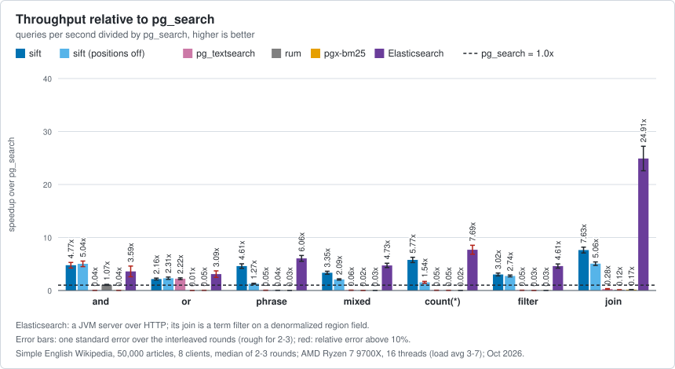

# pg_sift

[](https://github.com/brauliobo/pg_sift/actions/workflows/ci.yml)
[](https://github.com/brauliobo/pg_sift/actions/workflows/release.yml)
[](https://github.com/brauliobo/pg_sift/releases/latest)
[](#install)
[](LICENSE)

Fast full-text search with BM25 ranking inside PostgreSQL. pg_sift is an index type (`USING sift`) that answers boolean, phrase, prefix,
wildcard, regex and fuzzy queries, ranks results with exact BM25 and counts matches straight from the index. It needs no external search
server and no `shared_preload_libraries`.

<!-- bench:summary:begin (generated by `bench/bench readme` from docs/results; do not edit by hand) -->
- **Fast:** ahead of ParadeDB pg_search on every query class we measured, 1.9x to 6.2x on 50,000 Wikipedia articles ([benchmarks](#benchmarks)).
- **Small:** 31 MiB for those articles with phrase support, 1.1x smaller than pg_search; 13 MiB without word positions.
<!-- bench:summary:end -->
- **Plain PostgreSQL:** MVCC, VACUUM, `CREATE INDEX CONCURRENTLY`, partitions, partial and expression indexes, crash and replica safe (generic WAL).
- **Built for search pages:** top-k ranking, filters pushed into the ranked scan, facet counts, autocomplete with field boosts.

## Install

Requires PostgreSQL 17 or 18 (19 is experimental), server headers with `pg_config` on `PATH`, and a C compiler. Tested on x86-64.

```sh
make USE_PGXS=1 && sudo make USE_PGXS=1 install     # PG_CONFIG=/path/to/pg_config picks another installation
```

- Arch Linux: AUR `pg_sift` (recipe in [packaging/](packaging/)).
- Debian 13, Ubuntu 24.04 with PGDG `postgresql-18`: download the `.deb` from the [latest release](https://github.com/brauliobo/pg_sift/releases/latest)
  and `sudo apt install ./postgresql-18-pg-sift_1.2.0-1_amd64.deb`.
- RHEL, Rocky, Alma 9 or 10 with PGDG `postgresql18-server`:
  `sudo dnf install https://github.com/brauliobo/pg_sift/releases/download/v1.2.0/pg_sift_18-1.2.0-1.el9.x86_64.rpm`.

Then, as a superuser (after installing a newer version run `ALTER EXTENSION pg_sift UPDATE`):

```sql
CREATE EXTENSION pg_sift;
```

## Quick start

```sql
CREATE TABLE docs (id int PRIMARY KEY, title text, body text, published date, category int);
INSERT INTO docs VALUES
  (1, 'Hotel review', 'Breakfast was great and the staff were friendly. The pool was noisy.', '2026-01-10', 1),
  (2, 'Cafe', 'Friendly staff, no breakfast, but a quiet pool and spa.', '2026-02-11', 1),
  (3, 'Resume tips', 'A good résumé is short. Cafés near the office help.', '2026-03-12', 2),
  (4, 'Running', 'Runners were running; she runs every day.', '2026-04-13', 2),
  (5, 'Noisy hotel', 'The hotel was noisy at night, noise everywhere. Friendly staff though.', '2026-05-14', 1);
CREATE INDEX docs_body ON docs USING sift (body);

SELECT id FROM docs WHERE body @@> 'breakfast friendly';                   -- all terms: 1, 2
SELECT id, sift.score(ctid) FROM docs WHERE body @@> 'pool OR spa'
ORDER BY sift.score(ctid) DESC LIMIT 10;                                    -- BM25 top-10
SELECT count(*) FROM docs WHERE body @@> 'friendly';                        -- 3, from the index
```

`text @@> text` matches a document against a query; without an index it runs per row with the same results, only slower.

## Query language

Words are `AND`ed; `OR`, `NOT` (upper case), parentheses, quotes and a few operators combine them:

```sql
SELECT id FROM docs WHERE body @@> 'breakfast NOT noisy';             -- exclusion: 2
SELECT id FROM docs WHERE body @@> '"friendly staff"';                -- phrase: 2, 5
SELECT id FROM docs WHERE body @@> '{pool spa noisy}';                -- any of a set of words
SELECT id FROM docs WHERE body @@> 'brea* OR n?isy OR /no.*y/ OR frendly~1';  -- prefix, wildcard, regex, fuzzy
SELECT id FROM docs WHERE body @@> '(pool OR spa) AND friendly^3';    -- grouping and boost
```

## Ranking and filters

`ORDER BY sift.score(ctid) DESC LIMIT k` runs a ranked scan that skips the blocks that cannot reach the top k. Other conditions of the
query (`published >= ...`, joins) are applied inside that scan when the planner finds it cheaper, so a selective filter stays fast even
with a very common search term:

```sql
SELECT id, sift.score(ctid) FROM docs WHERE body @@> 'friendly' AND published >= '2026-02-01'
ORDER BY sift.score(ctid) DESC LIMIT 10;
```

## More

[docs/USAGE.md](docs/USAGE.md) covers the rest, each with examples:

- analyzers (stemming, accent folding), phrases and the `positions` option, several columns;
- autocomplete: prefix indexes, `fields` and field boosts;
- filter pushdown, partitioned tables, keyword facets, parallel scans;
- maintenance, settings and index options, replication, limits.

Design and on-disk format: [DESIGN.md](DESIGN.md).

## Benchmarks

<!-- bench:readme:begin (generated by `bench/bench readme` from docs/results; do not edit by hand) -->
Simple English Wikipedia (50,000 articles, 8 clients) and GeoNames cities15000 (34,166 places, autocomplete, 1 client): the slim tier of the suite, the default of `bench/bench all`, with the engines, query classes and workloads of the full tier on a smaller corpus and cells that stop at a 5% relative standard error (at most 1 s). Same data, queries and CPU budget for every engine, median of 2 interleaved rounds, measured 2026-10-17 on AMD Ryzen 7 9700X (16 threads), PostgreSQL 18.6. Cells are queries per second relative to pg_search 0.26.1; a `±` is one standard error of the ratio where it exceeds 10% of it.

| articles | index | build | and | or | phrase | mixed | `count(*)` | filter | join |
|---|---:|---:|---:|---:|---:|---:|---:|---:|---:|
| **sift** (default) | 31 MiB | 1.3 s | 4.0x ± 0.66 | 1.9x ± 0.29 | 4.0x ± 0.91 | 3.1x | 4.2x ± 0.67 | 2.8x ± 0.46 | 6.2x ± 1.5 |
| sift `positions = off` | 13 MiB | 1.0 s | 4.6x ± 0.82 | 1.9x ± 0.28 | 1.4x ± 0.32 | 2.5x ± 0.42 | 1.8x ± 0.4 | 2.9x ± 0.51 | 4.0x ± 0.93 |
| pg_search 0.26.1 | 32 MiB | 3.9 s | 1x | 1x | 1x | 1x | 1x | 1x | 1x |
| pg_textsearch 1.5.1 | 40 MiB | 5.4 s | 0.061x ± 0.02 | 2.4x ± 0.57 | 0.08x ± 0.023 | 0.072x ± 0.017 | 0.12x ± 0.037 | 0.16x ± 0.049 | 0.82x ± 0.4 |
| rum 1.3.15 | 86 MiB | 3.4 s | 1.3x ± 0.23 | 0.019x ± 0.0058 | 0.052x ± 0.012 | 0.025x ± 0.0044 | 0.045x ± 0.0077 | 0.028x ± 0.006 | 0.10x ± 0.027 |
| pgx-bm25 | 54 MiB | 3.8 s | 0.03x ± 0.0073 | 0.031x ± 0.0083 | 0.021x ± 0.0058 | 0.023x ± 0.0025 | 0.019x ± 0.0031 | 0.025x ± 0.0041 | 0.11x ± 0.026 |
| Elasticsearch | 70 MiB | 10.8 s | 1.9x ± 0.53 | 2.3x ± 0.6 | 2.9x ± 0.69 | 2.0x ± 0.48 | 4.0x ± 0.99 | 2.1x ± 0.4 | 11x ± 2.4 |

- Autocomplete on 34,166 places: sift answers the top 20 in 0.25-0.3 ms in every query class, pg_search in 0.72-1.9 ms, Elasticsearch in 0.44-0.81 ms; sift is ahead of pg_search in 24 of 24 warm cells (1.4x to 11x).
- `positions = off` shrinks the index to 13 MiB (2.6x smaller than pg_search's 32 MiB, the default sift index is 31 MiB); phrase runs at 1.4x and `count(*)` at 1.8x of pg_search's throughput, against 4.0x and 4.2x with positions.
- Prefix ranking agrees less with a BM25-over-n-grams oracle than pg_search's does, because sift scores a prefix as the best word it expands to ([correctness](docs/BENCHMARKS.md#correctness)).
- The host was shared (load average 10-18 during the cells, median 13), so absolute numbers are noisy and ratios close to each other are not distinguishable; every cell with its standard error, the cold-cache tables and the method are in [docs/BENCHMARKS.md](docs/BENCHMARKS.md).




Reproduce with `bench/bench all` (see [bench/README.md](bench/README.md); about 5 minutes of builds and measurements for the slim tier on the default CPU budget, about 7 minutes with the cold-cache tables of `--docs`); `bench/bench all --docs` rewrites this section from a new session. `--full` runs the full-size tier (every article of the dump, GeoNames cities500, about an hour); its last numbers are kept in [docs/BENCHMARKS.md](docs/BENCHMARKS.md) as history. `bench/bench regress --run` compares this checkout with an earlier release and exits non-zero on a regression.
<!-- bench:readme:end -->

## Testing, security, license

`make check` runs every suite in a throwaway cluster (about 2.5 minutes; `make check-full` adds sanitizers, soak, fuzz and mutants).
Report crashes, wrong results and index corruption privately as described in [SECURITY.md](SECURITY.md); to contribute see
[CONTRIBUTING.md](CONTRIBUTING.md). Changes per release: [CHANGELOG.md](CHANGELOG.md). pg_sift is released under the
[PostgreSQL License](LICENSE); third-party notices are in [NOTICE](NOTICE).
