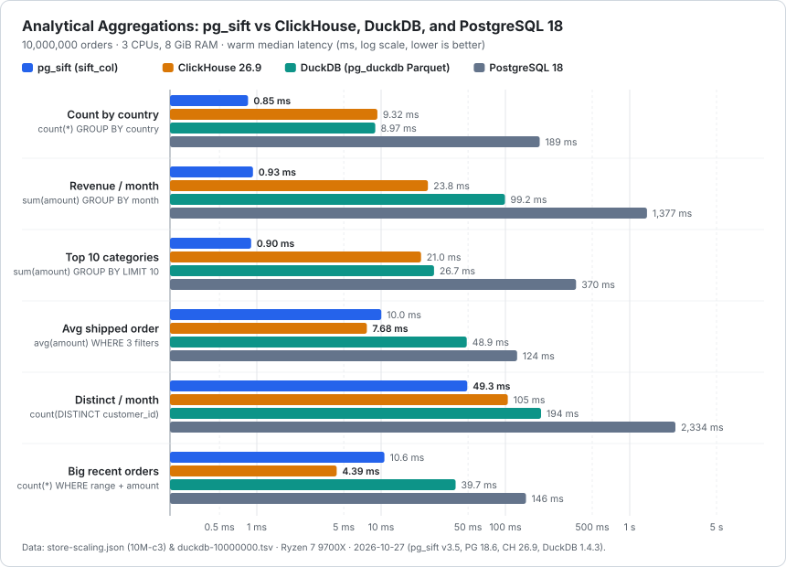
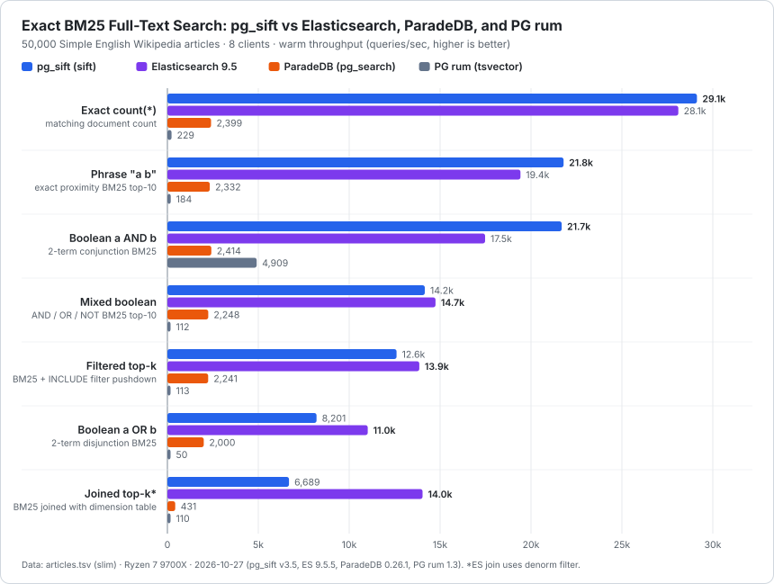
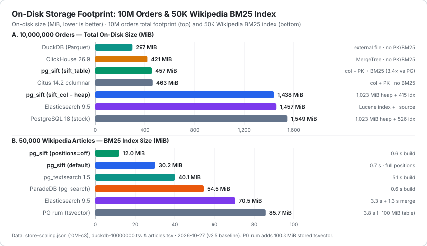

# pg_sift

[](https://github.com/brauliobo/pg_sift/actions/workflows/ci.yml) [](https://github.com/brauliobo/pg_sift/actions/workflows/release.yml) [](docs/SUPPORT.md#compatibility) [](https://github.com/brauliobo/pg_sift/releases/latest) [](LICENSE)

**pg_sift** brings columnar analytics, native column tables, and exact BM25 full-text search into PostgreSQL. Add a `sift_col` index to an existing OLTP table—or store data directly in a `sift_table`—and PostgreSQL's planner answers aggregations, filtered group-bys, top-N, and JSONB analytics through a SIMD-vectorized engine (`SiftAgg`) while keeping your existing SQL, transactions, MVCC, and replicas intact.

One `CREATE EXTENSION pg_sift`: no separate analytics database, no search cluster, no CDC pipeline, and no `shared_preload_libraries` required.

- **Best for:** Live OLTP tables serving dashboards, multi-tenant rollups, JSONB analytics, high-compression event tables, and exact BM25 search in the same transaction.
- **Exactness guarantee:** Every `SiftAgg` plan is semantically identical to PostgreSQL's native plan (`SET sift.enable_agg = off` to verify); queries it cannot prove equal run on PostgreSQL's own planner automatically.
- **Skip it for:** Primary-key point lookups (keep your b-tree), multi-node distributed warehouses requiring petabyte sharding, or CJK/n-gram text tokenization. See [docs/COMPARISON.md](docs/COMPARISON.md).

## Use Cases

### 1. Analytical Acceleration on Live OLTP Tables (`USING sift_col`)

Keep your heap table, primary keys, foreign keys, and existing SQL—including `NUMERIC`, `UUID`, joins, and shredded `JSONB`:

```sql
CREATE INDEX orders_col ON orders
  USING sift_col (customer_id, country, category, amount, created_at, payload)
  WITH (key_order = 'created_at', paths = 'payload.channel text, payload.discount float8');

-- Keep your existing SQL: runs as Custom Scan (SiftAgg) on orders_col
SELECT category, payload->>'channel' AS channel,
       count(*), count(DISTINCT customer_id), sum(amount)
FROM orders
WHERE country = 'DE' AND created_at >= now() - interval '90 days'
GROUP BY 1, 2
ORDER BY 5 DESC LIMIT 10;
```

`EXPLAIN` shows `Custom Scan (SiftAgg)`; `SET sift.enable_agg = off` runs PostgreSQL's standard plan for identical results. See [docs/ANALYTICS.md](docs/ANALYTICS.md).

### 2. Multi-Tenant & Hierarchy Scoped Analytics (`scope = ...`)

Accelerate tenant and group dashboards without duplicating fact rows or maintaining trigger-driven copies. Entity-Once scopes store fact rows once and maintain a 2-level cube-merge tree and Top-K ring with 0 B temp-file I/O:

```sql
CREATE INDEX events_col ON events
  USING sift_col (member_id, event_date, kind, score)
  WITH (
    key_order = 'member_id, event_date',
    scope     = 'tenant: member_id -> tenant_members(member_id, tenant_id)'
  );

-- Standard SQL join: answered in O(1) from pre-merged scope summaries & Top-K ring
SELECT date_trunc('month', e.event_date), count(*), avg(e.score)
FROM events e
JOIN tenant_members tm ON tm.member_id = e.member_id
WHERE tm.tenant_id = 42
GROUP BY 1;
```

Pair-table grants and revokes reconcile incrementally under your MVCC snapshot; add `cluster` for 1:1 hierarchies. See [docs/SCOPES.md](docs/SCOPES.md).

### 3. Native Columnar Storage Inside PostgreSQL (`USING sift_table`)

Store append-heavy or analytical tables directly in Format Major 2 compressed columns (≤ 33 B/row target on wide + JSONB schemas) with zero-refusal `COPY`, online `key_order`, native MVCC, secondary indexes, and the same scopes, pre-aggregates, skip indexes, and BM25 hybrid search as a `sift_col` index, tuned by 10 options and usually none:

```sql
CREATE TABLE events_col (
  id         bigint,
  tenant_id  int,
  event_date date,
  kind       text,
  amount     numeric(12,2),
  payload    jsonb
) USING sift_table;

SELECT sift.table_set_option('events_col', 'key_order', 'tenant_id, event_date');
COPY events_col FROM '/data/events.csv' WITH (FORMAT csv);

SELECT kind, count(*), sum(amount)
FROM events_col
WHERE tenant_id = 42 AND event_date >= '2026-01-01'
GROUP BY 1;
```

Shares 100% of Format Major 2 with `sift_col`—same 8,192-row granules, COW deletion vectors, and `SiftAgg` engine. Point lookups cost `O(log parts)`, a single-column `UPDATE` appends a per-column delta instead of rewriting the row, and `sift.approx_percentile()` / `sift.approx_quantiles()` answer from opt-in `kll` sketches. See [docs/TABLES.md](docs/TABLES.md).

6.0 adds the ClickHouse-class features, all with 0 new settings or options:

```sql
SELECT sift.create_projection('events_col', 'p_by_month',               -- secondary sort or rollup projection, chosen by SiftAgg
       'GROUP BY date_trunc(''month'', event_date) MEASURES count(*), sum(amount)');
SELECT sift.set_tier_policy('events_col', 's3://my-bucket/events', '30 days');   -- cold parts to S3/R2 (dlopen libcurl) or file://
SELECT sift.set_ttl('events_col', 'event_date', '400 days');                      -- O(1) part-drop TTL
SELECT country, sift.arg_max(user_id, amount) FROM events_col GROUP BY 1;         -- plus 64-FILTER pivots, ASOF, date_bin
```

Composite key marks and adaptive `PREWHERE` prune multi-column filters at granule level, trigram `LIKE '%...%'` runs as a SIMD pushdown, bulk `COPY` writes cold `L2` parts directly, and `ALTER TABLE ADD/DROP COLUMN` is `O(1)`. See [docs/ANALYTICS.md](docs/ANALYTICS.md) and [docs/TABLES.md](docs/TABLES.md#8-secondary-projections-siftcreate_projection).

### 4. Exact BM25 Full-Text Search (`USING sift`)

Ranked full-text search with boolean logic, phrases, prefix, wildcard, regex, fuzzy matching, `INCLUDE` filter pushdown, and exact facets in the same transaction as your rows:

```sql
CREATE INDEX docs_body ON docs
  USING sift (body)
  INCLUDE (category, published);

SELECT id, title, sift.score(ctid) AS score
FROM docs
WHERE body @@> '(battery OR charger) AND "friendly support" NOT squeaky'
  AND category = 1
ORDER BY sift.score(ctid) DESC
LIMIT 10;
```

The same BM25 search core also ships as standalone extensions for [SQLite](sqlite/README.md) and [MariaDB](mariadb/README.md). See [docs/SEARCH.md](docs/SEARCH.md).

### 5. Optional Vulkan Compute (`sift.gpu`)

Opt-in and off by default: build with `make VULKAN=1`, then `SET sift.gpu = auto|on` runs grouped and filtered integer and `numeric` counts and sums of a `sift_col` index on a Vulkan device. Units the device cannot take, a missing device, and a failed device all run on the CPU with identical rows. The 4 `sift.gpu*` settings are part of the 27 release GUCs; 6.0 reworks the device path for Format Major 2 (batched decode on the device, a shared VRAM cache, multi-key hash aggregation, `sift_col` and `sift_table`); GPU-versus-CPU numbers are measured at release. See [docs/GPU.md](docs/GPU.md).

## Benchmarks

Every benchmark verifies **exact answer equality** (`md5_equal`) against stock PostgreSQL 18 before recording timings. Numbers below are committed baseline measurements on AMD Ryzen 7 9700X (PG 18.6, `pg_sift` 3.5 baseline) and AMD Ryzen 9 5900XT (PG 18.7, `pg_sift` 5.0 scope suite); the date of each run is in the header of its file under `docs/results/`. `bench/bench v6-release --docs` regenerates charts and tables via `scripts/gen-docs.py`.

### Analytical Aggregations vs ClickHouse, DuckDB & PostgreSQL

10,000,000 orders, 3 CPUs & 8 GiB RAM per server, warm medians (`sift_col` vs ClickHouse 26.9, `pg_duckdb` 1.1.1 / DuckDB 1.4.3 Parquet, and PostgreSQL 18.6):



<!-- bench:v6-readme:begin -->
| Workload (10M orders, 3 CPUs) | `pg_sift` | ClickHouse | DuckDB | PG 18 |
|---|---:|---:|---:|---:|
| Count by country (`GROUP BY`) | **0.85 ms** | 9.32 ms | 8.97 ms | 188.9 ms |
| Revenue per month (`sum`) | **0.93 ms** | 23.8 ms | 99.2 ms | 1,377 ms |
| Top 10 categories (`LIMIT 10`) | **0.90 ms** | 21.0 ms | 26.7 ms | 370.2 ms |
| Avg shipped order (3 filters) | 10.0 ms | **7.68 ms** | 48.9 ms | 124.2 ms |
| Distinct customers/mo (`DISTINCT`) | **49.3 ms** | 104.5 ms | 193.7 ms | 2,334 ms |
| Big recent orders (range count) | 10.6 ms | **4.39 ms** | 39.7 ms | 146.4 ms |
<!-- bench:v6-readme:end -->

*Pre-aggregated rollups and `GROUP BY` run 10–25× faster than ClickHouse and 220–1,480× faster than stock PostgreSQL 18; ClickHouse leads on selective multi-filter averages and 30-day range counts at 10M rows (`sift_table` matches `sift_col` within ~1–4 ms). Full cold-cache, `pg_duckdb` heap, and 6.0 SIMD targets are in [docs/BENCHMARKS.md](docs/BENCHMARKS.md#2-analytical-aggregations-vs-clickhouse-duckdb-and-postgresql-18).*

*Methodology: `sift_col` indexes a precomputed month expression and keeps pre-aggregates, while the ClickHouse arm is a plain `MergeTree` without a `PROJECTION` or materialized month column; DuckDB reads a Parquet file written in `id` order through `pg_duckdb`; ClickHouse is timed client-side over HTTP (about 1 ms included); the point lookup is PostgreSQL's B-tree primary key; cold runs empty server caches but keep the OS page cache. Details in [Fairness and setup notes](docs/BENCHMARKS.md#fairness-and-setup-notes-read-before-quoting-the-table). The 43 ClickBench queries and a `ClickHouse + PROJECTION` arm run through `bench/bench clickbench` ([docs/BENCHMARKS.md](docs/BENCHMARKS.md#25-clickbench-q0-q42)).*

### Exact BM25 Search vs Elasticsearch, ParadeDB & PostgreSQL

50,000 Simple English Wikipedia articles (8 clients, warm QPS: `sift` vs Elasticsearch 9.5.5, ParadeDB `pg_search` 0.26.1, and PG `rum` 1.3.15) plus 10M orders title search vs stock PG 18 GIN (`to_tsvector`):



<!-- bench:v6-search:begin -->
| Search Workload | `pg_sift` | Elasticsearch | ParadeDB | PG FTS |
|---|---:|---:|---:|---:|
| Exact `count(*)` (50K Wiki, QPS) | **29,127** | 28,105 | 2,399 | 229 *(rum)* |
| Phrase `"a b"` (50K Wiki, QPS) | **21,794** | 19,423 | 2,332 | 184 *(rum)* |
| Boolean `a AND b` (50K Wiki, QPS) | **21,690** | 17,476 | 2,414 | 4,909 *(rum)* |
| Filtered top-k (50K Wiki, QPS) | 12,604 | **13,854** | 2,241 | 113 *(rum)* |
| Boolean `a OR b` (50K Wiki, QPS) | 8,201 | **11,021** | 2,000 | 50 *(rum)* |
| Title search count (10M orders) | **2.35 ms** | 11.6 ms | n/a | 78.5 ms *(GIN)* |
| Search + newest 10 (10M orders) | **13.1 ms** | 13.6 ms | n/a | 141.7 ms *(GIN)* |
<!-- bench:v6-search:end -->

*`pg_sift` delivers 4–12× ParadeDB QPS and matches or beats Elasticsearch on `AND`, `phrase`, and exact `count(*)` inside PostgreSQL's transaction boundary, while Elasticsearch leads on `OR`, `filter`, and denormalized `join`. Cold-cache p50 (`1.0–5.5 ms` vs `3.1–4.8 ms` ES and `13–17 ms` ParadeDB) and autocomplete latencies live in [docs/BENCHMARKS.md](docs/BENCHMARKS.md#3-exact-bm25-full-text-search-vs-elasticsearch-paradedb-and-postgresql).*

### Storage Footprint & Multi-Tenant Scope Snapshot



<!-- bench:v6-storage:begin -->
| Dimension | `pg_sift` | Reference | Comparison | Notes |
|---|---:|---:|---:|---|
| 10M orders (`sift_table`) | **457 MiB** | 1,549 MiB (PG 18) | **3.4× smaller** | vs 421 MiB ClickHouse, 1,457 MiB ES |
| 10M orders (`sift_col`) | **1,438 MiB** | 1,549 MiB (PG 18) | **−7% vs PG** | Shares 1,023 MiB PG heap + PK |
| 50K Wiki BM25 index | **30.2 MiB** | 54.5 MiB (ParadeDB) | **1.8× smaller** | 12.0 MiB `positions=off`; 70.5 MiB ES |
| Scoped rollup (2.4M rows) | **2.18 ms** | 542 ms (PG 18) | **249× faster** | 72/72 warm wins vs stock PG (`v5.0`) |
| Bounded memory (v6.0) | **16 / 64 MB** | O(1) flat RSS | **≤ 0.5 B/row** | `backend_cache_kb` / `shared_cache_kb` |
<!-- bench:v6-storage:end -->

Full methodology, cold-cache tables, memory flatness gates (`≤ 0.5 B/row` slope to 10M+ rows), wide+JSONB compression & WAL metrics, and 1-command Docker reproduction (`bench/bench kit`) live in [docs/BENCHMARKS.md](docs/BENCHMARKS.md).

## How It Works

```text
SQL Query ──▶ Single-Pass Planner (<2 ms) ──▶ SiftAgg (2,048-row SIMD: AVX-512 / AVX2 / NEON)
                     │                                        │
                     │ (falls back if not provably equal)     ▼
                     ▼                          Format Major 2 Storage (sift_col & sift_table)
              PostgreSQL Native Plan            • 2-level COW manifest + 8,192-row sorted granules
                                                • Adaptive 2-tier codecs (FOR/DELTA/RLE/ALP/FSST/ZSTD)
                                                • COW deletion vectors + O(1) [min_xid, max_xid] MVCC
```

- **Unified Format Major 2 Storage:** new `sift_col` indexes and `sift_table` tables share one immutable, CRC32C-verified format of 8,192-row granules, partitioned manifests, copy-on-write deletion vectors, and two-tier compression (fast L0 micro-parts for OLTP writes, compact L1/L2 parts for analytics). Relations created by 5.x stay on Format Major 1 with full read and write support, so upgrading needs no rebuild; `REINDEX INDEX CONCURRENTLY` (or `VACUUM FULL` / `sift.upgrade_table()` for a `sift_table`) moves one to Format 2.0 online.
- **Zero-Config Change Tracking:** a `sift_col` index follows deletes and updates by heap address (`track_changes = 'auto'`), so it works on any table: no primary key, a composite or `uuid` key, a partitioned table, or an index that omits the key.
- **2,048-Row Vectorized Execution:** Native fixed-width `NUMERIC`, `UUID`, inline-prefix strings, and zero-heap-I/O JSONB variant streams flow through 64-byte salted hash tables and 2-phase radix-partitioned parallel merges.
- **Strict O(1) Bounded Memory:** Every operation obeys PostgreSQL's `work_mem` / `maintenance_work_mem` plus two unified cache caps (`sift.backend_cache_kb = 16MB`, `sift.shared_cache_kb = 64MB`)—flat memory from 10k to 100M+ rows and hundreds of pooled backends. `sift.shared_memory()` and `sift.shared_memory_pools()` report all five shared pools.

## Quick Install

Supports PostgreSQL **17, 18, and 19** on Linux (`x86-64`, `arm64`) and macOS (`arm64`).

| Platform | Install |
|---|---|
| Debian 12/13, Ubuntu 22.04/24.04 | Download `.deb` from [Releases][rel], then `sudo apt install ./postgresql-N-pg-sift_*.deb` |
| RHEL/Rocky/Alma 9–10, AL2023 | Download `.rpm` from [Releases][rel], then `sudo dnf install ./pg_sift_N-*.rpm` |
| Signed APT / DNF repositories | See [docs/INSTALL-REPOS.md](docs/INSTALL-REPOS.md): `apt install postgresql-N-pg-sift` or `dnf install pg_sift_N` after one repository line |
| macOS / Arch / Docker | `brew tap brauliobo/pg_sift https://github.com/brauliobo/pg_sift.git && brew install pg_sift` · AUR · [Docker](docs/CONTAINERS.md) |
| From source (PG 17–19 headers) | `make USE_PGXS=1 && sudo make USE_PGXS=1 install` |

[rel]: https://github.com/brauliobo/pg_sift/releases/latest

Enable in your database:

```sql
CREATE EXTENSION pg_sift;
-- Recommended for aggregate workloads (avoids first-query re-planning; no restart needed):
ALTER DATABASE mydb SET session_preload_libraries = 'pg_sift';
```

Try it in 5 minutes with Docker: [docs/QUICKSTART.md](docs/QUICKSTART.md).

## Documentation

| Guide / Reference | Covers |
|---|---|
| **Guides** | |
| [Quickstart](docs/QUICKSTART.md) | 5-minute Docker tour: 100K-row table, `sift_col`, `sift` BM25, `bench/bench kit` |
| [Columnar Analytics](docs/ANALYTICS.md) | `sift_col`, `key_order`, key marks, `PREWHERE`, `preagg`, JSONB `paths`, joins, `arg_max`, `ASOF`, HLL |
| [Scoped Analytics](docs/SCOPES.md) | Entity-Once `scope` for multi-tenant/hierarchy joins, Top-K rings, pair edits |
| [Native Column Tables](docs/TABLES.md) | `sift_table` creation, 10 options, online `key_order`, direct `COPY`, MVCC, projections, S3/R2 tiering, TTL |
| [BM25 Full-Text Search](docs/SEARCH.md) | `sift` indexes, `INCLUDE` pushdown, SiftQL, analyzers, field weights, facets, RLS |
| **Operations & Lifecycle** | |
| [Operations & Sizing](docs/OPERATIONS.md) | 3-budget O(1) memory, disk/WAL sizing, monitoring, alerts, emergency switches, quarantine |
| [Vulkan Compute](docs/GPU.md) | Opt-in `make VULKAN=1` device path for `SiftAgg` integer aggregates: `sift.gpu*` settings, eligibility, residency, EXPLAIN, safety |
| [Repositories](docs/INSTALL-REPOS.md) | Signed APT and DNF repositories for PostgreSQL 17-19 on x86-64 and arm64 |
| [Containers](docs/CONTAINERS.md) | Docker, Docker Compose, and CloudNativePG image-volume & operand images |
| [Upgrading](docs/UPGRADING.md) | 5.1 → 6.0 preflight, `sift.migrate_plan()`, full 5.x compatibility, optional online Format 2.0, downgrades |
| [Support](docs/SUPPORT.md) | PostgreSQL 17–19 & OS/arch compatibility matrix, versioning, and format policy |
| **Engineering & Reference** | |
| [Benchmarks](docs/BENCHMARKS.md) | Methodology, hardware, analytical/scope/memory/compression/BM25 suites, reproduction |
| [Comparison](docs/COMPARISON.md) | Honest feature matrices vs PostgreSQL, Citus, TimescaleDB, ClickHouse, DuckDB, ES |
| [Architecture](docs/ARCHITECTURE.md) | Format Major 2 layout, codecs, SIMD `SiftAgg`, planner, refusals, EXPLAIN labels, C safety |
| [Options & Tuning](docs/OPTIONS.md) | The 8 knobs worth touching, plus all 63 options: 27 GUCs, 26 reloptions, and 10 table options; everything strictly better is automatic |
| [SQL Reference](docs/REFERENCE.md) | Public `sift.*` functions, views, operator classes, and `@@>` operator |
| [Limits](docs/LIMITS.md) | Hard limits and lifted 6.0 ceilings across `sift_col`, `sift_table`, `SiftAgg`, and `sift` |
| [Messages](docs/MESSAGES.md) | Operator reference for every `NOTICE`, `WARNING`, and `INFO` message |

**Standalone Search Ports:** The exact BM25 search core is also available for [SQLite (`sqlite/README.md`)](sqlite/README.md) and [MariaDB (`mariadb/README.md`)](mariadb/README.md); the columnar analytics engine is PostgreSQL-only.

**Contributing, Security & License:** See [CONTRIBUTING.md](CONTRIBUTING.md) and [SECURITY.md](SECURITY.md). Licensed under the [PostgreSQL License](LICENSE) (third-party notices in [NOTICE](NOTICE)).
