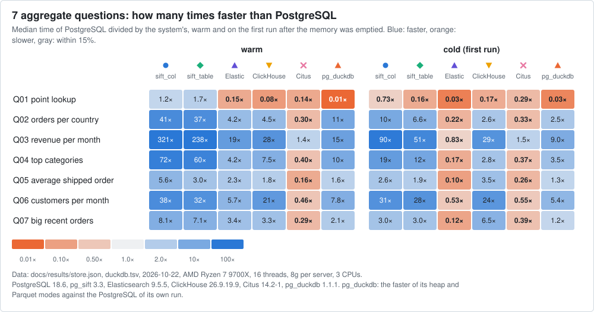

# Benchmarks

Benchmarks of the PostgreSQL extension, generated from [results/](results/) by `scripts/gen-docs.py` (`--check` fails when a block is stale). The SQLite extension has its own, against FTS5: [sqlite/README.md](../sqlite/README.md#numbers-against-fts5).

Every block has the same shape: a title, one line saying what is measured, on which data, host and versions, one table, a takeaway and the link to its raw file in `results/`; what a reader should distrust is in the **Caveats** list at the end of the block. Compare systems within one table; ratios depend on the size of the data and on what else the host runs.

- **Search** (BM25, slim tier: 50,000 articles and 34,179 places, `bench/bench all --docs`): the first section.
- **Aggregates** (an online store: `bench/bench store`, `bench/bench duckdb`) and their guide, with the charts, the scale benchmarks and the shapes of real queries: [perf/AGGREGATES.md](perf/AGGREGATES.md).
- **Other measurements**: sets of ids, rollups, writes, index sizes, build cost.

Sections that were history (the full-tier session of 2026-10-16, the earlier smaller tiers, the regression check against v1.1.0, the size note against ClickHouse, the run-time tables, the 10,000,000-order check of 3.0) are not repeated here: `git show a085c2d17:docs/BENCHMARKS.md`.

<!-- bench:slim:begin (generated by `bench/bench readme` from docs/results; do not edit by hand) -->
## Slim tier (the default): 50,000 articles, 34,179 places

Simple English Wikipedia (50,000 articles, 8 clients) and GeoNames cities15000 (34,179 places, 1 client), every engine of `bench/engines.tsv`, the same query classes as the full tier and its workloads but the unordered scan, cells of at most 1 s that stop at a relative standard error of 5%, 2-3 interleaved rounds. Generated by `bench/bench all --docs` from [results/](results/) (tier `slim`); the README quotes these tables. Measured 2026-10-22 on AMD Ryzen 7 9700X (16 threads), PostgreSQL 18.6, sift 322ca7afafa4, Elasticsearch 9.5.5-1.

### Articles

Method: one engine at a time on the same budget of 3 CPUs for the server of every engine (a cgroup quota on the server processes only, on four physical cores; the clients, pgbench and the load generator, run outside it on the other four; PostgreSQL engines with one parallel worker fewer than the budget, Elasticsearch with that many processors and shards) (the servers of the other engines idle), the engines interleaved in rounds, the same clients for all.
Host load average (1 min) during the cells: 4.2-7.0 (median 5.0).

Queries per second, median ± standard error (minimum-maximum over the rounds); index size and CREATE INDEX time of the one build per engine:

| engine | index (MiB) | build (s) | table growth (MiB) | and | or | phrase | mixed | count | filter | join |
|---|---:|---:|---:|---:|---:|---:|---:|---:|---:|---:|
| sift | 30.2 | 0.6 | 0.0 | 12646 ± 569 (12189-13169) | 3823 ± 134 (3754-3892) | 10727 ± 693 (10331-11124) | 6911 ± 305 (6830-6951) | 14113 ± 650 (13755-14471) | 5645 ± 254 (5623-5724) | 3048 ± 131 (3005-3091) |
| sift `positions = off` | 12.0 | 0.5 | 0.0 | 11942 ± 566 (11912-12414) | 3960 ± 176 (3934-3986) | 3046 ± 128 (2894-3105) | 4663 ± 212 (4626-4699) | 3545 ± 237 (3537-3552) | 5032 ± 233 (4856-5207) | 1930 ± 96 (1872-2185) |
| Elasticsearch | 71.7 | 3.6 | 0.0 | 5674 ± 2244 ! (3429-7918) | 4077 ± 627 ! (2356-4367) | 7682 ± 1221 ! (6460-8903) | 5831 ± 307 (5177-6229) | 12384 ± 562 (11913-12755) | 5226 ± 333 (5207-5246) | 5622 ± 232 (5564-5681) |
| pg_search | 41.1 | 1.4 | 0.0 | 2421 ± 152 (2401-2440) | 1700 ± 67 (1691-1708) | 2232 ± 107 (2196-2269) | 2067 ± 88 (2030-2072) | 2176 ± 88 (2138-2211) | 1934 ± 125 (1915-1952) | 465 ± 20 (452-478) |
| pg_textsearch | 40.1 | 4.6 | 0.0 | 80 ± 9.7 ! (78-81) | 4301 ± 199 (4201-4463) | 101 ± 16 ! (99-103) | 88 ± 17 ! (86-89) | 86 ± 16 ! (83-89) | 91 ± 17 ! (87-95) | 107 ± 22 ! (102-112) |
| rum | 85.7 | 3.1 | 100.3 | 2502 ± 121 (2381-2623) | 27 ± 2.8 ! (25-28) | 85 ± 5.6 (84-86) | 49 ± 5.3 ! (47-51) | 100 ± 8.7 (93-108) | 50 ± 4.8 (46-54) | 53 ± 5.0 (49-58) |
| pgx-bm25 | 54.2 | 2.7 | 0.0 | 91 ± 3.8 (90-92) | 77 ± 5.9 (73-80) | 56 ± 3.6 (54-59) | 66 ± 3.3 (64-68) | 57 ± 3.0 (57-62) | 57 ± 3.8 (56-68) | 63 ± 3.1 (59-63) |

Force-merge to one segment after the bulk load and refresh (the build column is the bulk load and refresh, the index column the size after the merge):

| engine | force-merge (s) | index before the merge (MiB) |
|---|---:|---:|
| Elasticsearch | 1.2 | 72.1 |

`±` is one standard error of the median over the n interleaved rounds (sample standard deviation / sqrt(n); with n = 2-3 a rough indication, read it with the range); `!` marks a relative standard error above 10%.

Ratio of queries per second to pg_search:

| engine | and | or | phrase | mixed | count | filter | join |
|---|---:|---:|---:|---:|---:|---:|---:|
| sift / pg_search | 5.22x | 2.25x | 4.81x | 3.34x | 6.49x | 2.92x | 6.56x |
| sift `positions = off` / pg_search | 4.93x | 2.33x | 1.36x | 2.26x | 1.63x | 2.60x | 4.15x |
| Elasticsearch / pg_search | 2.34x | 2.40x | 3.44x | 2.82x | 5.69x | 2.70x | 12.10x |
| pg_textsearch / pg_search | 0.03x | 2.53x | 0.05x | 0.04x | 0.04x | 0.05x | 0.23x |
| rum / pg_search | 1.03x | 0.02x | 0.04x | 0.02x | 0.05x | 0.03x | 0.11x |
| pgx-bm25 / pg_search | 0.04x | 0.05x | 0.03x | 0.03x | 0.03x | 0.03x | 0.14x |

#### Cold cache

Cold cache (index, heap and TOAST evicted before every query), p50 / maximum execution time in ms of up to 12 queries per cell (at least 5: a cell that takes seconds stops early, cold.tsv has the count); Method: one engine at a time on the same budget of 3 CPUs for the server of every engine (a cgroup quota on the server processes only, on four physical cores; the clients, pgbench and the load generator, run outside it on the other four; PostgreSQL engines with one parallel worker fewer than the budget, Elasticsearch with that many processors and shards) (the servers of the other engines idle), the engines interleaved in rounds, the same clients for all.

| class | sift | sift `positions = off` | Elasticsearch | pg_search | pg_textsearch | rum | pgx-bm25 |
|---|---:|---:|---:|---:|---:|---:|---:|
| and | 0.32 / 0.47 | 0.33 / 0.55 | 2.64 / 3.58 | 1.26 / 1.65 | 1.00 / 5.20 | 0.68 / 1.32 | 37.15 / 59.21 |
| or | 0.81 / 1.02 | 0.88 / 1.39 | 2.75 / 3.48 | 1.26 / 1.95 | 0.91 / 1.51 | 47.55 / 166.66 | 33.34 / 56.69 |
| phrase | 0.30 / 0.66 | 0.29 / 11.24 | 2.35 / 3.13 | 1.20 / 1.92 | 0.83 / 170.37 | 14.37 / 63.12 | 48.08 / 116.91 |
| mixed | 0.38 / 1.23 | 0.43 / 11.61 | 2.30 / 4.10 | 1.45 / 1.78 | 0.82 / 172.74 | 13.99 / 166.29 | 55.05 / 101.58 |
| count | 0.24 / 0.37 | 0.23 / 10.93 | 1.55 / 2.04 | 1.39 / 2.46 | 0.86 / 167.46 | 10.91 / 93.85 | 59.33 / 109.57 |
| filter | 0.44 / 1.29 | 0.39 / 2.89 | 2.10 / 3.86 | 1.33 / 1.76 | 0.87 / 165.98 | 17.41 / 167.92 | 52.04 / 102.77 |
| join | 0.45 / 4.20 | 0.40 / 11.59 | 1.76 / 2.65 | 5.07 / 22.18 | 0.80 / 165.91 | 14.28 / 169.80 | 51.91 / 111.68 |

### Places

Method: one engine at a time on the same budget of 3 CPUs for the server of every engine (a cgroup quota on the server processes only, on four physical cores; the clients, pgbench and the load generator, run outside it on the other four; PostgreSQL engines with one parallel worker fewer than the budget, Elasticsearch with that many processors and shards) (the servers of the other engines idle), the engines interleaved in rounds, the same clients for all.
Host load average (1 min) during the cells: 5.1-5.6 (median 5.2).

Index size, CREATE INDEX time and p50 latency in ms ± standard error of the `top` workload per query class (single client):

| engine | index (MiB) | build (s) | p1 | p2 | p3 | p4 | w1 | a2 | a2s | a3 | x2 |
|---|---:|---:|---:|---:|---:|---:|---:|---:|---:|---:|---:|
| sift | 13.6 | 0.5 | 0.20 ± 0.011 | 0.21 ± 0.004 | 0.18 ± 0.003 | 0.18 ± 0.001 | 0.14 ± 0.000 | 0.16 ± 0.002 | 0.16 ± 0.001 | 0.18 ± 0.006 | 0.17 ± 0.003 |
| sift `positions = off` | 12.2 | 0.5 | 0.19 ± 0.005 | 0.23 ± 0.008 | 0.19 ± 0.006 | 0.19 ± 0.010 | 0.15 ± 0.001 | 0.17 ± 0.000 | 0.17 ± 0.001 | 0.19 ± 0.007 | 0.17 ± 0.002 |
| Elasticsearch | 33.1 | 3.0 | 0.30 ± 0.012 | 0.29 ± 0.005 | 0.27 ± 0.003 | 0.24 ± 0.005 | 0.19 ± 0.004 | 0.19 ± 0.004 | 0.19 ± 0.006 | 0.24 ± 0.011 | 0.22 ± 0.002 |
| pg_search | 27.8 | 2.0 | 0.51 ± 0.012 | 0.58 ± 0.011 | 0.61 ± 0.007 | 0.62 ± 0.006 | 0.71 ± 0.003 | 0.81 ± 0.004 | 0.75 ± 0.004 | 1.25 ± 0.018 | 0.99 ± 0.009 |
| pg_textsearch | 21.5 | 0.6 | 340.46 ± 256.80 ! | 74.94 ± 12.59 ! | 12.12 ± 3.00 ! | 3.31 ± 0.11 | 2.93 ± 0.11 | 2.75 ± 0.024 | 2.85 ± 0.040 | 2.85 ± 0.004 | 2.81 ± 0.025 |
| rum | 30.1 | 0.7 | 20.96 ± 0.60 | 5.15 ± 0.18 | 2.01 ± 0.093 | 0.43 ± 0.018 | 0.26 ± 0.014 | 3.46 ± 0.12 | 9.01 ± 0.29 | 3.77 ± 0.13 | 2.70 ± 0.088 |
| pgx-bm25 | 29.6 | 0.7 | 4.67 ± 0.12 | 1.17 ± 0.035 | 26.06 ± 6.11 ! | 2.65 ± 0.23 | 1.33 ± 0.056 | 2.03 ± 0.058 | 4.44 ± 0.13 | 5.06 ± 0.16 | 3.97 ± 0.28 |

Extra columns and indexes of the emulated workloads (rum boost; pg_textsearch top-20, boost, filtered):

| engine | index (MiB) | build (s) | column fill (s) | table growth (MiB) |
|---|---:|---:|---:|---:|
| pg_textsearch | 119.5 | 4.1 | 2.2 | 34.1 |
| rum | 30.1 | 0.7 | 1.1 | 13.6 |

Force-merge to one segment after the bulk load and refresh (the build column is the bulk load and refresh, the index column the size after the merge):

| engine | force-merge (s) | index before the merge (MiB) |
|---|---:|---:|
| Elasticsearch | 1.3 | 34.2 |

Workload `top`, p50 latency in ms ± standard error (ratio to sift):

| class | sift | sift `positions = off` | Elasticsearch | pg_search | pg_textsearch | rum | pgx-bm25 |
|---|---:|---:|---:|---:|---:|---:|---:|
| p1 | 0.20 ± 0.011 | 0.19 ± 0.005 (0.97x) | 0.30 ± 0.012 (1.55x) | 0.51 ± 0.012 (2.58x) | 340.46 ± 256.80 ! (1728.22x) | 20.96 ± 0.60 (106.40x) | 4.67 ± 0.12 (23.71x) |
| p2 | 0.21 ± 0.004 | 0.23 ± 0.008 (1.09x) | 0.29 ± 0.005 (1.35x) | 0.58 ± 0.011 (2.72x) | 74.94 ± 12.59 ! (351.01x) | 5.15 ± 0.18 (24.12x) | 1.17 ± 0.035 (5.48x) |
| p3 | 0.18 ± 0.003 | 0.19 ± 0.006 (1.04x) | 0.27 ± 0.003 (1.50x) | 0.61 ± 0.007 (3.40x) | 12.12 ± 3.00 ! (67.33x) | 2.01 ± 0.093 (11.17x) | 26.06 ± 6.11 ! (144.78x) |
| p4 | 0.18 ± 0.001 | 0.19 ± 0.010 (1.08x) | 0.24 ± 0.005 (1.32x) | 0.62 ± 0.006 (3.46x) | 3.31 ± 0.11 (18.49x) | 0.43 ± 0.018 (2.43x) | 2.65 ± 0.23 (14.80x) |
| w1 | 0.14 ± 0.000 | 0.15 ± 0.001 (1.03x) | 0.19 ± 0.004 (1.29x) | 0.71 ± 0.003 (4.90x) | 2.93 ± 0.11 (20.21x) | 0.26 ± 0.014 (1.80x) | 1.33 ± 0.056 (9.17x) |
| a2 | 0.16 ± 0.002 | 0.17 ± 0.000 (1.01x) | 0.19 ± 0.004 (1.16x) | 0.81 ± 0.004 (4.95x) | 2.75 ± 0.024 (16.77x) | 3.46 ± 0.12 (21.10x) | 2.03 ± 0.058 (12.38x) |
| a2s | 0.16 ± 0.001 | 0.17 ± 0.001 (1.04x) | 0.19 ± 0.006 (1.16x) | 0.75 ± 0.004 (4.57x) | 2.85 ± 0.040 (17.38x) | 9.01 ± 0.29 (54.94x) | 4.44 ± 0.13 (27.07x) |
| a3 | 0.18 ± 0.006 | 0.19 ± 0.007 (1.07x) | 0.24 ± 0.011 (1.34x) | 1.25 ± 0.018 (7.06x) | 2.85 ± 0.004 (16.10x) | 3.77 ± 0.13 (21.30x) | 5.06 ± 0.16 (28.59x) |
| x2 | 0.17 ± 0.003 | 0.17 ± 0.002 (1.03x) | 0.22 ± 0.002 (1.33x) | 0.99 ± 0.009 (5.95x) | 2.81 ± 0.025 (16.93x) | 2.70 ± 0.088 (16.27x) | 3.97 ± 0.28 (23.92x) |

Workload `boost`, p50 latency in ms ± standard error (ratio to sift):

| class | sift | sift `positions = off` | Elasticsearch | pg_search | pg_textsearch | rum | pgx-bm25 |
|---|---:|---:|---:|---:|---:|---:|---:|
| p1 | 0.26 ± 0.003 | 0.26 ± 0.001 (1.02x) | 0.35 ± 0.017 (1.36x) | 1.03 ± 0.009 (3.98x) | 557.48 ± 438.40 ! (2152.43x) | 21.08 ± 0.62 (81.39x) | 4.44 ± 0.079 (17.14x) |
| p2 | 0.26 ± 0.010 | 0.27 ± 0.001 (1.07x) | 0.35 ± 0.006 (1.38x) | 1.11 ± 0.007 (4.35x) | 127.30 ± 24.64 ! (499.22x) | 4.90 ± 0.18 (19.22x) | 1.16 ± 0.032 (4.55x) |
| p3 | 0.21 ± 0.005 | 0.20 ± 0.016 (0.97x) | 0.32 ± 0.009 (1.53x) | 1.10 ± 0.015 (5.33x) | 9.22 ± 4.54 ! (44.65x) | 1.92 ± 0.099 (9.30x) | 27.38 ± 6.05 ! (132.59x) |
| p4 | 0.22 ± 0.004 | 0.23 ± 0.013 (1.03x) | 0.28 ± 0.005 (1.28x) | 1.14 ± 0.009 (5.19x) | 3.46 ± 0.12 (15.76x) | 0.44 ± 0.014 (2.01x) | 2.71 ± 0.29 ! (12.35x) |
| w1 | 0.16 ± 0.008 | 0.17 ± 0.002 (1.09x) | 0.25 ± 0.007 (1.60x) | 1.28 ± 0.013 (8.21x) | 2.92 ± 0.039 (18.72x) | 0.23 ± 0.010 (1.49x) | 1.32 ± 0.093 (8.46x) |
| a2 | 0.19 ± 0.002 | 0.20 ± 0.009 (1.03x) | 0.26 ± 0.002 (1.37x) | 1.56 ± 0.021 (8.10x) | 2.86 ± 0.011 (14.86x) | 3.51 ± 0.12 (18.23x) | 2.14 ± 0.071 (11.12x) |
| a2s | 0.21 ± 0.009 | 0.21 ± 0.007 (1.02x) | 0.26 ± 0.008 (1.23x) | 1.39 ± 0.011 (6.67x) | 2.88 ± 0.030 (13.81x) | 9.18 ± 0.28 (44.03x) | 4.39 ± 0.15 (21.06x) |
| a3 | 0.22 ± 0.004 | 0.23 ± 0.002 (1.04x) | 0.34 ± 0.011 (1.54x) | 2.49 ± 0.025 (11.45x) | 2.89 ± 0.009 (13.29x) | 4.08 ± 0.15 (18.76x) | 5.23 ± 0.23 (24.05x) |
| x2 | 0.20 ± 0.003 | 0.20 ± 0.003 (1.03x) | 0.29 ± 0.009 (1.48x) | 1.93 ± 0.019 (9.82x) | 2.93 ± 0.022 (14.91x) | 2.73 ± 0.095 (13.89x) | 3.80 ± 0.32 (19.34x) |

Workload `filter`, p50 latency in ms ± standard error (ratio to sift):

| class | sift | sift `positions = off` | Elasticsearch | pg_search | pg_textsearch | rum | pgx-bm25 |
|---|---:|---:|---:|---:|---:|---:|---:|
| p1 | 0.79 ± 0.011 | 0.79 ± 0.009 (1.00x) | 0.29 ± 0.011 (0.36x) | 1.74 ± 0.054 (2.20x) | 94.96 ± 23.50 ! (119.82x) | 20.36 ± 0.61 (25.69x) | 4.95 ± 0.15 (6.25x) |
| p2 | 0.41 ± 0.058 ! | 0.42 ± 0.057 ! (1.02x) | 0.30 ± 0.001 (0.73x) | 0.92 ± 0.025 (2.21x) | 13.61 ± 0.31 (32.87x) | 4.93 ± 0.17 (11.91x) | 1.37 ± 0.066 (3.31x) |
| p3 | 0.24 ± 0.015 | 0.20 ± 0.003 (0.83x) | 0.24 ± 0.006 (1.00x) | 0.62 ± 0.025 (2.57x) | 3.82 ± 0.13 (15.72x) | 0.87 ± 0.030 (3.59x) | 26.14 ± 5.33 ! (107.57x) |
| p4 | 0.21 ± 0.011 | 0.21 ± 0.020 (1.01x) | 0.17 ± 0.007 (0.82x) | 0.61 ± 0.028 (2.91x) | 2.82 ± 0.14 (13.49x) | 0.29 ± 0.008 (1.38x) | 2.64 ± 0.25 (12.63x) |
| w1 | 0.16 ± 0.005 | 0.16 ± 0.002 (1.00x) | 0.14 ± 0.008 (0.88x) | 0.63 ± 0.003 (3.87x) | 2.66 ± 0.010 (16.22x) | 0.20 ± 0.003 (1.24x) | 1.33 ± 0.065 (8.11x) |
| a2 | 0.17 ± 0.001 | 0.18 ± 0.003 (1.03x) | 0.14 ± 0.009 (0.81x) | 0.70 ± 0.004 (4.02x) | 2.65 ± 0.009 (15.19x) | 3.48 ± 0.12 (19.94x) | 2.19 ± 0.070 (12.55x) |
| a2s | 0.18 ± 0.013 | 0.19 ± 0.001 (1.04x) | 0.15 ± 0.013 (0.82x) | 0.68 ± 0.006 (3.72x) | 2.70 ± 0.011 (14.84x) | 9.09 ± 0.27 (49.95x) | 4.58 ± 0.15 (25.16x) |
| a3 | 0.20 ± 0.006 | 0.20 ± 0.003 (1.01x) | 0.18 ± 0.007 (0.92x) | 0.95 ± 0.006 (4.80x) | 2.68 ± 0.039 (13.60x) | 4.47 ± 0.25 (22.69x) | 5.21 ± 0.20 (26.45x) |
| x2 | 0.19 ± 0.009 | 0.19 ± 0.006 (0.99x) | 0.16 ± 0.006 (0.86x) | 0.79 ± 0.013 (4.17x) | 2.68 ± 0.037 (14.07x) | 2.94 ± 0.18 (15.43x) | 4.01 ± 0.28 (21.05x) |

Workload `count`, p50 latency in ms ± standard error (ratio to sift):

| class | sift | sift `positions = off` | Elasticsearch | pg_search | pg_textsearch | rum | pgx-bm25 |
|---|---:|---:|---:|---:|---:|---:|---:|
| p1 | 0.12 ± 0.006 | 0.12 ± 0.009 (1.04x) | 0.06 ± 0.004 (0.52x) | 0.47 ± 0.011 (3.99x) | 77.06 ± 47.53 ! (653.05x) | 12.08 ± 0.49 (102.37x) | 6.55 ± 0.43 (55.51x) |
| p2 | 0.12 ± 0.008 | 0.13 ± 0.014 ! (1.05x) | 0.08 ± 0.006 (0.67x) | 0.55 ± 0.022 (4.44x) | 18.63 ± 2.99 ! (151.46x) | 2.53 ± 0.13 (20.57x) | 1.49 ± 0.11 (12.11x) |
| p3 | 0.12 ± 0.009 | 0.12 ± 0.005 (1.01x) | 0.08 ± 0.005 (0.70x) | 0.59 ± 0.020 (5.02x) | 2.39 ± 0.10 (20.43x) | 0.90 ± 0.052 (7.68x) | 26.43 ± 5.39 ! (225.90x) |
| p4 | 0.12 ± 0.004 | 0.13 ± 0.010 (1.04x) | 0.09 ± 0.005 (0.69x) | 0.63 ± 0.026 (5.11x) | 1.18 ± 0.045 (9.63x) | 0.29 ± 0.015 (2.40x) | 2.72 ± 0.24 (22.20x) |
| w1 | 0.12 ± 0.001 | 0.12 ± 0.002 (1.03x) | 0.09 ± 0.006 (0.79x) | 0.74 ± 0.022 (6.27x) | 1.07 ± 0.040 (9.11x) | 0.18 ± 0.012 (1.54x) | 1.30 ± 0.097 (11.06x) |
| a2 | 0.13 ± 0.002 | 0.14 ± 0.003 (1.04x) | 0.10 ± 0.005 (0.76x) | 0.87 ± 0.017 (6.48x) | 1.35 ± 0.028 (10.07x) | 1.93 ± 0.13 (14.40x) | 1.96 ± 0.060 (14.63x) |
| a2s | 0.14 ± 0.004 | 0.15 ± 0.005 (1.07x) | 0.10 ± 0.005 (0.73x) | 0.77 ± 0.005 (5.67x) | 3.60 ± 0.14 (26.37x) | 8.27 ± 0.46 (60.59x) | 4.47 ± 0.18 (32.75x) |
| a3 | 0.14 ± 0.001 | 0.15 ± 0.012 (1.05x) | 0.15 ± 0.004 (1.02x) | 1.30 ± 0.013 (9.12x) | 1.01 ± 0.003 (7.09x) | 2.01 ± 0.068 (14.11x) | 5.14 ± 0.16 (36.07x) |
| x2 | 0.14 ± 0.006 | 0.14 ± 0.000 (1.00x) | 0.13 ± 0.004 (0.92x) | 1.01 ± 0.008 (7.27x) | 1.00 ± 0.004 (7.17x) | 1.29 ± 0.032 (9.28x) | 3.87 ± 0.33 (27.84x) |

`±` is one standard error of the median over the n interleaved rounds (sample standard deviation / sqrt(n); with n = 2-3 a rough indication, read it with the range); `!` marks a relative standard error above 10%.

#### Cold cache

Cold cache (index, heap and TOAST evicted before every query), p50 / maximum execution time in ms of up to 12 queries per cell (at least 5: a cell that takes seconds stops early, cold.tsv has the count); Method: one engine at a time on the same budget of 3 CPUs for the server of every engine (a cgroup quota on the server processes only, on four physical cores; the clients, pgbench and the load generator, run outside it on the other four; PostgreSQL engines with one parallel worker fewer than the budget, Elasticsearch with that many processors and shards) (the servers of the other engines idle), the engines interleaved in rounds, the same clients for all.

| workload | class | sift | sift `positions = off` | Elasticsearch | pg_search | pg_textsearch | rum | pgx-bm25 |
|---|---|---:|---:|---:|---:|---:|---:|---:|
| top | p1 | 0.28 / 0.38 | 0.31 / 0.39 | 1.74 / 2.71 | 0.47 / 0.69 | 476.78 / 1065.39 | 23.80 / 49.13 | 5.95 / 13.61 |
| top | p2 | 0.31 / 0.39 | 0.32 / 0.45 | 1.58 / 2.35 | 0.50 / 0.59 | 85.59 / 742.20 | 5.66 / 12.27 | 2.00 / 6.13 |
| top | a2 | 0.12 / 0.88 | 0.13 / 0.86 | 1.35 / 1.66 | 0.49 / 0.65 | 0.42 / 18.80 | 4.62 / 13.94 | 3.27 / 26.15 |
| top | a3 | 0.13 / 0.22 | 0.15 / 0.23 | 1.34 / 1.50 | 0.62 / 0.79 | 0.55 / 0.65 | 3.32 / 14.93 | 4.94 / 340.11 |
| boost | p1 | 0.39 / 0.54 | 0.40 / 0.53 | 1.53 / 2.47 | 0.76 / 1.08 | 883.24 / 1795.78 | 23.41 / 51.82 | 5.89 / 13.20 |
| boost | p2 | 0.37 / 0.47 | 0.42 / 0.70 | 1.48 / 1.85 | 0.71 / 1.33 | 144.47 / 1265.40 | 5.73 / 11.32 | 1.96 / 6.36 |
| boost | a2 | 0.17 / 2.28 | 0.17 / 2.10 | 1.45 / 18.29 | 0.67 / 0.90 | 0.57 / 33.70 | 4.12 / 13.19 | 3.27 / 26.33 |
| boost | a3 | 0.17 / 0.40 | 0.17 / 0.40 | 1.60 / 2.55 | 0.91 / 1.00 | 0.71 / 0.95 | 3.31 / 14.67 | 5.19 / 332.83 |
| filter | p1 | 2.92 / 3.67 | 2.96 / 3.84 | 1.40 / 1.71 | 4.40 / 5.67 | 76.05 / 201.03 | 23.80 / 50.90 | 7.15 / 13.58 |
| filter | p2 | 1.64 / 3.39 | 1.62 / 3.55 | 1.36 / 2.12 | 2.29 / 4.71 | 13.60 / 185.44 | 5.81 / 12.59 | 2.34 / 7.10 |
| filter | a2 | 0.13 / 0.86 | 0.12 / 0.86 | 1.09 / 1.72 | 0.52 / 1.11 | 0.23 / 3.23 | 4.34 / 9.58 | 3.33 / 26.48 |
| filter | a3 | 0.14 / 0.21 | 0.15 / 0.25 | 1.16 / 1.32 | 0.61 / 0.67 | 0.28 / 0.30 | 3.49 / 14.64 | 5.09 / 339.43 |
| count | p1 | 0.05 / 0.06 | 0.04 / 0.06 | 0.97 / 1.35 | 0.22 / 0.30 | 124.49 / 249.93 | 12.83 / 15.06 | 14.69 / 23.96 |
| count | p2 | 0.04 / 0.05 | 0.04 / 0.06 | 1.02 / 1.41 | 0.28 / 0.31 | 20.54 / 166.25 | 3.44 / 9.46 | 3.99 / 13.95 |
| count | a2 | 0.04 / 0.29 | 0.04 / 0.30 | 1.03 / 1.74 | 0.38 / 0.48 | 0.74 / 29.39 | 2.57 / 7.47 | 3.35 / 25.87 |
| count | a3 | 0.05 / 0.17 | 0.05 / 0.12 | 1.25 / 1.92 | 0.61 / 0.75 | 0.27 / 3.62 | 2.14 / 7.98 | 4.91 / 335.23 |
<!-- bench:slim:end -->

## Aggregates: an online store

Seven aggregate questions (and, apart, three searches with filters) on a table of orders, asked of PostgreSQL, PostgreSQL with pg_sift, Citus (columnar, one node), Elasticsearch and ClickHouse (pg_duckdb has its own run, below), each alone in a docker container with the same CPU and memory limits and the same seeded rows. The questions: [perf/AGGREGATES.md](perf/AGGREGATES.md#the-questions).

<!-- bench:store:begin (generated by `bench/bench store`; do not edit by hand) -->
1,000,000 orders and 7 aggregate questions (the 3 full-text ones are in the search section), 3 CPUs per container (PostgreSQL, pg_sift and Citus: a leader and 2 parallel workers; Elasticsearch: `node.processors` 3; ClickHouse: `max_threads` 3). Median of 5 warm runs in milliseconds with the fastest and slowest run in parentheses; the fastest of a row and anything within 5% of it in bold. Measured 2026-10-22 on AMD Ryzen 7 9700X 8-Core Processor, PostgreSQL 18.6, pg_sift 3.3, Elasticsearch 9.5.5, ClickHouse 26.9.19.9, Citus 14.2-1; seeded data sha256 `15a2ee51cb6bfc61`; pressure cpu=0.53%/2.54% io=0.00%/0.01% (some avg10/avg60) at the start of the runs (the host is shared).

| question | PostgreSQL | pg_sift `sift_col` | pg_sift `sift_table` | Elasticsearch | ClickHouse | Citus columnar |
|---|---:|---:|---:|---:|---:|---:|
| Find one order by its id | 0.269 (0.234-0.283) | 0.215 (0.208-0.31) | **0.158 (0.143-0.212)** | 1.75 (1.69-2.16) | 3.3 (3.13-3.43) | 1.85 (1.85-1.92) |
| How many orders per country | 21.7 (20.6-21.9) | **0.534 (0.496-0.59)** | 0.59 (0.565-0.723) | 5.15 (4.98-5.94) | 4.86 (4.43-16) | 71.4 (70.8-73.2) |
| Revenue per month | 172 (165-175) | **0.537 (0.526-0.571)** | 0.724 (0.689-0.784) | 9.1 (8.93-9.95) | 6.22 (6.04-7.84) | 119 (119-120) |
| The 10 categories with the most revenue | 39.9 (38.6-40.4) | **0.553 (0.534-0.608)** | 0.665 (0.621-0.691) | 9.47 (9.1-12.4) | 5.31 (5.07-5.38) | 99.8 (96.5-101) |
| Average value of the shipped orders of one country in one year | 9.81 (9.6-10.5) | **1.75 (1.68-1.84)** | 3.26 (3.18-3.42) | 4.21 (3.94-8.49) | 5.49 (5.27-25.8) | 61.9 (61.4-63.3) |
| How many different customers ordered each month | 201 (188-227) | **5.23 (5.03-5.51)** | 6.38 (6.07-7.09) | 35.6 (34.8-38.4) | 9.54 (9.28-10.9) | 433 (401-466) |
| How many orders over $100 in the last 30 days | 11.6 (11.4-12.6) | **1.42 (1.34-1.51)** | 1.63 (1.57-1.82) | 3.43 (3.28-7.7) | 3.48 (3.42-3.73) | 40.1 (38.7-40.5) |
| load time (data, indexes, merge) | 2.2 s | 1.4 s | 3.1 s | 11 s | **0.8 s** | 1.4 s |
| size: index or columnar data | 34.6 MiB (+ heap 124.2) | **18.9 MiB (+ heap 124.2, same as PostgreSQL)** | 25.1 MiB (+ primary key 21.4) | 111.4 MiB | 37.6 MiB | 24.7 MiB (+ primary key 21.4) |
| size on disk, total | 159 MiB | 143 MiB | 46 MiB | 111 MiB | **38 MiB** | 46 MiB |

**Takeaway:** the faster layout of pg_sift is the fastest system (pg_duckdb included), or within 5% of it, on 7 of 7 questions warm and 4 of 7 cold; against PostgreSQL it is 1.7x to 321x faster.

<picture><source media="(prefers-color-scheme: dark)" srcset="img/agg-speedup-dark.svg"></picture>

**Caveats**

- **Cold (the first run after the server's memory was emptied), not the fastest on** Q01 (PostgreSQL 1.4x faster), Q05 (ClickHouse 1.3x faster), Q07 (ClickHouse 2.2x faster).
- Elasticsearch runs with its shard request cache off (a repeated aggregation would otherwise be answered from memory); with it on it is not faster than pg_sift on any question.
- Every result is compared with PostgreSQL's before it is timed and the run stops on a difference; Elasticsearch counts distinct customers approximately (HyperLogLog++, off by at most 0.02% here), every other result matched exactly or within rounding.
- **The size rows.** *Index or columnar data* is what a system keeps beside the table: PostgreSQL its secondary indexes (the btrees on the date and on country and status, the GIN on the title), `sift_col` the column index and the BM25 title index; the heap in parentheses is the table with its primary key btree, the same heap for PostgreSQL and `sift_col`, which indexes the ordinary table. pg_sift `sift_table`, Elasticsearch, ClickHouse and Citus columnar store the data themselves, so there that row is the data, not an index in the PostgreSQL sense (`sift_table` and Citus add a primary key btree beside it). The total is the file sizes, the one number that compares across systems.
- Citus 14.2-1 (PostgreSQL 18.4) is measured as one node with the table in its `columnar` access method and its default settings (chunk_group_row_limit=10000, stripe_row_limit=150000, compression=zstd, compression_level=3), a primary key and no other index (columnar tables take btree and hash indexes only, so the three searches scan the title column). Columnar tables are append-only, so Citus is not in the update table.

#### Search with filters

The three full-text questions of the same set, a text search with filters on the same rows (the search benchmarks proper are in the [README](../README.md#search)); they are not part of the aggregates above.

| question | PostgreSQL | pg_sift `sift_col` | pg_sift `sift_table` | Elasticsearch | ClickHouse | Citus columnar |
|---|---:|---:|---:|---:|---:|---:|
| Search "wireless headphones": how many orders match | 7.15 (7-7.58) | **0.617 (0.563-0.657)** | 1.06 (1.03-1.1) | 3.33 (3.19-4.6) | 3.18 (3.09-3.55) | 859 (852-866) |
| Search "wireless headphones", shipped orders of $50 or more: orders per category | 7.56 (7.44-8.04) | 1.95 (1.85-2.03) | **1.67 (1.66-1.68)** | 4.54 (4.36-5.29) | 11.1 (9.71-13.7) | 403 (398-409) |
| Search "wireless headphones", shipped orders: the 10 newest | 64 (62.5-67.9) | 4.61 (4.53-4.73) | **2.98 (2.76-3.44)** | 5.25 (5.15-5.83) | 7.96 (7.4-9.47) | 536 (525-539) |

Raw results: [results/store.json](results/store.json); the charts and the scale benchmarks: [perf/AGGREGATES.md](perf/AGGREGATES.md).

### Configuration

- Host: AMD Ryzen 7 9700X 8-Core Processor, 16 hardware threads, 188 GiB of memory, 7.2.4-1-cachyos-bore; docker 29.8.2. Each server runs alone in a container with `--cpus N --memory 8g` (N = 3: a CPU quota, the CPUs are not pinned), no swap; the servers not under test sit idle.
- Thread budget: every engine is told the same N as the quota, because they start different numbers of threads on their own. What each server reported after it started (checked against N before anything is timed):

| result set | container `--cpus` | PostgreSQL, pg_sift, Citus: workers per gather (maintenance) | ClickHouse: `max_threads` (background pool) | Elasticsearch: `node.processors`, JVM processors (search / write threads) |
|---|---:|---:|---:|---:|
| 1,000,000 orders, 3 CPUs | 3 | 2 (2) | 3 (3) | 3, 3 (5 / 3) |

- PostgreSQL 18.6 (Debian 18.6-1.pgdg13+2) (the same image for both layouts, pg_sift 3.3 (the build under test), linked with `liblz4.so.1 libzstd.so.1`, `compression` unset on the index = `auto`, `sift.table_compression` '' (unset)): effective_cache_size=6GB, jit=off, shared_buffers=2GB, work_mem=64MB; `max_parallel_workers_per_gather` N - 1 (a leader and N - 1 workers are N processes; `max_parallel_maintenance_workers` the same), `max_worker_processes` 16 and `max_parallel_workers` 16 (far above the budget), `parallel_setup_cost` 100, `parallel_tuple_cost` 0.01, `min_parallel_table_scan_size` 1MB, the same flags for both containers.
- Citus 14.2-1 (image `citusdata/citus:14.2.0`, PostgreSQL 18.4): one node, no workers added, `citus` preloaded as the image ships it and only the `columnar` access method of `citus_columnar` used; the table `USING columnar` with the default settings (chunk_group_row_limit=10000, stripe_row_limit=150000, compression=zstd, compression_level=3), a primary key and no other index (columnar tables take btree and hash indexes only: no GIN for the search, no `UPDATE` or `DELETE`, so it is not in the update tables). The same server flags as the other PostgreSQL containers: effective_cache_size=6GB, jit=off, shared_buffers=2GB, work_mem=64MB; `max_parallel_workers_per_gather` N - 1, and the planner planned 0 workers for `count(*)` on the table.
- Elasticsearch 9.5.5 (Lucene 10.5.1): one node, 3 shards (one per CPU of the budget of the load: a shard is searched by one thread, so with one shard a search uses one core whatever `node.processors` says; the shard count is a choice of this harness, see docs/BENCHMARKS.md), no replica, JVM heap `-Xms4g -Xmx4g`, `node.processors` and `-XX:ActiveProcessorCount` set to N, security and machine learning off; `scaled_float` (factor 100) for the amount, `keyword` for country, category and status, `date` for the time, `text` for the title; each shard merged to one segment after the load; aggregations of the search API with `size: 0`; the shard request cache off (`request_cache=false`) except in the table that says otherwise; distinct counts are `cardinality` (HyperLogLog++, `precision_threshold` 40000), the only approximate result.
- ClickHouse 26.9.19.9: `MergeTree`, `PARTITION BY` month, `ORDER BY (country, created_at, id)` (`status` and `amount` stay out of the key so that they can be updated), `LowCardinality` strings, `Decimal(10, 2)` for the amount, a text index on the title, a Bloom filter on the id, the settings lightweight updates need; `max_threads`, `max_insert_threads`, `max_final_threads` and `background_pool_size` set to N; optimized to one part per partition after the load.
- pg_sift: `sift_col` over the columns the reports read plus the month of the order, a `sift` BM25 index on the title; `sift_table` is the table itself in column format with a `sift` index on the title and the primary key. PostgreSQL: primary key, btree on the date and on country and status, GIN on `to_tsvector('simple', title)`.
- Method: every engine has 3 CPUs for its server, the budget of the search tables; one client, one request at a time, wall time from this process to the end of the response over a persistent local connection; the engines are timed in turn within each run so a drift of the host load hits all of them; one untimed run per engine first (its result is checked against PostgreSQL's), then the timed runs. The numbers of one table are comparable with each other, not with another host.
<!-- bench:store:end -->

### pg_duckdb

<!-- bench:duckdb:begin (generated by `bench/bench duckdb`; do not edit by hand) -->
1,000,000 orders of the store benchmark (the same CSV in both servers) and its ten questions, one client (`psql` with `\timing`), median of 3 warm runs in milliseconds, lower is better, the fastest of a row and anything within 5% of it in bold. Measured 2026-10-22 on AMD Ryzen 7 9700X 8-Core Processor, 16 threads, 188 GB RAM, PostgreSQL 18.6 (Debian 18.6-1.pgdg13+2) with pg_sift, PostgreSQL 18.1 (Debian 18.1-1.pgdg12+2) with pg_duckdb; host load 7.06 4.73 4.80 cpu_psi 1.48% at the start and load 6.46 4.74 4.80 cpu_psi 1.23% at the end. PostgreSQL 18 with the same CPU quota (3), memory limit (8g) and flags in every container; pg_duckdb 1.1.1, commit 7b0db3737a1a, image pgduckdb/pgduckdb:18-v1.1.1 (sha256:44c88eb92079) (the official image, unmodified), DuckDB DuckDB v1.4.3 (threads 3, threads_for_postgres_scan 3, max_workers_per_postgres_scan 2, max_memory 4GB).

"pg_duckdb heap" is `duckdb.force_execution = on` reading the same heap; "pg_duckdb Parquet" a view over `read_parquet()` of a file pg_duckdb wrote from that table.

| question (ms) | PostgreSQL | pg_sift | pg_duckdb heap | pg_duckdb Parquet | fastest |
|---|---:|---:|---:|---:|---|
| Q01 | **0.03** | 0.03 | 4.81 | 4.95 | PostgreSQL |
| Q02 | 21.8 | **0.18** | 42.0 | 1.98 | pg_sift |
| Q03 | 172 | **0.28** | 55.8 | 11.4 | pg_sift |
| Q04 | 41.2 | **0.23** | 66.7 | 4.23 | pg_sift |
| Q05 | 10.1 | **0.81** | 20.9 | 6.38 | pg_sift |
| Q06 | 213 | **4.22** | 59.1 | 27.3 | pg_sift |
| Q07 | 11.1 | **0.76** | 26.8 | 5.41 | pg_sift |
| Q08 | 6.42 | **0.16** | 242 † | 40.3 † | pg_sift |
| Q09 | 6.46 | **1.21** | 171 † | 27.7 † | pg_sift |
| Q10 | 60.5 | **1.46** | 172 † | 40.7 † | pg_sift |

**Takeaway:** fastest system: pg_sift on 9 (Q02, Q03, Q04, Q05, Q06, Q07, Q08, Q09, Q10); PostgreSQL on 1 (Q01). pg_duckdb against pg_sift: faster on 0 (none), slower on 10 (Q01, Q02, Q03, Q04, Q05, Q06, Q07, Q08, Q09, Q10).

<picture><source media="(prefers-color-scheme: dark)" srcset="img/agg-speedup-dark.svg"></picture>

**Caveats**

- † the full-text questions have no tsvector in DuckDB, so they run as `lower(title) LIKE '%wireless%' AND ...` (a substring match, checked against the rows of PostgreSQL), a different way to search than an index.
- The client is `psql`, not the client of the store table above, so sub-millisecond cells differ from it; numbers of the two tables are not mixed.
- Cold = median of 3 first runs in a new session after the buffer cache was emptied (the OS page cache stays); statement timeout 30 s.
- pg_duckdb (the better of heap and Parquet) against the PostgreSQL executor: faster on 7 (Q02, Q03, Q04, Q05, Q06, Q07, Q10), by up to 15.1× (Q03, Parquet), slower on 3 (Q01, Q08, Q09).

Cold (new session, buffer cache emptied)

| question (ms) | PostgreSQL | pg_sift | pg_duckdb heap | pg_duckdb Parquet | fastest |
|---|---:|---:|---:|---:|---|
| Q01 | **0.41** | 1.44 | 12.1 | 13.2 | PostgreSQL |
| Q02 | 22.6 | **2.71** | 40.7 | 9.14 | pg_sift |
| Q03 | 176 | **2.81** | 60.3 | 19.5 | pg_sift |
| Q04 | 42.7 | **2.89** | 58.3 | 12.1 | pg_sift |
| Q05 | 19.5 | **6.97** | 31.4 | 14.8 | pg_sift |
| Q06 | 193 | **8.08** | 61.5 | 36.1 | pg_sift |
| Q07 | 17.0 | **5.77** | 32.8 | 13.8 | pg_sift |
| Q08 | 11.8 | **2.03** | 248 † | 49.0 † | pg_sift |
| Q09 | 12.6 | **5.76** | 174 † | 35.4 † | pg_sift |
| Q10 | 87.4 | **24.0** | 177 † | 52.5 † | pg_sift |

- Fastest of the four: pg_sift on 9 (Q02, Q03, Q04, Q05, Q06, Q07, Q08, Q09, Q10); PostgreSQL on 1 (Q01).
- pg_duckdb (the better of heap and Parquet) against the PostgreSQL executor: faster on 7 (Q02, Q03, Q04, Q05, Q06, Q07, Q10), by up to 9.0× (Q03, Parquet), slower on 3 (Q01, Q08, Q09).
- pg_duckdb against pg_sift: faster on 0 (none), slower on 10 (Q01, Q02, Q03, Q04, Q05, Q06, Q07, Q08, Q09, Q10).

Load and size (the Parquet file is written from the PostgreSQL table):

| lane | load s | index build s | data MiB | index MiB |
|---|---:|---:|---:|---:|
| PostgreSQL | 0.70 | 1.10 | 102.8 | 56.0 |
| pg_sift | 0.70 | 0.50 | 102.8 | 40.2 |
| pg_duckdb Parquet | 0.30 | - | 29.7 | - |

Raw results: [results/duckdb.tsv](results/duckdb.tsv); the questions: [perf/AGGREGATES.md](perf/AGGREGATES.md#the-questions); reproduce with `bench/bench duckdb`.
<!-- bench:duckdb:end -->

## What got faster in 3.3

<!-- bench:faster33:begin (generated by `bench/bench cases`; do not edit by hand) -->
63 cases of the 3.3 optimizations (`bench/cases.tsv`) on 1,000,000 rows (the orders of the store benchmark; the cases on `events` use the plan-choice gate's events, dims and facts, `test/plan/gen.sql`), one backend with no parallel workers, median of 3 rounds of 5 interleaved timed runs; lower is better, the speed-up is the PostgreSQL figure over the pg_sift one. Measured 2026-10-23 on AMD Ryzen 9 5900XT 16-Core Processor, 32 threads, 62 GB RAM, 18.6; host load 4.42 4.75 6.16 cpu_psi 0.00% at the start and load 4.59 4.78 6.15 cpu_psi 3.08% at the end.

| case | shape | unit | PostgreSQL | pg_sift | other engines and variants | speed-up | plan |
|---|---|---|---:|---:|---|---:|---|
| `bulk_copy_wal` | `COPY orders FROM file` of the whole CSV, promoted; PostgreSQL is a heap table, pg_sift a `sift_table` with `sift.table_bulk_groups` on (the default), `bulk_off` the same `sift_table` with it off | WAL bytes per row | 84.5 | 15.3 | `bulk_off` 254 | **5.5x** (`sift.table_bulk_groups` on vs off: 17x lower) | `sift_table, segments written: columns, tombstones` |
| `bulk_copy_wal` | (the same case) | ms | 897 | 1583 | `bulk_off` 3384 | 1.8x (slower) (`sift.table_bulk_groups` on vs off: 2.1x lower) | `sift_table, segments written: columns, tombstones` |
| `bulk_copy_wal` | (the same case) | CPU ms | 891 | 1576 | `bulk_off` 3367 | 1.8x (slower) (`sift.table_bulk_groups` on vs off: 2.1x lower) | `sift_table, segments written: columns, tombstones` |
| `topn_sorted_runs_btree` | `ORDER BY customer_id LIMIT 1000`, `order_columns = 'customer_id'`, a btree on the column | ms | 0.15 | 0.19 | `forced` 2.44 | same plan (1.2x slower) | `Index Only Scan using orders_customer on orders` |
| `filter_few_rows` | `WHERE parent_id IN (7, 8, 9) GROUP BY kind` (0.75% of the rows), a btree on `parent_id` | ms | 0.93 | 1.81 | - | 1.9x (slower) | `Group Keys: kind; Pushed Aggregates: count(*), sum(amount)` |
| `count_distinct_spill` | `count(DISTINCT quantity)` by `customer_id` (40,000 groups) at `work_mem = 1MB` | ms | 282 | 394 | - | 1.4x (slower) | `Group Keys: customer_id; Pushed Aggregates: count(DISTINCT quantity), count(DISTINCT s`... |
| `keyset_page` | `WHERE (created_at, id) < (bar) ORDER BY created_at DESC, id DESC LIMIT 50` | ms | 0.14 | 0.18 | `forced` 3.70 | same plan (1.3x slower) | `Index Scan` |
| `point_agg_id` | `sum(amount) WHERE id = <one id>`, the primary key btree against `point_tid_columns = 'id'` | ms | 0.06 | 0.10 | `forced` 0.20 | same plan (1.8x slower) | `Index Scan using orders_pkey on orders` |
| `topn_many_keys` | `ORDER BY` 5 columns `LIMIT 10`, no usable btree | ms | 101 | 102 | - | same plan | `Seq Scan on orders` |
| `partitions_many` | `GROUP BY country` over 3200 hash partitions of 62 rows, planning included (the normal plan is cheaper) | ms | 181 | 183 | - | same plan | `Seq Scan on orders_p_0` |
| `numeric_sum` | `sum(price)` over a `numeric` column with no precision, `WHERE country = 'US'` | ms | 140 | 139 | - | same plan | `Seq Scan on orders` |
| `topn_six_keys` | `ORDER BY` 6 columns `LIMIT 10`, no usable btree | ms | 104 | 104 | - | same plan | `Seq Scan on orders` |
| `partitions_tiny` | `GROUP BY country` over 5,000 hash partitions of 6 rows, planning included | ms | 76.2 | 79.1 | - | same plan | `Seq Scan on orders_p_0` |
| `dirty_share_half` | `avg((doc ->> 'score')::float8) GROUP BY grp`, one document in 2 has the score as a string (50% of 100,000 items) | ms | 20.4 | 20.1 | - | same plan | `Seq Scan on items_d2` |
| `keys_in_wide_50k` | `wid IN (50,000 values)` over a 50-million-wide key, `count`, `avg` by `kind` | ms | 39.9 | 39.0 | - | same plan | `Bitmap Heap Scan on events_w` |
| `keys_in_few_256` | `item_id IN (256 values)` over a key of a million values, `count`, `avg` by `kind` | ms | 0.51 | 0.51 | - | same plan | `Bitmap Heap Scan on events_u` |
| `text_key_filtered` | `GROUP BY title` with `WHERE country = 'US' AND amount > 900`, `count`, `sum` | ms | 41.7 | 40.0 | - | same plan | `Bitmap Heap Scan on orders` |
| `topn_page_totals` | `.., count(*) OVER (), sum(amount) OVER () WHERE country = 'US' ORDER BY created_at DESC LIMIT 10 OFFSET 20` | ms | 85.1 | 4.37 | - | **19x** | `Top-N: created_at DESC (limit 30); Pushed Aggregates: count(*), sum(orders.amount)` |
| `topn_coalesce` | `ORDER BY coalesce(customer_id, 0) DESC LIMIT 10` | ms | 73.9 | 0.99 | - | **74x** | `Top-N: coalesce(customer_id, 0) DESC (limit 10)` |
| `topn_lower` | `ORDER BY lower(category) LIMIT 10` | ms | 120 | 4.97 | - | **24x** | `Top-N: lower(category) (limit 10)` |
| `key_presence_distinct` | `count(DISTINCT segment_id)` (6,313 values, `key_columns`) | ms | 108 | 0.38 | `scan` 6.91 | **282x** | `Custom Scan (SiftAgg); Pushed Aggregates: count(DISTINCT segment_id)` |
| `cube_minmax_groupby` | `min(customer_id), max(customer_id) GROUP BY category` | ms | 115 | 0.20 | `scan` 7.45 | **591x** | `Group Keys: category; Pushed Aggregates: min(customer_id), max(customer_id)` |
| `calendar_month` | `sum(amount), count(*) GROUP BY date_trunc('month', created_at)` | ms | 320 | 0.74 | `scan` 7.73 | **433x** | `Group Keys: created_at: (date_trunc('month'::text, orders.created_at))::date (per day)`... |
| `cluster_visibility_map` | `count(*), sum(amount) WHERE created_at in a quarter GROUP BY country` after `CLUSTER` | ms | 17.6 | 3.24 | - | **5.4x** | `Group Keys: country; Pushed Aggregates: count(*), sum(orders.amount)` |
| `topn_text_key` | `ORDER BY title LIMIT 10` | ms | 58.0 | 8.01 | - | **7.2x** | `Top-N: title (limit 10)` |
| `topn_uuid_key` | `ORDER BY ref LIMIT 10` over a `uuid` column | ms | 73.0 | 11.0 | - | **6.6x** | `Top-N: ref (limit 10, stored dictionary)` |
| `topn_text_code` | `ORDER BY sku COLLATE "C" LIMIT 100` over a `text` column of distinct values | ms | 119 | 11.6 | - | **10x** | `Top-N: sku (limit 100)` |
| `topn_sorted_runs` | `ORDER BY customer_id LIMIT 100`, `order_columns = 'customer_id'`, no btree on the column | ms | 37.9 | 1.41 | `runs_off` 3.48 | **27x** | `Top-N: customer_id (limit 100)` |
| `topn_zone_keys` | `ORDER BY status, customer_id LIMIT 10` (5 statuses) | ms | 82.8 | 5.66 | `zone_off` 5.51 | **15x** | `Top-N: status, customer_id (limit 10)` |
| `topn_big_offset` | `ORDER BY amount LIMIT 20 OFFSET 150000` | ms | 470 | 169 | - | **2.8x** | `Top-N: amount (limit 150020, sorted)` |
| `count_distinct_hist` | `count(DISTINCT customer_id)` (40,000 values) | ms | 122 | 6.60 | `scan` 4.81 | **18x** | `Custom Scan (SiftAgg); Pushed Aggregates: count(DISTINCT customer_id)` |
| `group_numeric_key` | `GROUP BY` a `numeric(3,0)` column of 5 values, `count`, `sum` | ms | 163 | 0.15 | `scan` 9.00 | **1109x** | `Group Keys: orders.qn; Pushed Aggregates: count(*), sum(orders.amount)` |
| `rollup_dims` | `GROUP BY country, category`, `rollup_dims = 'country, category: amount'` | ms | 172 | 3.54 | `scan` 8.05 | **49x** | `Group Keys: country, category; Pushed Aggregates: count(*), sum(orders.amount)` |
| `dict_equality` | `WHERE title = '<one title>'`, `count`, `sum` | ms | 46.4 | 1.22 | - | **38x** | `Custom Scan (SiftAgg); Pushed Aggregates: count(*), sum(orders.amount)` |
| `dict_prefix` | `WHERE title LIKE 'wireless c%'`, `count`, `sum` | ms | 54.8 | 3.34 | - | **16x** | `Custom Scan (SiftAgg); Pushed Aggregates: count(*), sum(orders.amount)` |
| `partitions_scan` | `GROUP BY country` over 400 hash partitions of 500 rows, planning included | ms | 146 | 17.2 | - | **8.5x** | `Group Keys: country; Pushed Aggregates: count(*), sum(orders_p.amount)` |
| `topn_join_filter` | `SELECT e.ts FROM events e JOIN dims d .. WHERE d.tier = 'tier_a' ORDER BY e.ts DESC LIMIT 10` | ms | 24.0 | 2.11 | - | **11x** | `Top-N: ts DESC (limit 10) (the first plan of a backend was Top-N: ts DESC (limit 10))` |
| `spine_array_key` | 701 days `LEFT JOIN events ON jsonb_build_array(e.ts) = jsonb_build_array(day)`, `count` | ms | 1509 | 91.2 | - | **17x** | `Group Keys: ts: g.d; Pushed Aggregates: count(e.id)` |
| `lateral_first_row` | `LEFT JOIN LATERAL (.. WHERE f.parent_id = e.parent_id ORDER BY f.ts, f.id LIMIT 1)`, unique index on `(parent_id, ts, id)` | ms | 258 | 18.3 | - | **14x** | `Group Keys: kind; Pushed Aggregates: count(*), sum(l.val)` |
| `lateral_dim_test` | `LEFT JOIN LATERAL (SELECT d.tier FROM dims d WHERE d.id = e.parent_id AND d.active LIMIT 1)` | ms | 247 | 9.83 | - | **25x** | `Group Keys: parent_id: l.tier; Pushed Aggregates: count(*), sum(amount) (the first pla`... |
| `cte_two_readers` | `WITH s AS (.. GROUP BY parent_id, kind) SELECT (SELECT sum(a) FROM s), (SELECT count(*) FROM s WHERE n > 100)` | ms | 239 | 9.50 | - | **25x** | `Group Keys: parent_id, kind; Pushed Aggregates: count(*), sum(amount)` |
| `list_elements` | `jsonb_to_recordset(doc -> 'parts')` with `score > 5`, `count` by `kind` | ms | 303 | 8.10 | - | **37x** | `Group Keys: doc.parts[].kind; Pushed Aggregates: count(*)` |
| `topn_sorted_runs_filter` | `WHERE status = 'paid' ORDER BY customer_id LIMIT 100` (10% of the rows), `order_columns = 'customer_id'` | ms | 22.1 | 1.37 | `runs_off` 1.95 | **16x** | `Top-N: customer_id (limit 100)` |
| `superunit_total` | `count(*), sum(amount)` of the whole table | ms | 60.6 | 0.11 | `scan` 4.80 | **532x** | `Custom Scan (SiftAgg); Pushed Aggregates: count(*), sum(orders.amount)` |
| `dirty_share_few` | `avg((doc ->> 'score')::float8) GROUP BY grp`, one document in 33 has the score as a string (3% of 100,000 items) | ms | 20.7 | 2.17 | - | **10x** | `Group Keys: grp; Pushed Aggregates: count(*), avg(doc.score)` |
| `cte_series_arms` | three `UNION ALL` arms over `jsonb_to_recordset(doc -> 'parts')` with a mapping lookup, `count(DISTINCT id)` above a series, `lag()` over the groups | ms | 218 | 81.3 | - | **2.7x** | `Group Keys: id, parent_id, ts: periods.period, lookup output, doc.parts[].kind, doc.pa`... |
| `keys_in_wide_500k` | `wid IN (500,000 values)` over a 50-million-wide key, `count`, `avg` by `kind` | ms | 278 | 182 | - | **1.5x** | `Group Keys: kind; Pushed Aggregates: count(*), avg(score)` |
| `keys_in_narrow_500k` | `item_id IN (500,000 values)` over a key a byte table covers, planning included | ms | 274 | 177 | - | **1.6x** | `Group Keys: kind; Pushed Aggregates: count(*), avg(score)` |
| `keys_subq_500k` | `item_id IN (SELECT id FROM keyset WHERE n = 500000)`, `count`, `avg` by `kind` | ms | 338 | 15.8 | - | **21x** | `Group Keys: kind; Pushed Aggregates: count(*), avg(score) (the first plan of a backend`... |
| `keys_exists_500k` | `EXISTS (SELECT 1 FROM members m WHERE m.item_id = e.item_id AND m.group_id = 500000 AND m.deleted_at IS NULL)` | ms | 348 | 16.7 | - | **21x** | `Group Keys: kind; Pushed Aggregates: count(*), avg(score) (the first plan of a backend`... |
| `keys_join_500k` | `JOIN members m ON m.item_id = e.item_id AND m.group_id = 500000`, `count`, `avg` by `kind` | ms | 307 | 16.0 | - | **19x** | `Group Keys: kind; Pushed Aggregates: count(*), avg(score) (the first plan of a backend`... |
| `topn_numeric_wide` | `ORDER BY price LIMIT 10` over a `numeric(30,4)` column | ms | 93.7 | 58.4 | - | **1.6x** | `Top-N: price (limit 10)` |
| `topn_enum_key` | `ORDER BY lvl LIMIT 10` over an `enum` column | ms | 62.6 | 7.54 | - | **8.3x** | `Top-N: lvl (limit 10)` |
| `topn_interval_key` | `ORDER BY lead LIMIT 10` over an `interval` column | ms | 71.8 | 40.5 | - | **1.8x** | `Top-N: lead (limit 10)` |
| `count_distinct_wide_keys` | `count(DISTINCT customer_id)` by `segment_id` (6,313 groups of about 30 rows) | ms | 268 | 12.7 | - | **21x** | `Group Keys: segment_id; Pushed Aggregates: count(DISTINCT customer_id)` |
| `grouping_sets_report` | `GROUPING SETS ((country, category), (country), (category), ())`, `count`, `sum`, `avg`, `WHERE created_at >= '2025-01-01'` | ms | 207 | 29.9 | `scan` 31.3 | **6.9x** | `Group Keys: country, category, grouping set; Pushed Aggregates: count(*), sum(orders.a`... |
| `ranked_top_per_group` | `row_number() OVER (PARTITION BY country ORDER BY sum(amount) DESC)` over `GROUP BY country, category`, the first 3 of each country | ms | 163 | 7.74 | `scan` 7.58 | **21x** | `Group Keys: country, category; Pushed Aggregates: sum(orders.amount)` |
| `window_json_report` | `rank() OVER`, share of the total and `json_agg(.. ORDER BY ..)` of the 3 best countries per category, over `GROUP BY category, country` | ms | 195 | 9.90 | `scan` 10.3 | **20x** | `Group Keys: category, country; Pushed Aggregates: sum(orders.amount), count(*)` |
| `two_level_spend` | `GROUP BY width_bucket(spend, ..)` over `SELECT customer_id, sum(amount) .. GROUP BY customer_id` | ms | 428 | 90.1 | - | **4.8x** | `Group Keys: customer_id; Pushed Aggregates: sum(orders.amount)` |
| `group_by_id_top` | `GROUP BY id ORDER BY sum(amount * quantity) DESC LIMIT 10`, one group per order | ms | 401 | 174 | - | **2.3x** | `Group Keys: id; Pushed Aggregates: sum((orders.amount * (orders.quantity)::numeric))` |
| `count_distinct_unique` | `count(DISTINCT id) GROUP BY country` over a unique `bigint` key | ms | 897 | 3.74 | - | **240x** | `Group Keys: country; Pushed Aggregates: count` |
| `semi_exists_self` | `WHERE EXISTS (SELECT 1 FROM orders o2 WHERE o2.customer_id = o.customer_id AND o2.status = 'cancelled')`, `count`, `sum` | ms | 128 | 11.6 | - | **11x** | `Custom Scan (SiftAgg); Pushed Aggregates: count(*), sum(o.amount) (the first plan of a`... |
| `anti_not_in_self` | `WHERE customer_id NOT IN (SELECT customer_id FROM orders WHERE status = 'cancelled')`, `count`, `sum` | ms | 144 | 40.0 | - | **3.6x** | `Custom Scan (SiftAgg); Pushed Aggregates: count(*), sum(orders.amount)` |
| `point_agg_fk` | `count(*), sum(amount) WHERE customer_id = <one customer>`, no btree on `customer_id`, `point_tid_columns = 'customer_id'` | ms | 33.6 | 1.20 | - | **28x** | `Custom Scan (SiftAgg); Pushed Aggregates: count(*), sum(orders.amount)` |
| `jsonb_each_member` | `LEFT JOIN LATERAL jsonb_each(doc -> 'metrics') r ON r.key = 'm_a'`, `count`, `avg(CAST(r.value AS float))` by `kind` | ms | 338 | 9.49 | - | **36x** | `Group Keys: kind; Pushed Aggregates: count(*), count(doc.metrics.m_a), avg(doc.metrics`... |

**Takeaway:** pg_sift (the planner's own choice) is faster than PostgreSQL on the same rows (`sift.enable_agg = off`) on 49 of 53 numbers (1.5x to 1109x), slower on 4: bulk_copy_wal ms (1.8x slower), bulk_copy_wal CPU ms (1.8x slower), filter_few_rows ms (1.9x slower), count_distinct_spill ms (1.4x slower); the setting itself brings no gain (its variant is as fast, within 5%) on 5: topn_zone_keys ms `zone_off`, count_distinct_hist ms `scan`, grouping_sets_report ms `scan`, ranked_top_per_group ms `scan`, window_json_report ms `scan`; the planner kept the normal plan (the same plan as PostgreSQL's, no ratio; the slower ones are pg_sift's time with that plan) on 12: topn_sorted_runs_btree ms (1.2x slower), keyset_page ms (1.3x slower), point_agg_id ms (1.8x slower), topn_many_keys ms, partitions_many ms, numeric_sum ms, topn_six_keys ms, partitions_tiny ms, dirty_share_half ms, keys_in_wide_50k ms, keys_in_few_256 ms, text_key_filtered ms.

**Caveats**

- PostgreSQL is the same table, indexes and statement with `sift.enable_agg = off` (the btrees of the store's PostgreSQL lane are there); pg_duckdb is a container with a plain copy of the rows (`n/a`: it does not run the case, `not supported`: DuckDB cannot execute the statement).
- The plan column is what the pg_sift lane's EXPLAIN showed; a case whose plan is not the expected one, or whose answer differs from PostgreSQL's, stops the run.
- Variants: `bulk_off` is the same `sift_table` and COPY with write buffers instead of column groups (`sift.table_bulk_groups = off`), promotion included; `forced` is the top-N scan forced by turning the btree plans off (`enable_indexscan`, `enable_indexonlyscan`, `enable_bitmapscan`); `runs_off` is the sorted runs not read (`sift.topn_runs = off`); `scan` is the units scanned (`sift.agg_preagg = off`); `zone_off` is the zones of the keys after the first not used (`sift.topn_zone_keys = off`).
- Measured while the host was busy (the load average is in each row of the results): jsonb_each_member, point_agg_id. Read the ratios, not the milliseconds.

Raw results: [results/cases.tsv](results/cases.tsv); the cases: [../bench/cases.tsv](../bench/cases.tsv); reproduce with `bench/bench cases` (`--docs --rows 1000000` for the published size).
<!-- bench:faster33:end -->

## What got faster in 3.3, by size

<!-- bench:scale33:begin (generated by `bench/bench cases --scales`; do not edit by hand) -->
The cases of the table above at 100k, 300k, 1M, 2M orders (100,000 at 1x), the planner's own plan at each size (a case whose plan changes with the size shows it in the ratio), time in ms of PostgreSQL (`sift.enable_agg = off`, same table and indexes) / pg_sift, one backend, median of 3 rounds of 5 interleaved timed runs. Measured 2026-10-23 on AMD Ryzen 9 5900XT 16-Core Processor, 32 threads, 62 GB RAM, 18.6; host load 5.90 6.85 8.94 cpu_psi 6.14% at the start and load 4.84 4.55 6.63 cpu_psi 4.68% at the end.

| case | shape | 100,000 rows (1x) | 300,000 rows (3x) | 1,000,000 rows (10x) | 2,000,000 rows (20x) | crossover |
|---|---|---:|---:|---:|---:|---|
| `bulk_copy_wal` | `COPY orders FROM file` of the whole CSV, promoted; PostgreSQL is a heap table, pg_sift a `sift_table` with `sift.table_bulk_groups` on (the default), `bulk_off` the same `sift_table` with it off | 86.0 / 163 ms 1.9x slower | 242 / 456 ms 1.9x slower | 768 / 1439 ms 1.9x slower | 1570 / 4318 ms 2.7x slower | none up to 2M rows (2.7x slower at the largest, the ratio is falling) |
| `keyset_page` | `WHERE (created_at, id) < (bar) ORDER BY created_at DESC, id DESC LIMIT 50` | 0.12 / 0.14 ms same plan, 1.2x slower | 0.11 / 0.17 ms same plan, 1.5x slower | 0.12 / 0.17 ms same plan, 1.4x slower | 0.09 / 0.15 ms same plan, 1.6x slower | the planner keeps PostgreSQL's plan up to 2M rows |
| `point_agg_id` | `sum(amount) WHERE id = <one id>`, the primary key btree against `point_tid_columns = 'id'` | 0.05 / 0.09 ms same plan, 1.9x slower | 0.06 / 0.09 ms same plan, 1.6x slower | 0.05 / 0.09 ms same plan, 1.7x slower (busy) | 0.06 / 0.10 ms same plan, 1.5x slower (busy) | the planner keeps PostgreSQL's plan up to 2M rows |
| `cte_series_arms` | three `UNION ALL` arms over `jsonb_to_recordset(doc -> 'parts')` with a mapping lookup, `count(DISTINCT id)` above a series, `lag()` over the groups | 214 / 61.3 ms **3.5x** | 198 / 61.6 ms **3.2x** | 212 / 77.4 ms **2.7x** | 211 / 215 ms same plan | the planner keeps PostgreSQL's plan up to 2M rows |
| `topn_page_totals` | `.., count(*) OVER (), sum(amount) OVER () WHERE country = 'US' ORDER BY created_at DESC LIMIT 10 OFFSET 20` | 8.76 / 1.19 ms **7.4x** | 22.3 / 1.92 ms **12x** | 75.4 / 3.28 ms **23x** | 151 / 7.28 ms **21x** | wins from 100k rows |
| `topn_coalesce` | `ORDER BY coalesce(customer_id, 0) DESC LIMIT 10` | 6.53 / 0.69 ms **9.4x** | 19.3 / 1.07 ms **18x** | 64.9 / 1.41 ms **46x** | 128 / 0.82 ms **155x** (busy) | wins from 100k rows |
| `key_presence_distinct` | `count(DISTINCT segment_id)` (6,313 values, `key_columns`) | 11.2 / 0.14 ms **81x** | 30.7 / 0.27 ms **113x** | 102 / 0.45 ms **226x** | 210 / 0.60 ms **350x** (busy) | wins from 100k rows |
| `topn_sorted_runs` | `ORDER BY customer_id LIMIT 100`, `order_columns = 'customer_id'`, no btree on the column | 2.85 / 0.67 ms **4.2x** | 10.8 / 1.07 ms **10x** | 34.9 / 1.35 ms **26x** | 69.7 / 2.37 ms **29x** | wins from 100k rows |
| `lateral_first_row` | `LEFT JOIN LATERAL (.. WHERE f.parent_id = e.parent_id ORDER BY f.ts, f.id LIMIT 1)`, unique index on `(parent_id, ts, id)` | 24.5 / 1.71 ms **14x** | 69.8 / 4.45 ms **16x** | 246 / 17.2 ms **14x** | 488 / 37.0 ms **13x** | wins from 100k rows |
| `cte_two_readers` | `WITH s AS (.. GROUP BY parent_id, kind) SELECT (SELECT sum(a) FROM s), (SELECT count(*) FROM s WHERE n > 100)` | 20.1 / 1.35 ms **15x** | 60.8 / 2.63 ms **23x** | 218 / 9.10 ms **24x** | 431 / 18.2 ms **24x** | wins from 100k rows |
| `list_elements` | `jsonb_to_recordset(doc -> 'parts')` with `score > 5`, `count` by `kind` | 28.2 / 1.03 ms **27x** | 75.6 / 2.44 ms **31x** | 256 / 7.81 ms **33x** | 543 / 15.7 ms **35x** | wins from 100k rows |
| `grouping_sets_report` | `GROUPING SETS ((country, category), (country), (category), ())`, `count`, `sum`, `avg`, `WHERE created_at >= '2025-01-01'` | 20.8 / 4.32 ms **4.8x** | 57.4 / 9.58 ms **6.0x** | 195 / 28.8 ms **6.8x** | 374 / 57.2 ms **6.5x** | wins from 100k rows |
| `ranked_top_per_group` | `row_number() OVER (PARTITION BY country ORDER BY sum(amount) DESC)` over `GROUP BY country, category`, the first 3 of each country | 16.9 / 1.90 ms **8.9x** | 46.1 / 2.86 ms **16x** | 154 / 7.17 ms **21x** | 304 / 12.4 ms **24x** (busy) | wins from 100k rows |
| `window_json_report` | `rank() OVER`, share of the total and `json_agg(.. ORDER BY ..)` of the 3 best countries per category, over `GROUP BY category, country` | 21.4 / 3.81 ms **5.6x** | 56.6 / 5.01 ms **11x** | 178 / 9.09 ms **20x** | 364 / 16.0 ms **23x** (busy) | wins from 100k rows |
| `two_level_spend` | `GROUP BY width_bucket(spend, ..)` over `SELECT customer_id, sum(amount) .. GROUP BY customer_id` | 21.6 / 7.05 ms **3.1x** | 94.8 / 21.6 ms **4.4x** | 361 / 84.1 ms **4.3x** | 887 / 201 ms **4.4x** (busy) | wins from 100k rows |
| `group_by_id_top` | `GROUP BY id ORDER BY sum(amount * quantity) DESC LIMIT 10`, one group per order | 70.6 / 17.6 ms **4.0x** | 211 / 46.8 ms **4.5x** | 391 / 166 ms **2.4x** | 813 / 472 ms **1.7x** | wins from 100k rows |
| `count_distinct_unique` | `count(DISTINCT id) GROUP BY country` over a unique `bigint` key | 56.4 / 0.58 ms **98x** | 188 / 1.37 ms **137x** | 762 / 3.65 ms **208x** | 1733 / 7.55 ms **230x** | wins from 100k rows |
| `semi_exists_self` | `WHERE EXISTS (SELECT 1 FROM orders o2 WHERE o2.customer_id = o.customer_id AND o2.status = 'cancelled')`, `count`, `sum` | 11.1 / 1.12 ms **10x** | 31.1 / 2.05 ms **15x** | 101 / 6.70 ms **15x** | 251 / 18.6 ms **14x** | wins from 100k rows |
| `anti_not_in_self` | `WHERE customer_id NOT IN (SELECT customer_id FROM orders WHERE status = 'cancelled')`, `count`, `sum` | 11.1 / 2.67 ms **4.2x** | 37.4 / 10.3 ms **3.6x** | 131 / 36.2 ms **3.6x** | 306 / 83.2 ms **3.7x** (busy) | wins from 100k rows |
| `point_agg_fk` | `count(*), sum(amount) WHERE customer_id = <one customer>`, no btree on `customer_id`, `point_tid_columns = 'customer_id'` | 2.31 / 0.22 ms **10x** | 8.08 / 0.33 ms **24x** | 28.7 / 1.00 ms **29x** (busy) | 60.7 / 1.81 ms **34x** (busy) | wins from 100k rows |
| `jsonb_each_member` | `LEFT JOIN LATERAL jsonb_each(doc -> 'metrics') r ON r.key = 'm_a'`, `count`, `avg(CAST(r.value AS float))` by `kind` | 36.1 / 1.41 ms **26x** | 103 / 3.33 ms **31x** | 328 / 8.56 ms **38x** (busy) | 750 / 18.6 ms **40x** (busy) | wins from 100k rows |

**Takeaway:** at the largest size (2,000,000 rows) pg_sift is faster than PostgreSQL on 17 of 21 cases, slower on 3: bulk_copy_wal (2.7x slower), keyset_page (1.6x slower), point_agg_id (1.5x slower); the planner kept PostgreSQL's plan on 1: cte_series_arms.

**Caveats**

- The largest sizes are measured once on the host named above, not on a laptop: the milliseconds are that host's, the ratios and the crossover are what travels. `(busy)` marks a cell measured while the host was busy.
- The crossover of a case is the size from which pg_sift is faster by more than 5% and stays so; between two points it is a straight line through the two ratios on logarithmic axes, an estimate and not a measurement.

Raw results: [results/cases-scale.tsv](results/cases-scale.tsv); reproduce with `bench/bench cases --scales 1,10,100 --docs`.
<!-- bench:scale33:end -->

## Updates and deletes

<!-- bench:updates:begin (generated by `bench/bench store`; do not edit by hand) -->
Not measured at this build yet: `bench/bench refresh --stages updates` writes this block, the one in the README and `docs/img/updates-reads.svg`.
<!-- bench:updates:end -->

<!-- bench:store-updates:begin (generated by `bench/bench store`; do not edit by hand) -->
1,000,000 orders, after the read tests, 2026-10-22 on AMD Ryzen 7 9700X 8-Core Processor, 3 CPUs per container, pressure cpu=5.31%/4.80% io=0.27%/0.08% (some avg10/avg60) (NOISY: updates sift: 0.37 cores of other work above the 2.66 of the idle host, updates ch: 1.00 cores of other work above the 2.66 of the idle host) at the start. Each system changes rows through the path its documentation recommends; after each step the state (rows and sum of the amount per status) is compared with PostgreSQL's and the run stops on a difference. Medians; the best of a row in bold. Steps: update 1% (`id % 100 = 0`), update 10% (`id % 10 = 1`), delete 5% (`id % 20 = 3`), 10 single-row changes timed until a query sees them, the revenue-per-month query for 10 s while a second connection updates 0, 1,000 and 10,000 rows per second, then one maintenance step per system.

| 1,000,000 orders | PostgreSQL | pg_sift `sift_col` | pg_sift `sift_col`, maintenance on | pg_sift `sift_table` | pg_sift `sift_table`, maintenance on | Elasticsearch | ClickHouse, lightweight UPDATE | ClickHouse, ALTER UPDATE | ClickHouse, ReplacingMergeTree + FINAL |
|---|---:|---:|---:|---:|---:|---:|---:|---:|---:|
| update 1% of the rows (rows/s, higher is better) | 32,417 | 33,177 | 33,254 | **77,535** | **79,452** | 9,757 | 17,460 | 1,375 | 16,961 |
| update 10% of the rows (rows/s) | 88,281 | **157,905** | **161,457** | 132,845 | 129,980 | 28,188 | 20,695 | 22,486 | 15,818 |
| delete 5% of the rows (rows/s) | 391,367 | **427,667** | **413,764** | 314,464 | 289,045 | 62,316 | 149 | 7,005 | 12,681 |
| single-row change: acknowledged after (ms) | **0.354** | 0.453 | 0.378 | 0.51 | 0.499 | 3.71 | 3.68 | 3.35 | 6.42 |
| single-row change: seen by the next query (ms after the acknowledgement) | **0.173** | 7.88 | 7.76 | 16.6 | 16.5 | 1,006 | 5.98 | 2,566 | 18.5 |
| same with `refresh=wait_for`: acknowledged after (ms) |  |  |  |  |  | 1,008 (then 1.19) |  |  |  |
| revenue per month while 0 rows/s are updated: p50 / p95 (ms) | 160 / 177 | 33.1 / 49.1 | 32.6 / 34.2 | 52.9 / 53.9 | 52.7 / 53.8 | 6.7 / 21.3 | **6 / 7.43** | n/a | 21.4 / 24.7 |
| revenue per month while 1,000 rows/s are updated: p50 / p95 (ms) | 160 / 177 | 34.6 / 48.3 | 34.8 / 36.4 | 57.7 / 78.9 | 56.9 / 59.1 | **6.8 / 18.3** | 23 / 57.8 | n/a | 78.9 / 92.2 |
| rows/s the update load actually reached (asked 1,000) | 1,007 | 1,007 | 1,008 | 1,007 | 1,008 | 1,009 | 1,005 | n/a | 889 |
| revenue per month while 10,000 rows/s are updated: p50 / p95 (ms) | 162 / 173 | 35.4 / 47.5 | 35.4 / 46.5 | 45.3 / 69.2 | 43.1 / 61.2 | **7.69 / 36.9** | 47 / 76.8 | n/a | 76.6 / 90.2 |
| rows/s the update load actually reached (asked 10,000) | 10,004 | 10,004 | 10,002 | 9,979 | 10,001 | 10,004 | 1,173 | n/a | 959 |
| revenue per month, fresh table: p50 (ms) | 162 | 0.203 | **0.183** | 0.356 | 0.436 | 19.2 | 5.16 | 5.83 | 6.17 |
| revenue per month, after the changes: p50 (ms) | 166 | 35.8 | 35.5 | 55 | 36.7 | 10.4 | 23.4 | **5.18** | 30.9 |
| revenue per month, after VACUUM / merge / OPTIMIZE: p50 (ms) | 160 | 0.655 | **0.122** | 0.527 | 4.62 | 8.11 | 5.78 | 4.84 | 6.15 |
| size before: heap and primary key | n/a | n/a | n/a | n/a | n/a | n/a | n/a | n/a | n/a |
| size before: index or columnar data | 158.8 MiB | 143.2 MiB | 143.2 MiB | 46.5 MiB | 46.5 MiB | 111.4 MiB | **37.6 MiB** | **37.6 MiB** | **37.5 MiB** |
| size before, total | 159 MiB | 143 MiB | 143 MiB | 46 MiB | 46 MiB | 111 MiB | **38 MiB** | **38 MiB** | **38 MiB** |
| size after the changes: heap and primary key | n/a | n/a | n/a | n/a | n/a | n/a | n/a | n/a | n/a |
| size after the changes: index or columnar data | 175.8 MiB | 168.2 MiB | 168.3 MiB | 73.3 MiB | 63.5 MiB | 137.9 MiB | 38.7 MiB | **36.1 MiB** | 41.2 MiB |
| size after the changes, total | 176 MiB | 168 MiB | 168 MiB | 73 MiB (5 free) | 64 MiB (1 free) | 138 MiB | 39 MiB | **36 MiB** | 41 MiB |
| size after VACUUM / merge / OPTIMIZE: heap and primary key | n/a | n/a | n/a | n/a | n/a | n/a | n/a | n/a | n/a |
| size after VACUUM / merge / OPTIMIZE: index or columnar data | 175.8 MiB | 151.9 MiB | 165.1 MiB | 48.5 MiB | 56.3 MiB | 137.9 MiB | **36.9 MiB** | **36.1 MiB** | 38.7 MiB |
| size after VACUUM / merge / OPTIMIZE, total | 176 MiB | 152 MiB | 165 MiB | 48 MiB | 56 MiB (1 free) | 138 MiB | **37 MiB** | **36 MiB** | 39 MiB |

**Takeaway:** Updating 10% of the rows, in rows per second: pg_sift `sift_col`, maintenance on 161,457, pg_sift `sift_col` 157,905, pg_sift `sift_table` 132,845, pg_sift `sift_table`, maintenance on 129,980, PostgreSQL 88,281, Elasticsearch 28,188, ClickHouse, ALTER UPDATE 22,486, ClickHouse, lightweight UPDATE 20,695, ClickHouse, ReplacingMergeTree + FINAL 15,818.

<picture><source media="(prefers-color-scheme: dark)" srcset="img/store-updates-dark.svg"></picture>

**Caveats**

- **Paths:** PostgreSQL: `UPDATE` / `DELETE` ... `WHERE id IN (...)`, 1,000 ids per statement; pg_sift `sift_col`: the same statements; the heap is updated, the `sift_col` index follows; pg_sift `sift_col`, maintenance on: the same, in a database with the automatic vacuum and merge of the column index on; pg_sift `sift_table`: the same statements on the column-format table; pg_sift `sift_table`, maintenance on: the same, in a database with `sift.table_auto_defrag = on`; Elasticsearch: `_bulk` `update` (script) and `delete` actions, 1,000 per request, default refresh; ClickHouse, lightweight UPDATE: `UPDATE` / `DELETE FROM` ... `WHERE id IN (...)` (patch parts), 1,000 ids per statement; ClickHouse, ALTER UPDATE: one `ALTER TABLE ... UPDATE` / `DELETE` with the predicate of the rows, `mutations_sync = 1`; ClickHouse, ReplacingMergeTree + FINAL: `INSERT ... SELECT` of a new version of the rows, 1,000 ids per statement; reads use `FINAL`.
- The rows say what those paths did on this table, not what other sizes, hardware or concurrency would do: ClickHouse recommends lightweight `UPDATE` for frequent small changes and mutations for rare large ones, `ReplacingMergeTree` needs `FINAL` at read time; Elasticsearch reindexes the whole document and shows it at the next refresh.
- Official pages: PostgreSQL: [Routine vacuuming](https://www.postgresql.org/docs/18/routine-vacuuming.html), [UPDATE](https://www.postgresql.org/docs/18/sql-update.html); pg_sift: [Column indexes, aggregates and sift_table](USAGE.md#column-indexes-aggregates-and-sift_table); Elasticsearch: [Update API](https://www.elastic.co/docs/api/doc/elasticsearch/operation/operation-update), [Bulk API](https://www.elastic.co/guide/en/elasticsearch/reference/8.19/docs-bulk.html), [The refresh parameter](https://www.elastic.co/docs/reference/elasticsearch/rest-apis/refresh-parameter), [Force a merge](https://www.elastic.co/docs/api/doc/elasticsearch/operation/operation-indices-forcemerge); ClickHouse: [Updates in ClickHouse (which method for which job)](https://clickhouse.com/docs/concepts/features/operations/update/overview), [UPDATE (lightweight updates)](https://clickhouse.com/docs/reference/statements/update), [ALTER TABLE ... UPDATE (mutations)](https://clickhouse.com/docs/reference/statements/alter/update), [ReplacingMergeTree](https://clickhouse.com/docs/reference/engines/table-engines/mergetree-family/replacingmergetree).

Raw results: [results/store.json](results/store.json); the first-run and latency spread of every step: `bench/bench store table`.
<!-- bench:store-updates:end -->

## Compression

<!-- bench:store-compression:begin (generated by `bench/bench store`; do not edit by hand) -->
The `sift_col` index of the same 1,000,000 orders under each `compression` setting, 2026-10-22 on AMD Ryzen 7 9700X 8-Core Processor, PostgreSQL 18.6, pg_sift 3.2 linked with `liblz4.so.1 libzstd.so.1`; size and build time of the index alone, every setting read back from the server that ran it.

| `compression` of the `sift_col` index | `reloptions` | index size | build time | vs `none` |
|---|---|---:|---:|---:|
| `none` | `{compression=none}` | 21.8 MiB | 0.3 s | 1.00x |
| encodings only | `{compression=for+delta+rle+dict+scale+alp}` | 10.9 MiB | 0.2 s | 0.50x |
| `auto` (explicit) | `{compression=auto}` | 10.9 MiB | 0.2 s | 0.50x |
| unset (the default) | `(not set)` | 10.9 MiB | 0.2 s | 0.50x |
| `lz4` | `{compression=lz4}` | 10.9 MiB | 0.2 s | 0.50x |
| `zstd:3` | `{compression=zstd:3}` | 10.6 MiB | 0.2 s | 0.49x |

**Takeaway:** the default (`compression` unset = `auto`) is 10.9 MiB, 0.50x of `none` (21.8 MiB), and `zstd:3` is 10.6 MiB; the build time stays within 0.2-0.3 s.

**Caveats**

- The chunk bytes of every column (identical to an explicit `auto`, identical to the encodings alone, identical to `lz4`; `sift.col_leaves`) show that `auto` layered no LZ4 or zstd over the encodings on this data (the cost rule of [docs/perf/COMPRESSION.md](perf/COMPRESSION.md) accepts a layer only when its decode time is worth the bytes); no SQL function reports the layer chunk by chunk, so it is read from the byte counts.
- Warm time of a question across the 6 settings: the slowest against the fastest 1.13x to 2.12x, in no fixed order, so the differences are run-to-run noise (the medians are in `store-compression.json`).
- Table and indexes on disk of the other layouts and systems with their own compression settings: pg_sift `sift_table` with `sift.table_compression` = none: 30 MiB; pg_sift `sift_table` with `sift.table_compression` = auto: 13 MiB; pg_sift `sift_table` with `sift.table_compression` = lz4: 14 MiB; pg_sift `sift_table` with `sift.table_compression` = zstd:3: 13 MiB; ClickHouse, default (LZ4): 38 MiB; ClickHouse, ZSTD(3): 27 MiB; Elasticsearch, default (LZ4): 95 MiB; Elasticsearch, best_compression: 35 MiB; PostgreSQL (heap, btree, GIN): 159 MiB; Citus columnar (chunk_group_row_limit=10000, stripe_row_limit=150000, compression=zstd, compression_level=3), primary key: 46 MiB.

Raw results: [results/store-compression.json](results/store-compression.json); reproduce with `bench/bench store all --sizes 1000000 --compression --docs`.
<!-- bench:store-compression:end -->

## Other measurements

Each block names its host, date and build; the numbers are generated from `docs/results/*.tsv`.

### Filtering by a set of ids

A fact table filtered by a set of entity ids, the shape of a dashboard that filters by a user's list: synthetic and deterministic data (`bench/sql/sets/gen.sql`), pg_sift 3.1.0 against PostgreSQL's own plans and ClickHouse. `bench/bench sets` measures it again, for example on a later build.

<!-- bench:sets:begin (generated by `bench/bench sets`; do not edit by hand) -->
3,000,000 facts of 200,000 entities (facts per entity: zipf, p50 5, p90 20, p99 135, the largest about 85,000), 30 sources, 40 languages, 1.5% soft-deleted; the set is the members of one group of a 334,000-row membership table (60 groups of 100, 20 of 1,000, 4 of 2,000, 4 of 5,000, 8 of 10,000, 2 of 100,000). The sets of up to a few thousand ids are the ones the workload has today, larger ones are headroom. One client, the median of  timed runs of the statement `SELECT src_id, count(*), avg(score) ... WHERE deleted_at IS NULL AND fact_date >= <12 months ago> AND entity_id <set> GROUP BY 1`, in milliseconds, planning included (lower is better); the plan the statement ran is in brackets. Build: pg_sift v3.2.0. Measured 2026-10-22 on AMD Ryzen 7 9700X 8-Core Processor (98% threads), scope 3 CPUs 12G, PostgreSQL 18.6; host load 3.78 4.47 5.22 cpu_psi 0.81% at the start and load 4.62 4.60 5.23 cpu_psi 0.02% at the end. psql \timing of one statement, planning included, one client, 9 timed runs after one untimed, cells interleaved in random order; max_parallel_workers_per_gather 2, jit off

| arm | statement | 1k ids | 2k ids | 5k ids | 10k ids | 100k ids |
|---|---|---:|---:|---:|---:|---:|
| `array_generic` | `entity_id = ANY($1::int4[])`, generic plan (above 2k ids: index and bitmap scans off) | 5.52 (SiftAgg) | 6.33 (SiftAgg) | 10.2 (SiftAgg) | 15.1 (SiftAgg) | 126 (SiftAgg) |
| `array_custom` | `= ANY($1::int4[])`, custom plan (the array is a constant), default costs | 6.40 (SiftAgg) | 8.62 (SiftAgg) | 15.1 (SiftAgg) | 25.4 (SiftAgg) | 225 (SiftAgg) |
| `literal_in` | literal `IN (1, 2, ...)`, default costs | 6.53 (SiftAgg) | 8.77 (SiftAgg) | 15.6 (SiftAgg) | 27.4 (SiftAgg) | 238 (SiftAgg) |
| `literal_in_agg` | literal `IN` list, `SiftAgg` kept (page costs raised) | 6.51 (SiftAgg) | 9.02 (SiftAgg) | 16.1 (SiftAgg) | 27.0 (SiftAgg) | 238 (SiftAgg) |
| `normal_plan` | literal `IN` list, normal plan (`sift.enable_agg = off`) | 7.96 (Index Scan) | 56.6 (Index Scan) | 61.0 (Index Scan) | 65.1 (Index Scan) | 137 (Index Scan) |
| `member_in` | `IN (SELECT entity_id FROM memberships WHERE group_id = ...)`, default costs | 5.65 (SiftAgg) | 7.08 (SiftAgg) | 11.1 (SiftAgg) | 17.5 (SiftAgg) | 147 (SiftAgg) |
| `member_in_agg` | the same, `SiftAgg` kept | 6.03 (SiftAgg) | 7.45 (SiftAgg) | 11.4 (SiftAgg) | 17.4 (SiftAgg) | 143 (SiftAgg) |
| `ch_literal_ins` | ClickHouse, literal list, table in the order of id | 9.00 | 12.0 | 18.0 | 26.0 | 259 |
| `ch_literal_tuned` | ClickHouse, literal list, partitioned by month, ordered by (source, entity, date, id) | 13.0 | 15.0 | 20.0 | 35.0 | 256 |
| `ch_member_tuned` | ClickHouse, `IN (SELECT ...)` of the membership table, same table | 12.0 | 13.0 | 13.0 | 14.0 | 15.0 |

The same statement with the key column of another type, the array as a parameter of a generic plan (`= ANY($1::T[])`, index and bitmap scans off above 2k) against the literal list on the normal plan (same rows, key mapped from the entity id):

| key type | array 1k | array 5k | normal plan 1k | normal plan 5k |
|---|---:|---:|---:|---:|
| `int4` | 5.52 (SiftAgg) | 10.2 (SiftAgg) | 7.96 (Index Scan) | 61.0 (Index Scan) |
| `int8` | 6.72 (SiftAgg) | 12.2 (SiftAgg) | 8.48 (Index Scan) | 66.6 (Index Scan) |
| `text` | 25.1 (SiftAgg) | 28.2 (SiftAgg) | 9.52 (Index Scan) | 72.6 (Index Scan) |
| `date` | 6.03 (SiftAgg) | 10.4 (SiftAgg) | 8.38 (Index Scan) | 60.3 (Index Scan) |

Reproduce: `bench/bench sets` (data: `bench/sql/sets/gen.sql`, deterministic; results: [results/sets.tsv](results/sets.tsv)).
<!-- bench:sets:end -->

### Element rollups

Aggregates over the elements of jsonb arrays, answered from the rollups stored with a `sift_col` index (3.1: `rollup` option) against the scan of every unit and against the normal plan.

<!-- bench:rollup:begin (generated by `bench/bench extras`; do not edit by hand) -->
Documents of 3 to 6 string elements per array (bench/sql/jsonb/gen.sql). `normal` is the plan of PostgreSQL without sift, `scanned` the `sift_col` scan pushdown that reads every unit (`sift.agg_preagg` off), `rollup` the answer from the rollups stored with the index; the three are separate arms of one statement, in milliseconds, lower is better. Measured 2026-10-22 on AMD Ryzen 7 9700X 8-Core Processor (89% threads), PostgreSQL 18.6; host load 4.62 4.60 5.23 cpu_psi 0.02% at the start and load 5.90 6.46 5.91 cpu_psi 0.00% at the end. server-side median ms of 21 runs (normal plan: 7), one backend, no parallel workers, seq_page_cost 10000, rollup worker off; index and build rows with the default rollups and with rollup = 'off'

| documents | query | normal | scanned | rollup | scanned vs normal | rollup vs scanned |
|---|---|---:|---:|---:|---:|---:|
| 100k | `j02` | 151 | 0.79 | 0.08 | 191.6× | 9.88× |
| 100k | `j17` | 160 | 0.95 | 0.10 | 168.1× | 9.50× |
| 1M | `j02` | 1888 | 9.21 | 1.99 | 205.0× | 4.63× |
| 1M | `j17` | 2080 | 12.0 | 0.86 | 173.6× | 13.9× |

The cost of the rollups: the index with `rollup = 'off'` against the default, `CREATE INDEX` on one backend (CPU ms of the backend) and with 2 workers (wall ms).

| documents | index MiB, off | index MiB, default | index size | build CPU ms, off | build CPU ms, default | build CPU | wall ms, off, 2 workers | wall ms, default, 2 workers |
|---|---:|---:|---:|---:|---:|---:|---:|---:|
| 100k | 2.4 | 2.4 | +2.0% | 257 | 268 | +4.3% | 91.0 | 93.0 |
| 1M | 23.6 | 24.1 | +2.0% | 2521 | 2508 | -0.5% | 1000 | 975 |

Reproduce: `bench/bench extras rollup` (results: [results/rollup.tsv](results/rollup.tsv)).
<!-- bench:rollup:end -->

### `sift_table`: loads, updates, deletes and VACUUM

The write path of the table access method against the heap, 3.0.2 against 3.1.0.

<!-- bench:tablewrites:begin (generated by `bench/bench extras`; do not edit by hand) -->
The same orders loaded into a heap table and into a `sift_table` (`bench/tbl.sh`), one client, milliseconds, lower is better; the heap column is the v3.1.0 run. Measured 2026-10-22 on AMD Ryzen 7 9700X 8-Core Processor (95% threads), PostgreSQL 18.6; host load 5.90 6.46 5.91 cpu_psi 0.00% at the start and load 6.22 6.20 5.90 cpu_psi 6.87% at the end. bench/tbl.sh 1000000 rows (100,000 rows per load transaction), best of 3 for reads, writes once; scratch cluster, shared_buffers 2GB, one client

| operation | heap | sift_table v3.0.2 | sift_table v3.1.0 | v3.1.0 vs v3.0.2 | sift_table / heap |
|---|---:|---:|---:|---:|---:|
| bulk INSERT SELECT 1000000 rows | 1259 | 1804 | 1830 | +1.4% | 1.45 |
| CREATE INDEX btree (id) | 94.0 | 87.0 | 88.0 | +1.1% | 0.94 |
| count(*) | 17.0 | 7.00 | 7.00 | +0.0% | 0.41 |
| sum(total) group by store_id | 40.0 | 9.00 | 10.0 | +11.1% | 0.25 |
| filter status=paid, sum | 28.0 | 8.00 | 8.00 | +0.0% | 0.29 |
| jsonb extract, sum | 44.0 | 55.0 | 55.0 | +0.0% | 1.25 |
| btree point lookup x1000 | 7.00 | 10.0 | 12.0 | +20.0% | 1.71 |
| btree range 10000 rows | 7.00 | 7.00 | 7.00 | +0.0% | 1.00 |
| UPDATE 10% non-key | 172 | 389 | 391 | +0.5% | 2.27 |
| DELETE 5% | 65.0 | 153 | 151 | -1.3% | 2.32 |
| count(*) after writes | 40.0 | 67.0 | 67.0 | +0.0% | 1.68 |
| VACUUM | 80.0 | 275 | 274 | -0.4% | 3.42 |
| count(*) after vacuum | 16.0 | 7.00 | 7.00 | +0.0% | 0.44 |
| VACUUM FULL | 256 | 242 | 243 | +0.4% | 0.95 |

Load rate (rows per second, higher is better): heap 794281, sift_table 554323 on v3.0.2, 546448 on v3.1.0. Size in MB, table / indexes: heap 130 / 20; sift_table 9 / 20 on v3.0.2, 9 / 20 on v3.1.0.

One transaction and a long run (`bench/tbl-bigcopy.sh`, `bench/tbl-stress.sh`):

| case | measure | v3.0.2 | v3.1.0 |
|---|---|---:|---:|
| COPY 5000000 rows, one transaction | seconds | 10.738 | 10.3257 |
| COPY 5000000 rows, one transaction | peak_mb | 762 | 762 |
| VACUUM after the COPY | seconds | 2.6064 | 2.48691 |
| COPY, one transaction: checks | failed_checks | 0 | 0 |
| stress 120 s, 16 clients | tps_mean | n/a | 1931 |
| stress 120 s, 16 clients | passed | n/a | 1 |

Reproduce: `bench/bench extras tablewrites` (results: [results/tablewrites.tsv](results/tablewrites.tsv)).
<!-- bench:tablewrites:end -->

### `sift_table`: single-row INSERT loops

<!-- bench:writepath:begin (generated by `bench/bench extras`; do not edit by hand) -->
Single-row `INSERT` statements into a `sift_table` with a primary key, in one transaction (`bench/tbl-writepath.sh`, build v3.1.0). Measured 2026-10-22 on AMD Ryzen 7 9700X 8-Core Processor (78% threads), PostgreSQL 18.6; host load 6.22 6.20 5.90 cpu_psi 6.87% at the start and load 5.18 5.92 5.82 cpu_psi 0.02% at the end. 10000000 rows in the main loop, a fraction through psql, with savepoints and per access method; a cluster of its own, 2 CPUs and 12G, fsync off

| mode | access method | measurements |
|---|---|---|
| psql | - | rows 1000000, seconds 12.15, rows per s 82304, peak mb 168, max entries 25 |
| savepoint-commit | - | rows 1000000, seconds 3.47, rows per s 288184, peak mb 259, max entries 24, end seconds 0.00, wal mb 241 |
| throughput-autocommit | sift_table | rows 500000, seconds 5.76, rows per s 86805 |
| throughput-one-transaction | sift_table | rows 500000, seconds 5.39, rows per s 92764 |
| throughput-plpgsql-loop | sift_table | rows 500000, seconds 1.55, rows per s 322580 |
| throughput-autocommit | heap | rows 500000, seconds 5.49, rows per s 91074 |
| throughput-one-transaction | heap | rows 500000, seconds 5.26, rows per s 95057 |
| throughput-plpgsql-loop | heap | rows 500000, seconds 1.37, rows per s 364963 |

Reproduce: `bench/bench extras writepath` (results: [results/writepath.tsv](results/writepath.tsv)).
<!-- bench:writepath:end -->

### BM25 index size

<!-- bench:bm25size:begin (generated by `bench/bench extras`; do not edit by hand) -->
The size of the BM25 index on two corpora, v3.0.2 against v3.1.0. Measured 2026-10-22 on AMD Ryzen 7 9700X 8-Core Processor (76% threads), PostgreSQL 18.6; host load 5.18 5.92 5.82 cpu_psi 0.02% at the start and load 4.84 5.78 5.77 cpu_psi 0.00% at the end. one segment built serially (max_parallel_maintenance_workers 0); titles: 1000000 orders of bench/sql/store/gen.sql; articles: 50000 Simple English Wikipedia articles of the slim tier; queries: median of 21 server-side runs

| corpus | index | MiB v3.0.2 | MiB v3.1.0 | change |
|---|---|---:|---:|---:|
| titles | default | 11.0 | 11.0 | +0.0% |
| titles | `positions = off` | 7.7 | 7.7 | +0.0% |
| articles | default | 31.3 | 31.3 | +0.0% |
| articles | `positions = off` | 13.1 | 13.1 | +0.0% |

Build (CPU seconds of one backend) and two queries (median ms, `a AND b` count and top 10 by BM25):

| corpus | index | build s v3.0.2 | build s v3.1.0 | change | count v3.0.2 | count v3.1.0 | top 10 v3.0.2 | top 10 v3.1.0 |
|---|---|---:|---:|---:|---:|---:|---:|---:|
| titles | default | 0.26 | 0.26 | +1.1% | 1.36 | 1.36 | 1.06 | 1.07 |
| titles | `positions = off` | 0.23 | 0.23 | +0.4% | 1.36 | 1.36 | 1.07 | 1.07 |
| articles | default | 0.83 | 0.82 | -1.0% | 0.22 | 0.21 | 0.25 | 0.24 |
| articles | `positions = off` | 0.62 | 0.59 | -4.2% | 0.22 | 0.21 | 0.24 | 0.24 |

Reproduce: `bench/bench extras bm25size` (`scripts/bm25-size.sh` is the same measurement on the standard corpora; results: [results/bm25size.tsv](results/bm25size.tsv)).
<!-- bench:bm25size:end -->

### Field weights and facets

<!-- bench:fields:begin (generated by `bench/bench extras`; do not edit by hand) -->
Four facets of one search (top 10 categories, top 10 countries, two price buckets, the month) in one `sift.facet_counts` call against four `GROUP BY` statements, in milliseconds. Measured 2026-10-22 on AMD Ryzen 7 9700X 8-Core Processor (91% threads), PostgreSQL 18.6; host load 4.75 5.65 5.73 cpu_psi 1.67% at the start and load 4.51 5.55 5.70 cpu_psi 0.33% at the end. 1000000 orders of bench/sql/store/gen.sql, median of 21 server-side runs, no parallel workers

| search | matches | `facet_counts` | four GROUP BYs, `SiftAgg` | four GROUP BYs, normal plan | `facet_counts` vs normal plan |
|---|---:|---:|---:|---:|---:|
| wireless | 291928 | 21.8 | 12.1 | 177 | 8.11× |
| wireless OR portable OR compact OR premium | 532430 | 33.9 | 20.5 | 183 | 5.41× |
| wireless smart black (selective) | 0 | 1.26 | 0.77 | 0.84 | 0.67× |

Top 10 of a two-word search by BM25, one field against two fields with equal and with unequal weights (`sift.field_query`), median ms:

| query | ms |
|---|---:|
| title only | 1.07 |
| title, category (weights 1, 1) | 1.09 |
| title^3, category | 1.10 |

Index sizes (MiB): col 10.8, title 7.9, fields 14.9.

Reproduce: `bench/bench extras fields` (results: [results/fields.tsv](results/fields.tsv)).
<!-- bench:fields:end -->

### Build and write cost per operation

<!-- bench:buildcost:begin (generated by `bench/bench extras`; do not edit by hand) -->
User-space instructions of the server processes per operation, v302 as the baseline (millions of instructions per operation); the other columns are the ratio to it with the 95% interval and the verdict. A ratio below 1 is fewer instructions. Measured 2026-10-22 on AMD Ryzen 7 9700X 8-Core Processor (92% threads), PostgreSQL 18.6; host load 4.51 5.55 5.70 cpu_psi 0.33% at the start and load 3.63 3.87 4.61 cpu_psi 0.00% at the end. perf stat instructions:u of the processes the postmaster forks for one operation, ratio to the first build with a 95% interval (geometric mean of the per-round ratios, interleaved rounds); a cell regresses when its whole interval is above 1.02

| cell | v302 Minstr/op | v310 | main |
|---|---:|---:|---:|
| session | 4.50 | 1.003 [0.982, 1.024] uncertain (v3.1.0) | 1.002 [0.982, 1.023] uncertain (v3.2.0) |
| insert1 | 0.12 | 1.000 [1.000, 1.000] ok (v3.1.0) | 1.000 [1.000, 1.000] ok (v3.2.0) |
| bulk | 0.05 | 1.002 [1.002, 1.003] ok (v3.1.0) | 1.003 [1.002, 1.003] ok (v3.2.0) |
| copy | 0.06 | 1.000 [1.000, 1.000] ok (v3.1.0) | 1.000 [1.000, 1.000] ok (v3.2.0) |
| update | 0.04 | 0.999 [0.996, 1.001] ok (v3.1.0) | 0.999 [0.997, 1.002] ok (v3.2.0) |
| delete | 0.01 | 1.000 [0.995, 1.004] ok (v3.1.0) | 0.999 [0.995, 1.003] ok (v3.2.0) |
| promote | 113 | 1.000 [0.999, 1.001] ok (v3.1.0) | 1.000 [0.999, 1.001] ok (v3.2.0) |
| merge | 904 | 1.000 [1.000, 1.000] ok (v3.1.0) | 1.000 [1.000, 1.000] ok (v3.2.0) |
| create | 887 | 1.004 [1.004, 1.004] ok (v3.1.0) | 1.004 [1.004, 1.004] ok (v3.2.0) |
| vacuum_backlog | 926 | 1.000 [1.000, 1.000] ok (v3.1.0) | 1.000 [1.000, 1.000] ok (v3.2.0) |
| vacuum_dead | 399 | 1.000 [1.000, 1.000] ok (v3.1.0) | 1.000 [1.000, 1.000] ok (v3.2.0) |
| vacuum_clean | 11.8 | 0.998 [0.989, 1.006] ok (v3.1.0) | 0.998 [0.989, 1.008] ok (v3.2.0) |
| vacuum_nofree | 4.14 | 1.000 [1.000, 1.000] ok (v3.1.0) | 1.000 [1.000, 1.000] ok (v3.2.0) |
| idle60_count | 3.43 | 1.000 [0.992, 1.009] ok (v3.1.0) | 1.000 [0.992, 1.009] ok (v3.2.0) |
| idle60_rank | 3.80 | 1.000 [1.000, 1.000] ok (v3.1.0) | 1.000 [0.999, 1.000] ok (v3.2.0) |
| idle60_and | 2.41 | 1.000 [0.999, 1.001] ok (v3.1.0) | 1.000 [0.999, 1.001] ok (v3.2.0) |
| idle60_or | 6.99 | 1.000 [1.000, 1.000] ok (v3.1.0) | 1.000 [1.000, 1.000] ok (v3.2.0) |
| idle60_phrase | 2.45 | 1.000 [0.999, 1.001] ok (v3.1.0) | 1.000 [0.999, 1.000] ok (v3.2.0) |
| idle1_count | 0.46 | 0.993 [0.973, 1.013] ok (v3.1.0) | 0.999 [0.984, 1.014] ok (v3.2.0) |
| idle1_rank | 0.58 | 1.000 [0.996, 1.005] ok (v3.1.0) | 1.001 [0.995, 1.006] ok (v3.2.0) |
| idle1_and | 0.30 | 0.993 [0.977, 1.010] ok (v3.1.0) | 0.996 [0.983, 1.010] ok (v3.2.0) |
| idle1_or | 0.90 | 1.001 [0.997, 1.004] ok (v3.1.0) | 1.000 [0.998, 1.002] ok (v3.2.0) |
| idle1_phrase | 0.35 | 1.001 [0.990, 1.012] ok (v3.1.0) | 1.000 [0.988, 1.012] ok (v3.2.0) |
| vac_count | 10.6 | 1.000 [0.999, 1.001] ok (v3.1.0) | 1.000 [0.999, 1.001] ok (v3.2.0) |
| vac_rank | 22.0 | 1.000 [1.000, 1.000] ok (v3.1.0) | 1.000 [1.000, 1.000] ok (v3.2.0) |
| vac_and | 11.9 | 1.000 [1.000, 1.000] ok (v3.1.0) | 1.000 [1.000, 1.000] ok (v3.2.0) |
| vac_or | 42.8 | 1.000 [1.000, 1.000] ok (v3.1.0) | 1.000 [1.000, 1.000] ok (v3.2.0) |
| vac_phrase | 12.1 | 1.000 [1.000, 1.000] ok (v3.1.0) | 1.000 [1.000, 1.000] ok (v3.2.0) |

Reproduce: `bench/bench extras buildcost` (results: [results/buildcost.tsv](results/buildcost.tsv)).
<!-- bench:buildcost:end -->

## What is native, what is emulated, what is NA

Every cell of every table and chart has a number except where a table says `error`: every workload can be expressed on every engine, natively or by an
emulation that is documented here, and the emulations are checked against an exact SQL oracle (Correctness, below). Two engines have no native query
for some places workloads (a typed prefix ranked by BM25; a field boost), and pgx-bm25 refuses wildcards shorter than three letters.

| engine | articles | places workload | how it runs |
|---|---|---|---|
| sift, sift `positions = off` | all | all | native (`fields = 'name', prefix_index = 3`; the variants differ only in the reloption) |
| pg_search | all | all | native (`edge_ngram(1, 15)` fields, a typed prefix is a term) |
| pg_textsearch | all (ranked AND, phrase, mixed, filter, join through the tsquery filter and standalone scores) | count, unordered scan | native: the prefix tsquery `'gra':* & 'ho':*` through its `bm25` index (a tsquery `@@` filter) |
| pg_textsearch | | top-20, boost, filtered top-20 | **emulation**: `bm25` indexes on stored columns of the edge n-grams of the words |
| rum | all | top-20, filtered, count, unordered scan | native: prefix tsquery, `<=>` ranking |
| rum | | boost | **emulation**: a second tsvector with weights |
| pgx-bm25 | all (`join` works at this size; it is an `error` cell at the 25k quick tier) | all words of 3 letters or more | native: `bm25_wildcard` per word, `bm25_boost` for the name field; the wildcard expansion limit is raised to 100000 (the default 1000 made `san*` an error at 236,262 places) |
| pgx-bm25 | | words of 1-2 letters | **emulation inside the same index**: two stored columns hold the 1-2 letter n-grams of the words of the two sections and the word is a whole term there; the extension refuses a wildcard under three letters |

The pg_textsearch emulation exists because it has no prefix scoring (a text search configuration has no edge n-grams) and no per-field
boost. The harness stores, next to the native index and in the same database, `ng_text` and `ng_name`, generated columns holding the
edge n-grams (1-15 letters) of every word of the all-fields text and of the name field (`"grand ho"` becomes `g gr gra gran grand h ho`), the
analysis of pg_search's `edge_ngram(1, 15)`, and a `bm25` index on each. A typed query is then whole terms: the matches are the places
whose `ng_text` matches `plainto_tsquery(typed)` (a derived table, `OFFSET 0`, through the index) and they are ordered by the BM25 score of
the distinct n-grams of the typed words (pg_search scores each n-gram once). The boost is the weighted sum of two bm25 scores,
`score(ng_text) + 3 * score(ng_name)`, the name counting three times like the other engines' `name:{...}^3`. The score is
written `(ng_text <@> query) * 1` so that the planner scores the matches standalone: a bare `ORDER BY ng_text <@> query` over the `@@`
scan takes the index scan's current score, which that scan does not compute, and returns the matches unranked. This is an exact
BM25 ranking of all the matches, so its cost follows the number of matches: it is a faithful emulation of what the engine can express,
not a tuned one, and it is the reason for the p1 and p2 latencies below. The extra columns and indexes are not in the index-size and
build-time charts (they show the native index; the emulation has its own table below).

rum has no field boost either. The emulation is a second stored tsvector, `setweight(name words, 'A') || setweight(other fields,
'B')`, with its own `rum_tsvector_ops` index, ranked with `<=>`; rum's weight classes are fixed (A 1.0, B 0.4) so the name counts 2.5 times, the
closest to the x3 of the other engines. rum's `<=>` is a proximity ranking, not BM25, so the weighted ranking agrees with the BM25
oracle about as much as its plain ranking does (Correctness).

## Correctness

`bench/bench check oracle|rank ENGINE` checks the articles engines against a tsvector oracle (match sets, `count(*)`) and pgx-bm25's BM25
(soft top-10 overlap); `bench/bench check --dataset places [oracle|rank] [N]` checks the places engines against an exact oracle in SQL
(`bench/sql/places_oracle.sql`), N queries per class (30: 270 queries):

- match set: the places returned for a typed query must be those with every typed word as a prefix of a word of the all-fields text, with
  the engine's own idea of a word (pg_search's tokenizer, sift's accent folding, the PostgreSQL parser for rum and pg_textsearch's native
  index, alphanumeric runs for the n-gram text of the pg_textsearch emulation);
- top-20, boost, filtered top-20: BM25 over the edge n-grams (k1 = 1.2, b = 0.75, the typed words' distinct n-grams, boost = all-fields
  score + 3 x name score, ties at rank 20 accepted): the share of the returned places that the oracle accepts as a top-20, averaged over the queries
  (`agree`; `exact` counts the queries at 1.0), and the returned places that are not matches (`wrong`).

The tables of these checks (agreement per engine and class, and the diagnosis of the remaining match differences) were copied by hand and are not repeated: `git show a085c2d17:docs/BENCHMARKS.md`; `bench/bench check` prints them for the current build.

## Method of the harness and its run time

`bench/bench run` is one pipeline for every engine and both datasets. The slim tables are measured as follows:

- **One engine at a time.** Every engine has a cluster of its own (a lane; Elasticsearch a server next to it). The lanes are built one after the other, so a build is timed alone, and then all stay up and idle.
  For each class, the engines run their cells one after the other, each alone on the host (the slim tables above: every server in a systemd scope with `CPUQuota=300%` pinned to four physical cores and the load generators outside it on the other four, as the top of this file says; without `SERVER_BUDGET` every CPU to itself), the same client counts for all (8 in the articles cells, one in the places cells), the same
  statements (`--random-seed=7`), and the order of the engines rotates every round (engine k first in round k). Why not all at once: engines side by side compete for cores, memory bandwidth and the turbo
  budget, so what one of them measures depends on what the others do at that moment, and equal slices of the machine are smaller than any server wants (a build or a parallel scan uses more than one core); alone,
  every engine sees the same machine, and the cost is wall time. What stays uncontrolled is the rest of the host: a timed batch is not waited for, its window is judged by the work of others in it (`sentinel_*` in `steps/lib.sh`: NOISY above 0.25 cores over the idle host's, listed in `noisy.txt`), the load average is recorded with every cell and printed with every table, the interleaved rounds spread a
  drift over the engines alike, and a busy host shows as wide standard errors. Without `SERVER_BUDGET` nothing limits or shares the CPUs and the load generators run on the same CPUs as the servers, as any client would.
- **Cache.** The built lanes (the database with its index, in a stopped data directory) are cached by a hash of the adapter, the extension binary, the corpus, the harness and PostgreSQL; the slim tier does not write the cache (its builds are quick), the full tier does.

- **A cell and when it stops.** A cell is one class (articles: 8 clients, queries per second) or one workload on one class (places: one client, p50 and p95 of the transaction latency, which includes the lookup of the
  query text) on one engine in one round. It is not measured for a fixed time: `steps/cell.py` runs pgbench in chunks that log every transaction and stops once the cell has at least `--min-time` (0.25 s) and
  `--min-samples` transactions (3 for places, 1 per client for articles) **and** its relative standard error is at most `--rse` (5%), or after `--max-time` (slim 1 s; full: articles 2 s, places 1 s) whichever comes first.
  A fast cell therefore takes the minimum, a slow one the maximum. A chunk is a count of transactions per client (`pgbench -t`, the duration option takes whole seconds only) when it is short and a client runs
  many transactions in it, whole seconds (`-T`) when it is long or slow; the first transaction of every client of a short chunk is dropped (a backend that has just started pays for its caches in its first query), a cell has
  no other warm-up (the relations are prewarmed after the build), and the statements are seeded alike for every engine (chunk k uses `--random-seed=7+k`). When fewer than `1 / rse^2` = 400 queries fit in the maximum
  (the batch means below need that many for 5% on a trace of unit coefficient of variation) the cell is measured for the whole maximum in one chunk: no precision is within reach, so the time is not split into chunks that
  each end with idle clients waiting for the slowest statement. What remains of a slow cell is the statements still running when the time is up (several seconds for the engines with seconds per query).
- **Single-client cells (places) in one process.** `steps/cell.py batch` times every Postgres cell of a round in one process on connections it keeps open (libpq through ctypes; simple protocol, the same script
  as pgbench: the lookup of the query text, then the statement, the latency from the first statement sent to the last result, seeded alike for every engine), checking the stop rule every ~20 ms of work. A cell no longer
  pays a process start, a connect, a log file and a quiet wait. The noise check is the host's CPU and IO stall time (`/proc/pressure`, `some`) over the
  cell's own window, above `SIFT_QUIET_MAX` (10%) the cell is measured again after the batch and is listed in `noisy.txt` only if it is noisy twice. Outliers are not removed: p50 and p95 are order statistics. The throughput
  cells (articles, 8 clients) still use pgbench, whose spawn is a small part of a cell of a second or more. Validated against pgbench on one cluster, three statements of 0.03, 0.1 and 0.75 ms, five alternating
  repetitions each: the p50 of the batch driver is a constant 5-8 us above pgbench's (the ctypes calls of two statements per transaction), the same for every engine: 25% of a 0.03 ms statement, 6% of 0.1 ms, 1% of 0.75 ms. The
  fastest cell of the slim places tables is 0.096 ms (1% of the 168 cells below 0.1 ms, 13% below 0.2 ms), so the ratios between engines move by 6% at most and only for the fastest cells; numbers of the two drivers are not mixed
  in one table.
- **Standard error.** Within a round: queries per second by batch means (the transactions of each client are cut into consecutive batches of at least 5; the rate of a batch is the clients' transactions over their
  pooled seconds, so a few slow statements weigh what they last; the error is the standard deviation of the batch rates over the square root of their number, with at least 4 batches, or, with fewer, the standard error
  of the mean latency, sd / (mean sqrt(n)), whichever is larger); the p50 by order statistics, distribution free: half the distance between the n/2 - sqrt(n)/2 and n/2 + sqrt(n)/2 ranked latencies (the 68% interval
  of the median). The standard error of a cell is the larger of the sample standard deviation of its rounds over `sqrt(n)` and the error the rounds' own errors leave, `sqrt(sum se^2) / n`; the value is the median
  of the rounds. The within-round error matters: the rounds replay the same seeded statements, so the spread of the rounds does not show which statements of a heavy-tailed trace a cell happened to run, and the earlier
  standard errors (the spread alone) were too small for such cells (and for the slow engines, which run few statements) by a large factor. Tables show `median ± stderr (min-max)`, charts one standard error as an error bar,
  and `!` flags a relative standard error above 10%.
- **Rounds.** 2-3 (3 is the most, more runs with a warning): after the second round only the cells with a relative standard error above 5% are measured again, except the cells whose own error per round is so large that three
  rounds cannot bring them to 5% (a cell limited by time: a repetition costs as much as the first measurement and moves the error by a factor of 0.8 at best). `bench regress` runs 3 rounds.
- **Cold cache.** Per engine and class up to 12 queries, each after the heap, TOAST and index files of the table were evicted (per relation, `pg_buffercache_evict_relation`, and `posix_fadvise` unless the data directory
  is on tmpfs, where there is no cache other than the shared buffers), one engine after the other. At least 5 queries run, then only while the cell has used less than 3 s: a query of seconds (the pg_textsearch emulation of the
  one-letter ranked prefixes) is not run twelve times; `cold.tsv` has the count.
- **pgx-bm25** (`bm25`) runs in every table of a run. Articles: `and`, `or`, `phrase`, `mixed`, `count`, `filter` are native (jsonb queries through `@@@` / `&@@`); `fuzzy` is unsupported (NA). Places: `top`, `filter`, `count`, `scan` and the name boost (`bm25_boost`) are native for words of 3 letters or more
  (`bm25_wildcard`; the extension refuses a wildcard under 3 letters, and refuses one that expands to more than `bm25_native.wildcard_max_expansions` = 1000 terms, which `san*` does at 236,262 places: the adapter raises it to 100000); 1-2 letter words are emulated in the same
  index with stored edge n-gram columns, reported as part of its index.
- **Visibility map.** Every places database is a copy of a vacuumed template (`VACUUM (FREEZE, ANALYZE)` once, before the copies), so `count(*)` of the first engine does not read the heap of a freshly loaded cluster; the articles database is copied from a vacuumed template too.

### Sizes, cached cells and the release pass

`bench/bench --size smoke|quick|standard|full` sets how much a pass measures (`bench/presets.env`; `bench/bench --list` prints the table): 50,000 / 200,000 / 1,000,000 / 10,000,000 orders and 10,000 / 25,000 / 50,000 / 218,058
articles, with runs, warm-ups, cold runs, update windows and rounds that shrink with the size. **The release pass is `standard`, `full` is opt-in.** Ratios change with the size (`bench/bench store stable` compares two sizes), so a smaller size is not a faster `full`; `quick` and `smoke` are for the development loop and are never published (`--docs` is refused). `bench/bench store stable A.json B.json`
compares two sizes: exit status 1 when a headline pair flips by more than 1.5x or its ratio moves by more than 2x.

**Cached cells.** The cells of the engines that are not under test (Elasticsearch, ClickHouse, Citus) are kept in `$BENCH_STORE/store-cache` under a key made of the engine image, its settings and statements, the dataset hash, the thread
budgets, the runs and the host fingerprint (CPU, threads, memory, kernel, docker, governor). A pass measures only the pg_sift engines (and keeps PostgreSQL as the unmeasured reference of the result checks) unless `--remeasure-all`, `--remeasure E,E`,
`--no-cache`, or a key changed. A published table marks a cell read from the cache with its date and key; cells of another host fingerprint are refused, entries older than 30 days (`--cache-max-age`) and cells that were NOISY are never used.
The pg_sift lanes are never cached. Loaded data is kept in docker volumes named by the content key (rows, image, table definitions, load code), so a pass loads only what changed. The cold method is `--cold-runs N` (evict the server's memory,
the default) or `--restart-runs N` (restart the container, ClickHouse and Elasticsearch ~20 s each); the restart-against-evict check (`--cold-check`) is off unless asked and stored once per engine image.

**Engines at the same time.** `--parallel-engines N` runs the timed windows of independent engines concurrently, each in a docker cpuset of equal size on disjoint physical cores (the SMT sibling of a core is never given to another engine), the sets
rotating across runs so that no engine always gets the same cores; the external-noise sentinel and the equal-budget rules are unchanged. `bench/bench store interference` measures the same cell alone and while the others run. Neighbours looping on cores of their own change a median (memory bandwidth and L3 traffic are shared), so **the release pass keeps one engine at a time** (`--parallel-engines` defaults to 1); the option stays for development runs, whose numbers are not comparable with the published ones.

**Resume.** Every run has an id and a manifest (`bench/out/run-ID/.run`: command line, pid, state, per-stage state); `bench/bench resume [ID]` runs the unfinished run again and keeps everything that finished
with the same key: stages, store parts (`store-<set>-<part>.json`, key = code, host fingerprint, data hash and every setting of the command), search rounds (`round-N.done`, the rows of a round that was cut off are dropped) and the cached
cells. Result and state files are written whole or not at all (temp file, fsync, rename), a result of another key is never reused, and loads are restartable (a data volume counts as loaded only when its record, written last, exists;
otherwise it is dropped and loaded again). SIGINT and SIGTERM stop the stage's processes, record `interrupted` and exit 75 (resumable); a SIGKILL or a reboot leaves `running`, which the next start finds out by the pid and
marks `crashed`, removing the containers it started (`label sift-run=ID`); `bench/bench clean --run-id ID` removes only that run's containers and directory. A failed stage of `final` is recorded and the pass goes on unless
`--fail-fast`; `resume` runs only the stages that did not finish. Locks are `flock` locks, which a dead process does not hold. `bench/test/test_resume.sh` kills a synthetic run at random points and checks that the resumed results
equal an uninterrupted run (same files, no duplicate rows, no half-written file). Exit status: 0 done, 1 failed, 3 a result differs from PostgreSQL's, 4 over budget (`BUDGET_STRICT`), 75 interrupted.

**Utilization.** Every part of the store pass reports the wall time against the sum of its timed windows and the share of the time fewer than `--busy-cores` cores were busy; a part whose timed windows are below 70% of its wall prints `WARN`.

`bench/bench final [--size P] [--docs] [--dry-run]` is the release pass: the stages store, compression, stats, gap and search with a printed budget each, the total checked first (default 25 min), a finished stage skipped when its key
(code, host, settings) is unchanged, and the per-stage times at the end.

**Practice this follows.** Closed-loop single-client cells measure service time and are labelled as such; a throughput cell at a fixed arrival rate (open loop, latency from the intended send time) avoids coordinated omission
([Tene](https://groups.google.com/g/mechanical-sympathy/c/icNZJejUHfE/m/BfDekfBEs_sJ), [wrk2](https://github.com/giltene/wrk2)); the update tables already run at fixed rates. Cold and hot runs follow
[ClickBench](https://github.com/ClickHouse/ClickBench) (hot runs after a cache-populating run; a cold run after clearing the OS page cache and, in the current rules, restarting the server); the disclosure (hardware, versions, settings, dataset hash) is in
each result file's `meta`. Changes between two result files are reported with the bootstrap interval of the ratio of the medians and a Mann-Whitney test (`bench/bench compare A.json B.json`), the rank test being the most efficient at finding true
performance changes in [the comparison of change-detection methods](https://arxiv.org/pdf/2303.14256).
