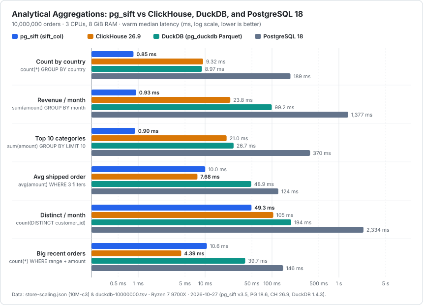
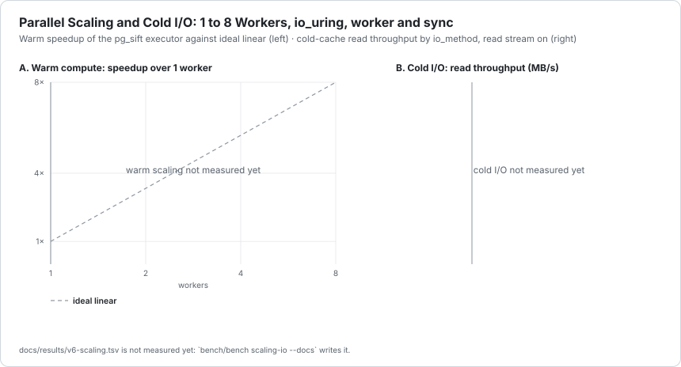
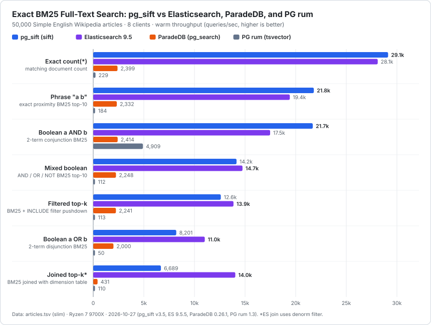
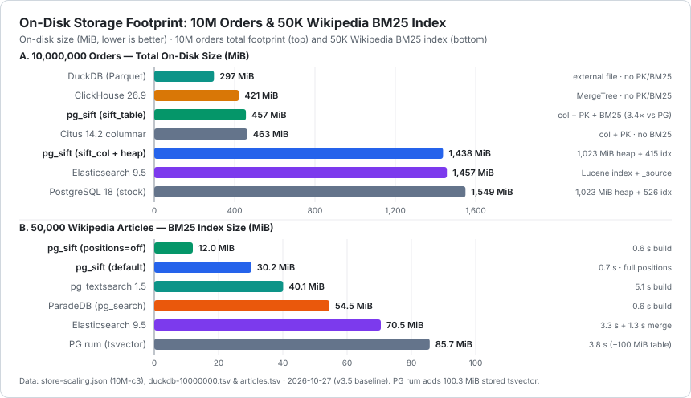
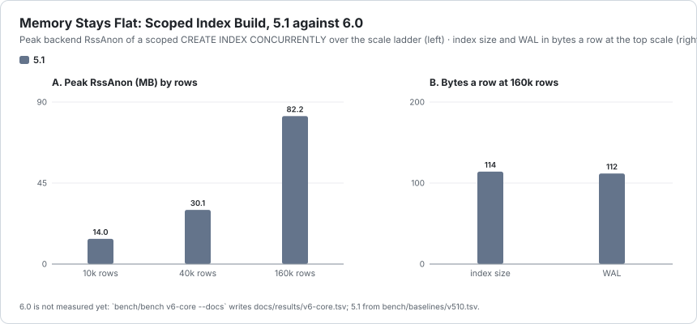

# Benchmarks and Methodology

Benchmark methodology, committed cross-engine baselines, `pg_sift` 6.0 release gates, and 1-command reproduction steps. Every analytical and scoped benchmark verifies **exact answer equality** (`md5_equal`) against plain PostgreSQL before recording timings.

## 1. Methodology, Hardware & Reproduction

- **Measurement protocol:** Warm medians (after untimed warmup) and cold medians, one engine running at a time on equal container CPU/RAM budgets, tracking wall latency (`ms`), throughput (`QPS`), disk footprint (`MiB`), WAL bytes, and peak `RssAnon`.
- **Committed baselines vs 6.0 regeneration:** Cross-engine tables and SVG charts below come from committed measurements on **AMD Ryzen 7 9700X** (3 CPUs / 8 GiB RAM per server, PG 18.6, `pg_sift` 3.5 baseline), **AMD Ryzen 9 5900XT** (PG 18.7, `pg_sift` 5.0 scope suite), and the `5.1.0` wide+JSONB baseline (PG 18.7, `bench/baselines/v510.tsv`). The run date and versions of every file are in its header under `docs/results/`. Running the suites below writes fresh `6.0` results there and `scripts/gen-docs.py` regenerates both tables and `docs/charts/*.svg` automatically.
- **What "cold" means per suite** (the scripts do exactly this, nothing more):

  | Suite | Emptied before each cold run | OS page cache |
  |---|---|---|
  | Orders (`store`, 1M tables below) and `duckdb` | PostgreSQL: every shared buffer (`pg_buffercache_evict_all()`), a new session per run. ClickHouse: mark, uncompressed-block, primary-index, skipping-index and query caches. Elasticsearch: node caches, index closed and reopened. `pg_duckdb` Parquet lane: the file's pages are dropped from the OS page cache (`posix_fadvise(POSIX_FADV_DONTNEED)`) | **Kept** for the heap data (dropping it needs root), **dropped** for the Parquet file; this is the state after a server restart on a warm host, not a cold disk |
  | Articles and places (`articles`) | PostgreSQL: heap, TOAST and index buffers of the table. Elasticsearch: node caches, index closed and reopened | **Dropped** for those files (`posix_fadvise(POSIX_FADV_DONTNEED)`); not dropped on `tmpfs` data directories, which have no separate page cache |

  Orders cold cells are therefore server-memory-cold, not disk-cold; the `store` command can also time a container restart (`--restart-runs`) to check the two agree (`--cold-check`).
- **No fabricated numbers:** Every cell below is either a committed measurement (dated with exact versions) or an explicit `*TBD*` placeholder for pending 6.0 Round 1+ sign-off runs.

### Run Locally in 1 Command

```sh
# 1. Self-contained 10-query orders comparison in Docker (verifies exact answer equality):
bench/bench kit --rows 200000 --cpus 2 --runs 3

# 2. Cross-engine orders analytics & storage suite (PG 18, sift_col, sift_table, ClickHouse, ES, Citus):
bench/bench store all --docs

# 3. DuckDB (pg_duckdb Parquet & heap) comparison at 10M orders:
bench/bench duckdb --rows 10000000 --out docs/results/duckdb-10000000.tsv

# 4. Full-text BM25 suite (Wikipedia articles & GeoNames places vs ES, ParadeDB, rum, pg_textsearch):
bench/bench all --docs

# 5. Multi-tenant Entity-Once scope benchmark vs stock PG, semijoin, denorm, rollup, and pg_ivm:
bench/bench scope-stock --docs

# 6. The 6.0 scaling ladder (memory flatness, compression, WAL) and the parallel / cold-I/O / writer scaling of the executor:
bench/bench v6-core --docs
bench/bench scaling-io --docs

# 7. The whole post-6.0 pass in one command (about 20-25 min with the rivals cached, 45-50 min cold; `v6-quick` is the 90 s smoke):
bench/bench v6-release --docs

# 8. Regenerate README tables & docs/charts/*.svg from docs/results/:
python3 scripts/gen-docs.py

# 9. The 43 ClickBench queries (10M and 100M `hits` rows) on PostgreSQL, pg_sift, ClickHouse with and without PROJECTIONs, and DuckDB:
bench/bench clickbench run --scale 10m
bench/bench clickbench report --md --svg
```

## 2. Analytical Aggregations vs ClickHouse, DuckDB, and PostgreSQL 18



### 2.1 10,000,000 Orders — Warm Median Latency (ms, 3 CPUs, 8 GiB RAM)

Measured on AMD Ryzen 7 9700X (`docs/results/store-scaling.json` tier `10M-c3` for PG 18.6, `pg_sift` 3.5 baseline, ClickHouse 26.9.19.9, Elasticsearch 9.5.5, Citus 14.2; `docs/results/duckdb-10000000.tsv` on the same host, dataset, and 3-CPU/8 GiB budget for `pg_duckdb` 1.1.1 / DuckDB 1.4.3):

<!-- bench:v6-orders-10m:begin -->
| Query (10M orders) | `sift_col` | `sift_table` | ClickHouse | DuckDB Parquet | PG 18 |
|---|---:|---:|---:|---:|---:|
| `01` Point lookup (`WHERE id = 42`) | 0.27 ms | **0.20 ms** | 5.90 ms | 7.00 ms | 0.25 ms |
| `02` Count by country (`GROUP BY`) | **0.85 ms** | 1.65 ms | 9.32 ms | 8.97 ms | 188.9 ms |
| `03` Revenue / month (`sum GROUP BY`) | **0.93 ms** | 1.75 ms | 23.8 ms | 99.2 ms | 1,377 ms |
| `04` Top 10 categories (`LIMIT 10`) | **0.90 ms** | 2.09 ms | 21.0 ms | 26.7 ms | 370.2 ms |
| `05` Avg shipped order (3 filters) | 10.0 ms | 9.87 ms | **7.68 ms** | 48.9 ms | 124.2 ms |
| `06` Distinct customers / month | **49.3 ms** | 53.9 ms | 104.5 ms | 193.7 ms | 2,334 ms |
| `07` Big recent orders (range + `>100`) | 10.6 ms | 13.8 ms | **4.39 ms** | 39.7 ms | 146.4 ms |
<!-- bench:v6-orders-10m:end -->

- **Additional engines on the same 10M run:** `pg_duckdb` scanning PostgreSQL heap directly ran `02`–`07` in `383 / 519 / 589 / 158 / 601 / 191 ms`; Elasticsearch 9.5 ran `02`–`07` in `6.0 / 69.7 / 68.0 / 28.9 / 260.1 (approx HLL++) / 6.3 ms`; Citus 14.2 columnar ran `02`–`07` in `709 / 1,183 / 946 / 603 / 4,814 / 381 ms`.
- **Where ClickHouse wins (committed baseline):** On selective multi-filter scans without pre-aggregate hits (`05` average shipped order and `07` 30-day range count at 10M rows), ClickHouse's MergeTree primary key + SIMD scan is faster (`7.68 ms` vs `10.0 ms`, `4.39 ms` vs `10.6 ms`). The composite key marks, adaptive `PREWHERE`, and cold read-ahead of 6.0 ([ANALYTICS.md](ANALYTICS.md#composite-key-marks)) target exactly these two rows; section 2.4 holds the gate and the 6.0 run replaces this baseline.

#### Fairness and setup notes (read before quoting the table)

Every engine is loaded from the layout in `bench/sql/store/{sift,sift_table,ch,pg,citus}.sql` and measured by the code in `bench/engines/` and `bench/steps/duckdb.py`. The differences that favor or disadvantage an engine:

1. **`01` Point lookup is the B-tree primary key, not `sift_col`.** `sift.sql` adds `PRIMARY KEY (id)` to the heap and `sift_col` does not index `id`; the `sift_col` and PG 18 columns of `01` both run on that B-tree (hence `0.27 ms` vs `0.25 ms`). ClickHouse answers it with a Bloom-filter skipping index on `id` (its sorting key starts with `country`), and DuckDB Parquet scans a file sorted by `id`.
2. **`sift_col` has a precomputed month expression; ClickHouse and DuckDB compute it per query.** `sift.sql` indexes `(date_trunc('month', created_at)::date)` inside `sift_col`, which also feeds the automatic per-unit pre-aggregates behind `03` and `06` (`0.93 ms` and `49.3 ms`). The ClickHouse arm runs `toStartOfMonth(created_at)` over a plain `MergeTree` (`PARTITION BY toYYYYMM(created_at) ORDER BY (country, created_at, id)`) with **no `PROJECTION`, no `AggregatingMergeTree` / materialized view and no materialized month column**, the ClickHouse features that play the role of pre-aggregates. A ClickHouse `PROJECTION` over `(month, sum(amount))` would answer `03` from a few rows, so the `03` gap is "pre-aggregate against full scan", not "engine against engine", and the other grouped rows (`02`, `04`, `06`) compare `pg_sift` pre-aggregates and indexed columns with ClickHouse's unprojected scans; the like-for-like rows are `05` and `07`, where `pg_sift` does not win. The `ClickHouse + PROJECTION` arm (`ch_proj`, `bench/sql/store/ch.sql` section `proj`: `p_by_month`, `p_by_cat`, `p_by_country`) holds the same rows with the projections that match these pre-aggregates, and `ClickBench` (section 2.5) runs the projections of the `pg_sift` arms on both.
3. **DuckDB reads a Parquet file written in `id` order, through `pg_duckdb`.** `bench/steps/duckdb.py` loads the CSV sorted by `id`, writes the file with `COPY orders TO ... (FORMAT parquet)` (default row groups, no `country` / `created_at` ordering, no month column) and queries it from a view in a PostgreSQL 18 session. Row-group statistics therefore prune nothing for `country` / `created_at` filters, and the PostgreSQL wire path adds result conversion. A native DuckDB CLI over a file sorted by `(country, created_at)` would be faster; this table is the `pg_duckdb` experience a PostgreSQL user gets out of the box.
4. **ClickHouse time is the client's wall clock.** `bench/engines/clickhouse.py` times one HTTP `POST` on a persistent connection, the response read, UTF-8 decode and TSV split in Python; PostgreSQL arms time one `psql` session statement client-side. The HTTP and parse overhead (about a millisecond) is inside every ClickHouse cell and is a visible share of the sub-10 ms ones (`01`, `02`, `07`); ClickHouse's server-side figure, the `elapsed_ns` of the `X-ClickHouse-Summary` header, is recorded beside it (`server_ms` rows of `docs/results/store.json`, the `ch_server_ms` I/O figure of the generic suites) and PostgreSQL's `EXPLAIN (ANALYZE)` Execution Time beside the client time of ClickBench. Results of every engine are compared with PostgreSQL's before a cell is accepted.
5. **Approximate distinct counts.** Elasticsearch `06` uses HyperLogLog++ (marked `approx` above); `pg_sift` `06` is exact.
6. **Cold is server-memory-cold on this suite** (see section 1): the OS page cache stays, for every engine.

### 2.2 1,000,000 Orders — Warm & Cold Cache Medians (ms, 3 CPUs)

From `docs/results/store.json` (`1M-c3`; cold runs empty the server's own caches and buffers before each query, the OS page cache stays; see section 1):

<!-- bench:v6-orders-1m:begin -->
| Query (1M orders, warm / cold) | `sift_col` | `sift_table` | ClickHouse | Elasticsearch | PG 18 |
|---|---:|---:|---:|---:|---:|
| `02` Count by country | 0.56 / 9.89 | **0.54 / 8.51** | 4.95 / 10.7 | 6.00 / 125.2 | 22.0 / 34.7 |
| `03` Revenue / month | 0.65 / **2.90** | **0.61** / 3.26 | 6.91 / 7.18 | 13.7 / 215.0 | 192.5 / 197.7 |
| `04` Top 10 categories | 0.67 / **3.03** | **0.62** / 3.27 | 6.12 / 16.6 | 11.5 / 214.8 | 43.4 / 59.5 |
| `05` Avg shipped order | **1.92** / 16.9 | 2.10 / 18.0 | 7.01 / **6.57** | 5.68 / 182.1 | 10.6 / 25.8 |
| `06` Distinct customers / month | **6.16 / 10.9** | 8.71 / 14.0 | 14.0 / 10.9 | 45.9 / 441.3 | 293.4 / 224.4 |
| `07` Big recent orders | **2.05** / 7.79 | 2.07 / 9.95 | 3.66 / **3.77** | 3.38 / 89.5 | 12.0 / 28.3 |
<!-- bench:v6-orders-1m:end -->

### 2.3 `pg_sift` 6.0 SIMD & Format Major 2 Release Gates (10M–100M Wide + JSONB)



Release gates of `bench/bench scaling-io --docs` (`docs/results/v6-scaling.tsv`): warm compute probes against 1 worker, cold I/O probes against `sync` without a read stream. The query-class cases of `bench/bench v6-cases` write `docs/results/cases.tsv`.

<!-- bench:v6-gates:begin -->
*Not measured for 6.0 yet: `bench/bench scaling-io --docs` writes `docs/results/v6-scaling.tsv` and populates this block.*
<!-- bench:v6-gates:end -->

### 2.4 ClickHouse-Parity Gates (`CH-01` to `CH-08`)

Each gate is checked against the same engines and datasets as the tables above and by the same `md5_equal` rule; none adds a setting or an option (27 `sift.*` settings and 12 / 14 / 10 / 0 options are unchanged).

| Gate | What is measured | Release target |
|---|---|---|
| `CH-01` | Unprojected filtered scans `05` and `07`, 10M orders, warm and cold | `sift_col` and `sift_table` tie or beat ClickHouse: `05 ≤ 7.5 ms`, `07 ≤ 4.5 ms` warm |
| `CH-02` | `sift_table` 10M orders `COPY` load time and footprint | Load `≤ 14.0 s` (≤ 1.5× ClickHouse `9.3 s`), size `≤ 420 MiB` (below ClickHouse `421.4 MiB`) |
| `CH-03` | Format: 424 B metapage, 224 B part descriptor, page types 44 and 45, three new sections | All static asserts pass; `ALTER TABLE ADD/DROP COLUMN` rewrites 0 parts; `pg_checksums` clean |
| `CH-04` | `SIFT_PROJ_SORT` and `SIFT_PROJ_AGG` under concurrent DML, `VACUUM`, and crash recovery | 0 oracle diffs; projected rollups under 1 ms, matching ClickHouse `PROJECTION`s |
| `CH-05` | `file://` and S3 SigV4 tiering, `O(1)` TTL drop | 0 diffs, 0 leaks, bounded local cache; TTL is one metadata commit |
| `CH-06` | Wide and multi-column `COUNT(DISTINCT)`, `arg_max`/`arg_min`, 16-branch `FILTER` pivot, trigram `LIKE`, Grace join, `ASOF`, `date_bin`, windows | 0 diffs against stock PostgreSQL on 0, 1, 2, and 4 workers; ≥ 10× faster than stock PostgreSQL per class |
| `CH-07` | ClickBench `Q0`-`Q42` plus the fair `ClickHouse + PROJECTION` arm | 43 of 43 queries `md5_equal`; results in section 2.5 |
| `CH-08` | Zero-knob freeze and packaging | Still 27 settings and 12 / 14 / 10 / 0 options; multi-arch images, signed APT and DNF repositories ([INSTALL-REPOS.md](INSTALL-REPOS.md)), version-sync lint |

*Not measured for 6.0 yet: the gates are recorded by `bench/bench v6-release --docs` at release; no number of this section is a measurement.*

### 2.5 ClickBench (`Q0`-`Q42`)

The 43 official ClickBench queries in PostgreSQL dialect on the canonical 105-column `hits` table: `bench/sql/clickbench/queries.sql` (usable with `bench/bench analytics clickbench --queries-file`). Arms: stock PostgreSQL 18 (reference), `sift_table` (with `skip_index = 'url:trigram, title:trigram'` set through `sift.table_set_option`) and `sift_col` (`key_order` only), both with the same projections as ClickHouse, ClickHouse, ClickHouse with `PROJECTION`s (`ch_proj`), and `pg_duckdb`/DuckDB. Two tiers: a deterministic synthetic generator for the 10M certification run (every query returns rows) and the real `hits.parquet` files for the 100M release run (`--source parquet`).

- **Exactness first:** every query is run on every arm before any timing. Rows are decoded from each engine's text format, `AVG` columns are rounded to 9 significant digits from their decimal text, everything else is exact, rows are sorted, and the md5 must equal PostgreSQL's; an arm that differs records no timing and the run exits with status 1. Queries with a `LIMIT` are verified through a variant with a total `ORDER BY`; the official text is what is timed.
- **Fairness:** one list of projections (`p_by_adv`, `p_by_region`, `p_by_counter_day`, `p_by_user`) renders both `sift.create_projection(...)` and ClickHouse `ALTER TABLE ... ADD PROJECTION`; the TSV header names the projections the timed queries used (`system.query_log.projections`). A `sift_col` index has at most 32 columns, so the 105-column table gets one over the 25 columns the queries name and `SELECT *` (`Q23`) reads the heap. All databases are created with the `C` locale, the only string order the three engines share.
- **Timing:** ClickHouse server time is the `elapsed_ns` of the `X-ClickHouse-Summary` header, PostgreSQL's is the `EXPLAIN (ANALYZE, TIMING OFF)` execution time of a separate run, and DuckDB's is its `.timer` (1 ms resolution), each recorded beside the client wall clock. Cold runs empty the engine's caches and the OS page cache for the data files; the result file records `os_cache=dropped|kept`.
- **Output:** `docs/results/clickbench.tsv`, the block below (`bench/bench clickbench report --md`), and `docs/charts/clickbench.svg` (geometric mean of the warm wall times).

<!-- bench:clickbench-10M:begin -->
*Not measured for 6.0 yet: `bench/bench clickbench run --scale 10m` then `report --md --svg` writes `docs/results/clickbench.tsv`, this block, and `docs/charts/clickbench.svg`. A 20,000-row smoke on the installed 5.x build checked all 43 queries `md5_equal` on five arms; it is a correctness check, not a benchmark.*
<!-- bench:clickbench-10M:end -->

## 3. Exact BM25 Full-Text Search vs Elasticsearch, ParadeDB, and PostgreSQL



### 3.1 50,000 Wikipedia Articles — Warm Throughput (QPS, 8 Clients)

Measured on AMD Ryzen 7 9700X (`docs/results/articles.tsv`, `slim` tier, Simple English Wikipedia, 2–3 interleaved rounds, exact BM25 parity verified):

<!-- bench:v6-search-warm:begin -->
| Query Class | `pg_sift` (`sift`) | Elasticsearch 9.5 | ParadeDB (`pg_search`) | PG `rum` | `pg_textsearch` |
|---|---:|---:|---:|---:|---:|
| Exact `count(*)` | **29,127** | 28,105 | 2,399 | 229 | 161 |
| Phrase `"a b"` | **21,794** | 19,423 | 2,332 | 184 | 201 |
| Boolean `a AND b` | **21,690** | 17,476 | 2,414 | 4,909 | 172 |
| Mixed boolean | 14,159 | **14,749** | 2,248 | 112 | 147 |
| Filtered top-k | 12,604 | **13,854** | 2,241 | 113 | 163 |
| Boolean `a OR b` | 8,201 | **11,021** | 2,000 | 50 | 9,222 |
| Joined top-k\* | 6,689 | **14,037**\* | 431 | 110 | 189 |
<!-- bench:v6-search-warm:end -->

*\*Elasticsearch runs a term filter on a denormalized region field rather than a relational join. With `positions = off`, `pg_sift` hits **24,146 QPS** on `a AND b` with a **12.0 MiB** index. On the full 218,058-article corpus (`articles.tsv` tier `full`), `pg_sift` reaches **10,279 QPS** (`AND`), **8,239 QPS** (`phrase`), and **6,976 QPS** (`count`) vs ParadeDB's `2,679 / 2,520 / 1,501 QPS`.*

### 3.2 50,000 Wikipedia Articles — Cold-Cache Latency (p50 ms)

Index, heap, and TOAST evicted from shared buffers and the OS page cache before every query (`docs/results/articles.tsv`, `slim-cold`):

<!-- bench:v6-search-cold:begin -->
| Query Class | `pg_sift` (`sift`) | Elasticsearch 9.5 | ParadeDB (`pg_search`) | PG `rum` | `pg_textsearch` |
|---|---:|---:|---:|---:|---:|
| Exact `count(*)` | **1.03 ms** | 3.11 ms | 16.06 ms | 31.29 ms | 8.86 ms |
| Phrase `"a b"` | **1.31 ms** | 3.29 ms | 14.80 ms | 16.95 ms | 8.08 ms |
| Boolean `a AND b` | **1.76 ms** | 4.24 ms | 17.08 ms | 3.57 ms | 9.21 ms |
| Filtered top-k | **1.67 ms** | 3.88 ms | 15.90 ms | 17.30 ms | 9.01 ms |
| Boolean `a OR b` | 5.50 ms | **4.77 ms** | 14.54 ms | 56.90 ms | 7.02 ms |
| Joined top-k | **1.75 ms** | 3.67 ms | 13.12 ms | 17.97 ms | 8.84 ms |
<!-- bench:v6-search-cold:end -->

### 3.3 10,000,000 Orders Title Search vs Stock PostgreSQL GIN (`tsvector`)

From `docs/results/store-scaling.json` (`10M-c3`, 3 CPUs, warm median ms; PG 18 uses `CREATE INDEX USING gin (to_tsvector('simple', title))`):

<!-- bench:v6-search-10m:begin -->
| Query (10M orders, `"wireless headphones"`) | `sift_col` + `sift` | `sift_table` + `sift` | Elasticsearch 9.5 | ClickHouse 26.9 | PG 18 GIN |
|---|---:|---:|---:|---:|---:|
| `08` Search `count(*)` | **2.35 ms** | 6.46 ms | 11.57 ms | 3.23 ms | 78.53 ms |
| `09` Search + filter + `GROUP BY category` | 13.69 ms | 11.70 ms | **8.27 ms** | 24.56 ms | 80.44 ms |
| `10` Search + filter + `ORDER BY ts DESC LIMIT 10` | 13.13 ms | **9.93 ms** | 13.63 ms | 17.73 ms | 141.68 ms |
<!-- bench:v6-search-10m:end -->

*Autocomplete (`docs/results/places.tsv`, 34,189 GeoNames places, 1 client, top-20): `pg_sift` p50 **0.20–0.26 ms** across all 9 prefix/multi-word classes vs Elasticsearch **0.22–0.46 ms**, ParadeDB **0.56–1.30 ms**, and PG `rum` **0.44–28.07 ms**.*

## 4. Multi-Tenant & Entity-Once Scoped Analytics (`scope = ...`)

### 4.1 Committed Baseline vs Tuned Stock PostgreSQL & `pg_ivm` (2.4M Events)

Measured on AMD Ryzen 9 5900XT, PG 18.7 (`pg_sift` 5.0 suite, `docs/results/scope-stock.tsv`, 2,400,007 events, 2,648 members, 32 tenants, 9 query classes × 8 tenants = 72 cells, 700/700 `md5_equal`):

| Rival Arm | Warm (`sift_scope` Win / Tie / Loss) | Cold (`sift_scope` Win / Tie / Loss) | Tenant 1 `sum_by_month` | Tenant 1 `distinct/mo` |
|---|---:|---:|---:|---:|
| `stock_default` (PG B-tree) | **72 / 0 / 0** | **71 / 0 / 1** | 542 ms vs **2.18 ms** | 757 ms vs **1.52 ms** |
| `semijoin` (covering B-trees) | **63 / 2 / 7** | **62 / 1 / 9** | 285 ms vs **2.18 ms** | 636 ms vs **1.52 ms** |
| `denorm_flat` (trigger copy) | **51 / 2 / 19** | **48 / 1 / 23** | 329 ms vs **2.18 ms** | 652 ms vs **1.52 ms** |
| `denorm_part` (list-part copy) | **54 / 4 / 14** | **54 / 0 / 18** | — | — |
| `rollup` (trigger totals) | **54 / 5 / 5** | **52 / 3 / 9** | — | — |
| `pg_ivm` 1.17 (inc. matview) | **32 / 2 / 30** | **34 / 3 / 27** | 43.3 ms vs **2.18 ms** | 58.4 ms vs **1.52 ms** |

*Where rivals win: `pg_ivm` beats `sift_scope` on pre-materialized exact-match point views (`count_by_score`: `0.22 ms` vs `0.38 ms`, `filtered_count`: `0.09 ms` vs `4.54 ms`), and `denorm_flat` wins `latest_20_rows` (`0.05 ms` vs `1.02 ms` in v5.0 — targeted by v6.0's O(1) Top-K ring).*

### 4.2 Entity-Once v6.0 Build & Storage Overhead Targets (Wide + JSONB, 2.1× M:N)

<!-- bench:v6-scope-build:begin -->
Entity-Once scope on the wide + JSONB schema at 160,000 rows (`docs/results/v6-core.tsv`; 5.1 from `bench/baselines/v510.tsv`):

| Metric | v5.1.0 Measured | `pg_sift` 6.0 Target | `pg_sift` 6.0 Measured |
|---|---:|---:|---:|
| Plain scoped `CREATE INDEX` wall time | 1.79× entity | ≤ 1.15× entity | *TBD* |
| Scoped `CIC` Pass 2 wall time | 107% of Pass 1 | ≤ 15% of Pass 1 | *TBD* |
| Scope build temp-file I/O | 249 B/row | **0 B** | *TBD* |
| Scope disk overhead vs entity | +98.3% | ≤ 5% (≤ 1% `cluster`) | *TBD* |
| Scoped whole-key read | 0.06 ms | O(1) (< 0.5 ms) | *TBD* |
| Scoped month read | 0.09 ms | O(1) (< 0.5 ms) | *TBD* |
| Scoped latest-20 read | 0.07 ms | O(1) (< 0.5 ms) | *TBD* |
<!-- bench:v6-scope-build:end -->

### 4.3 Generated `bench/bench scope-stock --docs` Blocks

<!-- bench:scope-stock-tally:begin -->
*Not measured for 6.0 yet: `bench/bench scope-stock --docs` writes `docs/results/scope-stock.tsv` and populates this block.*
<!-- bench:scope-stock-tally:end -->

<!-- bench:scope-stock-geomean:begin -->
*Not measured for 6.0 yet: `bench/bench scope-stock --docs` writes `docs/results/scope-stock.tsv` and populates this block.*
<!-- bench:scope-stock-geomean:end -->

<!-- bench:scope-stock-costs:begin -->
*Not measured for 6.0 yet: `bench/bench scope-stock --docs` writes `docs/results/scope-stock.tsv` and populates this block.*
<!-- bench:scope-stock-costs:end -->

## 5. Storage Footprint, Compression & Write Efficiency



### 5.1 On-Disk Size & Load Time — 10M & 1M Orders

From `docs/results/store-scaling.json` (`10M-c3`), `docs/results/store.json` (`1M-c3`), and `docs/results/duckdb-10000000.tsv`:

<!-- bench:v6-size-orders:begin -->
| System | 10M Total Size | 10M Load | 1M Breakdown (Heap+PK / Col+Idx) | Notes |
|---|---:|---:|---:|---|
| DuckDB (`pg_duckdb` Parquet) | 297.3 MiB | 3.3 s | — | External file; no PK or BM25 |
| ClickHouse 26.9 | 421.4 MiB | 9.3 s | 0 / 37.6 MiB | MergeTree; no PK or BM25 |
| **`pg_sift` (`sift_table`)** | **456.6 MiB** | 28.4 s | 21.4 / 28.9 MiB (50.4 MiB) | **3.4× smaller** than PG 18; incl. PK + BM25 |
| Citus 14.2 columnar | 463.4 MiB | 13.2 s | 21.4 / 24.7 MiB (46.1 MiB) | Append-only; no BM25 |
| **`pg_sift` (`sift_col`)** | **1,437.5 MiB** | 16.1 s | 124.2 / 19.4 MiB (143.7 MiB) | Shares PG heap + PK; **7% smaller** than PG |
| Elasticsearch 9.5 | 1,456.9 MiB | 69.6 s | 0 / 112.1 MiB | Separate JVM cluster |
| PostgreSQL 18 (stock) | 1,549.1 MiB | 27.6 s | 124.2 / 34.6 MiB (158.8 MiB) | Heap + PK + B-trees + GIN |
<!-- bench:v6-size-orders:end -->

The `sift_table` load row is the committed baseline of the unbatched path: 6.0 loads through the direct-to-`COLD_L2` route (`CH-02`, section 2.4), and the 6.0 run replaces this row.

### 5.2 BM25 Index Size & Build Time — 50,000 Wikipedia Articles

From `docs/results/articles.tsv` (`slim` tier):

<!-- bench:v6-size-bm25:begin -->
| Engine | Index Size | Build Time | Table Growth | Notes |
|---|---:|---:|---:|---|
| **`pg_sift` (`positions=off`)** | **12.0 MiB** | **0.6 s** | 0.0 MiB | No phrase positions |
| **`pg_sift` (default)** | **30.2 MiB** | 0.7 s | 0.0 MiB | Full phrase + BM25 + filters |
| `pg_textsearch` 1.5 | 40.1 MiB | 5.1 s | 0.0 MiB | Timescale BM25 |
| ParadeDB (`pg_search` 0.26) | 54.5 MiB | 0.6 s | 0.0 MiB | Tantivy inside PG |
| Elasticsearch 9.5 | 70.5 MiB | 3.3 s | 0.0 MiB | +1.3 s force-merge (71.7 MiB pre-merge) |
| PG `rum` 1.3 | 85.7 MiB | 3.8 s | +100.3 MiB | Requires stored `tsvector` column |
<!-- bench:v6-size-bm25:end -->

### 5.3 Wide + JSONB Compression & Write Efficiency (Format Major 2 Targets)

13-column wide + 3-JSONB schema with `NUMERIC(12,2)`, `UUID`, and `2.1×` M:N scope (`5.1.0` measured in `round0-v510`, PG 18.7):

<!-- bench:v6-wide-json:begin -->
13-column wide + 3-JSONB schema with `NUMERIC(12,2)`, `UUID`, and a `2.1×` M:N scope at 160,000 rows (`docs/results/v6-core.tsv`; 5.1 from `bench/baselines/v510.tsv`):

| Metric | PG 18 Heap | ClickHouse ZSTD | `pg_sift` v5.1 | `pg_sift` 6.0 Target | `pg_sift` 6.0 Measured |
|---|---:|---:|---:|---:|---:|
| Size, entity index | — | — | 57.5 B/row | — | *TBD* |
| Size, scoped index | — | — | 114.1 B/row | ≤ 33 B/row (≤ 16 excl. a 16 B UUID) | *TBD* |
| Heap + TOAST | — | — | 363.8 B/row | — | *TBD* |
| Page / extent utilization | 92–96% | ~99% | *TBD* | ≥ 95% | *TBD* |
| Bulk build WAL (`wal_level=replica`) | — | — | 111.8 B/row | ≤ 45 B/row | *TBD* |
| 1-row OLTP `INSERT` WAL | ~460 B/row | n/a | 495.7 B/row | ≤ 220 B/row | *TBD* |
| 2% `DELETE` WAL (incl. DV fold) | ~60 B/row | ~40 B/row | 98.7 B/row | ≤ 45 B/row | *TBD* |
| Steady-state compaction WA | — | 3.0–5.0× | 2.13× | ≤ 2.35× | *TBD* |
<!-- bench:v6-wide-json:end -->

## 6. Memory Flatness (`10k → 10M+` Rows)



CI enforces three hard memory invariants across 4 scale points (`10k`, `100k`, `1M`, `10M`; nightly `50M`):
- **Peak gate:** `peak_context_bytes <= configured_budget * 1.15`
- **Slope gate (OLS `100k..10M`):** `slope <= 0.5 B/row`
- **Idle retention gate:** `idle_RssAnon <= sift.backend_cache_kb * 1024 + 8 MB`

<!-- bench:v6-memory:begin -->
Slopes are an OLS fit over the 0k–160k ladder (`docs/results/v6-core.tsv`; 5.1 from `bench/baselines/v510.tsv`):

| Workload | Budget | Slope gate | v5.1.0 Baseline | `pg_sift` 6.0 Measured |
|---|---|---:|---:|---:|
| Scoped `CIC` `RssAnon` slope | `maintenance_work_mem = 4MB` | ≤ 0.5 B/row | 470.8 B/row | *TBD* |
| Scoped `CIC` temp-file slope | `maintenance_work_mem = 4MB` | ≤ 0.5 B/row | 282.8 B/row | *TBD* |
| Scoped index size slope | — | — | 113.7 B/row | *TBD* |
| Scoped `CIC` WAL slope | — | — | 111.5 B/row | *TBD* |
| `VACUUM` `RssAnon` slope | `maintenance_work_mem = 4MB` | ≤ 0.5 B/row | 197.6 B/row | *TBD* |
| Idle pooled backends (34 indexes) | `backend_cache_kb` cap | ≤ cap + 8 MB | +8.3 MB | *TBD* |
<!-- bench:v6-memory:end -->

## 7. Parallel Compute & Cold I/O

Parallel guided-morsel scans, aggregation, build and compaction run on PostgreSQL's parallel workers (`sift.parallel_scan = on` by default); cold scans stream extents through the `io_method` of the server. `bench/bench scaling-io --docs` writes `docs/results/v6-scaling.tsv`:


<!-- bench:v6-scaling:begin -->
*Not measured for 6.0 yet: `bench/bench scaling-io --docs` writes `docs/results/v6-scaling.tsv` and populates this block.*
<!-- bench:v6-scaling:end -->

## 8. Vulkan GPU versus CPU (Opt-in)

`sift.gpu = on` (build with `make VULKAN=1`, [GPU.md](GPU.md)) runs eligible integer aggregates of a `sift_col` index on a Vulkan device. `bench/gpu/bench-pg.sh ROWS` times each query with `sift.gpu = off` (one CPU core) and `sift.gpu = on` (first query, then median of the rest with chunks resident on the device) on the `store` orders table.

**Staging preview (standalone device suite, not PostgreSQL; replaced by the integrated Round 5 run in Stage 7).** Two GeForce RTX 3060 12 GiB on a shared Ryzen 9 5900XT host, 10M and 50M rows, warm means the decoded columns are resident in device memory, each CPU figure from the same run:

| Shape (warm) | Device kernel | Against 32 CPU workers | Against 4 CPU workers |
|---|---|---|---|
| Ungrouped, `WHERE` on one column | **271-295 GB/s** (89-97 % of the 304 GB/s measured peak) | 4.8-6.8x | 9.5-17.9x |
| Dense, 100 groups | 80 GB/s | 3.0-3.3x | 6.2-7.2x |
| Hash, about 1M groups, 2 keys | 3.3-3.5 GB/s | **8.2-9.5x** | 9.3-9.5x |
| Expression, top-100 | unchanged | 0.8-1.1x | 1.2-2.4x |

Cold first queries of the simple shapes lose to the CPU (0.1-0.6x) and stay with it under `sift.gpu = auto`. Parity: **0 differences** against the scalar oracle on both devices (211 aggregate runs, 372 decoded chunks, ASan and UBSan clean). The loaded host disturbs every CPU figure; repeat on an idle host before quoting.

*Not measured for 6.0 yet: `bench/gpu/bench-pg.sh 1000000` and `10000000` populate this block at release.*
