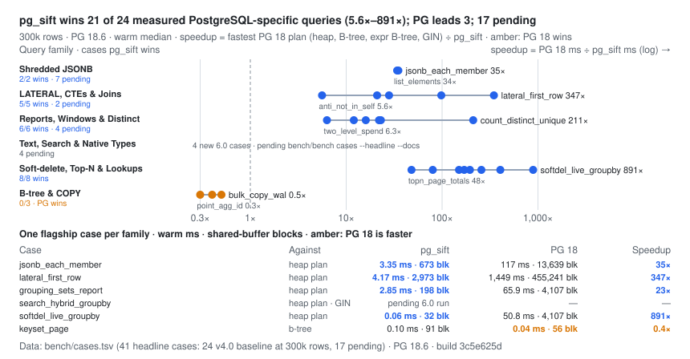

# PostgreSQL-specific queries

`pg_sift` against the strongest stock PostgreSQL 18 index a DBA would build, on 41 SQL shapes PostgreSQL applications write, in six families: shredded `JSONB` (`->>`, `@>`, `?`, `jsonb_path_exists`, `jsonb_each`, `jsonb_to_recordset`, `jsonb_typeof`) against `GIN` and expression B-trees; `LATERAL`, `CTE`s, semi and anti joins, snowflake and partitioned joins; `GROUPING SETS`, window functions, `FILTER`, `percentile_cont` and `DISTINCT ON`; hybrid BM25 + SQL, prefix `LIKE`, arrays and calendar reports; soft-delete filters, `IN` lists and top-N; keyset pagination, point lookups and bulk `COPY`. Summary: [README](../../README.md#benchmarks). Protocol and fairness rules: [BENCHMARKS.md](../BENCHMARKS.md).

<picture>
  <source media="(prefers-color-scheme: dark)" srcset="../charts/readme-pg-queries-dark.svg">
  
</picture>

## Protocol

The cases of [bench/cases.tsv](../../bench/cases.tsv) marked `headline=yes`, each a SQL file of [bench/cases/](../../bench/cases). Every answer is compared with stock PG 18 before a time counts. One backend, the data in memory, warm median of the timed runs. Each cell is the statement time, the millions of user instructions of the backend and its workers, and the shared-buffer blocks it touched (hits and reads, 8 kB each). The rival is the fastest of PostgreSQL's plan without the `pg_sift` index (`heap plan`) and, where the case builds one in a twin schema of stock PG 18 indexes only, its B-tree (`b-tree`), expression B-tree (`expr b-tree`) or `GIN` plan (`jsonb_path_ops`, `to_tsvector`, arrays); the ratio is its time divided by `pg_sift`'s, so a value under 1 is a case PG 18 answers faster. `Against` names the rivals of a case not measured yet.

The committed baseline is release 4.0 (run `3c5e625d`, 300,000 orders, PG 18.6, `track_changes` on) for 24 cases; the 17 cases added for 6.0 are *pending 6.0 run* and never estimated. `bench/bench cases --headline --docs` writes `docs/results/cases.tsv`; every case it holds is drawn from it instead.

<!-- bench:v6-pg-queries:begin -->
**Shredded JSONB** (9 cases)

| Case | Against | `pg_sift`: ms · M instr · blocks | PG 18: ms · M instr · blocks | PG ÷ `pg_sift` |
|---|---|---:|---:|---:|
| `jsonb_each_member`: `LEFT JOIN LATERAL jsonb_each` | heap plan | 3.35 ms · 35.9 M · 673 | 117 ms · 916 M · 13,639 | **35×** |
| `list_elements`: `jsonb` array elements with a filter | heap plan | 3.36 ms · 35.9 M · 623 | 113 ms · 781 M · 13,639 | **34×** |
| `jsonb_contains_object`: `jsonb @>` of a nested object | heap plan · GIN | *pending 6.0 run* | — | — |
| `jsonb_key_read`: `sum(attrs->>k) FILTER (WHERE attrs ? k)` | heap plan · GIN | *pending 6.0 run* | — | — |
| `jsonb_scalar_groupby`: `GROUP BY doc->>k, doc[k]` | heap plan · expr b-tree | *pending 6.0 run* | — | — |
| `jsonb_path_exists_gin`: `jsonb_path_exists` filter `GROUP BY` | heap plan · GIN | *pending 6.0 run* | — | — |
| `jsonb_exists_same_elem`: `EXISTS` of one `jsonb` array element | heap plan · GIN | *pending 6.0 run* | — | — |
| `jsonb_typeof_groupby`: `GROUP BY jsonb_typeof` of mixed values | heap plan · expr b-tree | *pending 6.0 run* | — | — |
| `jsonb_sift_table_paths`: `jsonb_to_recordset` on `sift_table` paths | heap plan · GIN | *pending 6.0 run* | — | — |

**LATERAL, CTEs & Joins** (7 cases)

| Case | Against | `pg_sift`: ms · M instr · blocks | PG 18: ms · M instr · blocks | PG ÷ `pg_sift` |
|---|---|---:|---:|---:|
| `lateral_first_row`: `LATERAL ... ORDER BY LIMIT 1` | heap plan | 4.17 ms · 65.6 M · 2,973 | 1,449 ms · 25,536 M · 455,241 | **347×** |
| `cte_series_arms`: 3-arm `CTE` + `UNION ALL` + `DISTINCT` | heap plan | 8.76 ms · 133 M · 768 | 858 ms · 8,283 M · 13,731 | **98×** |
| `cte_two_readers`: `CTE` read by two aggregates | heap plan | 2.48 ms · 25.8 M · 500 | 68.4 ms · 542 M · 13,639 | **28×** |
| `semi_exists_self`: Self `EXISTS` semi join | heap plan | 2.77 ms · 19.3 M · 4,381 | 57.2 ms · 468 M · 8,212 | **21×** |
| `anti_not_in_self`: Self `NOT IN` anti join | heap plan | 10.1 ms · 76.6 M · 4,464 | 56.1 ms · 577 M · 8,212 | **5.6×** |
| `star_snowflake_join`: Snowflake join of 3 dimensions | heap plan | *pending 6.0 run* | — | — |
| `partitioned_range_agg`: Range-partitioned monthly `GROUP BY` | heap plan | *pending 6.0 run* | — | — |

**Reports, Windows & Distinct** (10 cases)

| Case | Against | `pg_sift`: ms · M instr · blocks | PG 18: ms · M instr · blocks | PG ÷ `pg_sift` |
|---|---|---:|---:|---:|
| `count_distinct_unique`: `count(DISTINCT)` of a unique key | heap plan | 1.13 ms · 14.7 M · 126 | 238 ms · 2,962 M · 4,105 | **211×** |
| `grouping_sets_report`: 4-level `GROUPING SETS` report | heap plan | 2.85 ms · 38.9 M · 198 | 65.9 ms · 744 M · 4,107 | **23×** |
| `ranked_top_per_group`: Window top 3 per group | heap plan | 2.82 ms · 33.1 M · 248 | 63.2 ms · 645 M · 4,105 | **22×** |
| `window_json_report`: Ranked window report as `jsonb` | heap plan | 4.53 ms · 61.8 M · 298 | 71.5 ms · 724 M · 4,105 | **16×** |
| `group_by_id_top`: `GROUP BY` primary key, top 10 | heap plan | 13 ms · 103 M · 253 | 162 ms · 1,936 M · 4,105 | **12×** |
| `two_level_spend`: Aggregate of an aggregate | heap plan | 24.4 ms · 245 M · 338 | 153 ms · 748 M · 4,105 | **6.3×** |
| `ordered_window_rank`: `rank() OVER (ORDER BY k)` | heap plan · b-tree | *pending 6.0 run* | — | — |
| `filter_pivot_agg`: `FILTER (WHERE ...)` pivot report | heap plan | *pending 6.0 run* | — | — |
| `percentile_stddev_agg`: `percentile_cont` and `stddev` by group | heap plan | *pending 6.0 run* | — | — |
| `distinct_on_latest`: `DISTINCT ON` latest row per customer | heap plan · b-tree | *pending 6.0 run* | — | — |

**Text, Search & Native Types** (4 cases)

| Case | Against | `pg_sift`: ms · M instr · blocks | PG 18: ms · M instr · blocks | PG ÷ `pg_sift` |
|---|---|---:|---:|---:|
| `bm25_hybrid_groupby`: BM25 match + `GROUP BY` | heap plan · GIN | *pending 6.0 run* | — | — |
| `text_like_prefix_agg`: Prefix `LIKE` + `GROUP BY` | heap plan · b-tree | *pending 6.0 run* | — | — |
| `pg_array_cardinality_agg`: `text[] @>` + `cardinality` | heap plan · GIN | *pending 6.0 run* | — | — |
| `calendar_date_trunc_agg`: `date_trunc` month calendar report | heap plan · expr b-tree | *pending 6.0 run* | — | — |

**Soft-delete, Top-N & Lookups** (8 cases)

| Case | Against | `pg_sift`: ms · M instr · blocks | PG 18: ms · M instr · blocks | PG ÷ `pg_sift` |
|---|---|---:|---:|---:|
| `softdel_live_groupby`: Soft-delete `GROUP BY` | heap plan | 0.057 ms · 0.667 M · 32 | 50.8 ms · 596 M · 4,107 | **891×** |
| `key_presence_distinct`: `count(DISTINCT key)` of a whole table | heap plan | 0.14 ms · 2.09 M · 26 | 56.7 ms · 410 M · 4,105 | **405×** |
| `key_table_point`: Rows of three foreign keys | heap plan | 0.075 ms · 0.748 M · 28 | 19.3 ms · 273 M · 4,107 | **257×** |
| `point_in_100`: `IN` list of 100 ids | heap plan | 0.076 ms · 1.07 M · 143 | 14.8 ms · 161 M · 4,107 | **195×** |
| `point_agg_fk`: Aggregate of one foreign key, no B-tree | heap plan | 0.063 ms · 0.391 M · 95 | 10.7 ms · 121 M · 4,107 | **170×** |
| `keycut_customer_agg`: Aggregate of one customer (arrival order) | heap plan | 0.069 ms · 0.719 M · 34 | 10.3 ms · 121 M · 4,107 | **150×** |
| `topn_coalesce`: `ORDER BY coalesce(...) LIMIT n` | heap plan | 0.4 ms · 5.58 M · 98 | 32.1 ms · 299 M · 4,105 | **80×** |
| `topn_page_totals`: Page of rows with its set total | heap plan | 0.61 ms · 7.69 M · 473 | 29 ms · 374 M · 4,107 | **48×** |

**B-tree & COPY** (3 cases)

| Case | Against | `pg_sift`: ms · M instr · blocks | PG 18: ms · M instr · blocks | PG ÷ `pg_sift` |
|---|---|---:|---:|---:|
| `bulk_copy_wal`: Bulk `COPY` into `sift_table` | heap plan | 422 ms · 5,210 M · 802 | 229 ms · 3,164 M · 12,061 | 0.5× |
| `keyset_page`: Keyset page `(created_at, id)` | b-tree | 0.104 ms · 0.997 M · 91 | 0.039 ms · 0.491 M · 56 | 0.4× |
| `point_agg_id`: Primary-key point aggregate | b-tree | 0.035 ms · 0.339 M · 25 | 0.012 ms · 0.173 M · 5 | 0.3× |
<!-- bench:v6-pg-queries:end -->

## Where stock PostgreSQL 18 wins

- **`point_agg_id`:** an aggregate of one primary key. The B-tree of the key reaches its row in a few blocks; `pg_sift` answers in tens of microseconds too, and the planner keeps the B-tree plan.
- **`keyset_page`:** the page after a `(created_at, id)` bar. A two-column B-tree walks straight to the bar; the planner keeps it.
- **`bulk_copy_wal`:** `COPY` into a `sift_table` encodes column groups, so its wall time is longer than a heap `COPY`, while it writes far fewer blocks.

## Reproduce

```sh
bench/bench cases --headline --rows 300000 --docs
bench/bench cases --cases lateral_first_row --rows 300000
```
