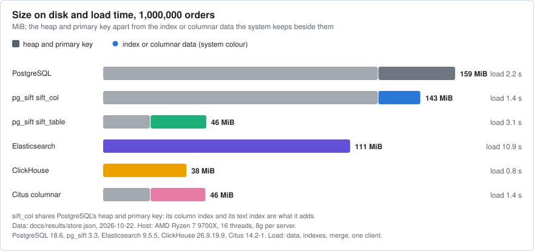
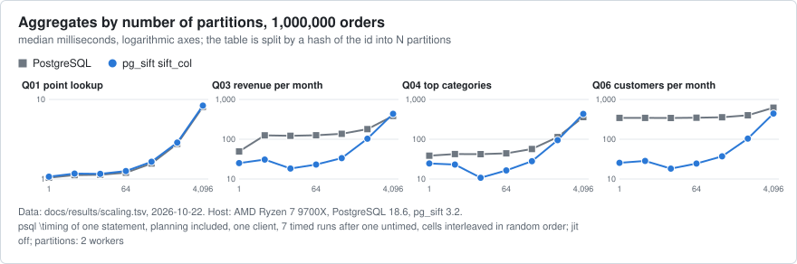
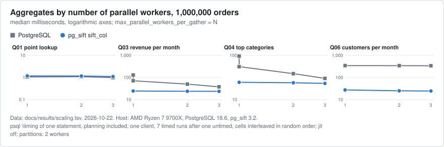

# Aggregate benchmarks: what is measured and what each chart answers

The page behind the README's [Benchmarks](../../README.md#benchmarks): one place for every benchmark of the aggregates (`count`, `sum`, `avg`, `count(DISTINCT)`, top-N, text search with
filters), the question each table and chart answers, and what the reader can do with the answer. Every number and chart is generated from [docs/results](../results) by
`scripts/gen-docs.py`; the tables of one benchmark, the cold runs and the method are in [BENCHMARKS.md](../BENCHMARKS.md).

## Who reads what

| Reader | Starts at | Question |
|---|---|---|
| Someone who has never heard of pg_sift (30 seconds) | the README's *Performance highlights* | What is measured, on what, and where does it lose? |
| Someone choosing between systems | the README's [Aggregates](../../README.md#aggregates-an-online-store) | For my question, which system is faster, and by how much? |
| Someone sizing a deployment | [Scale](#scale-rows-partitions-workers-cpus) and the size chart | Does it hold with more rows, partitions and CPUs; what does it cost in disk and load time? |
| Someone with queries of their own | [Shapes](#shapes-of-real-queries) | Do joins, lookups, top-N, distinct, time buckets and `UNION ALL` get faster? |
| Someone reproducing or extending | [Reproduce](#reproduce) and [bench/README.md](../../bench/README.md) | Which command writes which file? |

## What is behind the numbers

<!-- bench:agg-map:begin (generated by `bench/steps/aggregates_page.py`; do not edit by hand) -->
| what it answers | results file in docs/results | measured | host | command |
|---|---|---|---|---|
| the ten questions, six systems, 1 and 3 CPUs, warm and cold, updates | store.json | 2026-10-22 | AMD Ryzen 7 9700X, 16 threads | `bench/bench store all` |
| the ten questions at 25k, 100k, 10M orders (the 1M set is in store.json) | store-scaling.json | 2026-10-22 | AMD Ryzen 7 9700X, 16 threads | `bench/bench store all --sizes N,N` |
| pg_duckdb against PostgreSQL and pg_sift, 1,000,000 orders | duckdb.tsv | 2026-10-22 | AMD Ryzen 7 9700X, 16 threads, 188 GB RAM | `bench/bench duckdb` |
| the same at 10,000,000 orders | duckdb-10000000.tsv | 2026-10-22 | AMD Ryzen 7 9700X, 16 threads, 188 GB RAM | `bench/bench duckdb --rows 10000000 --out FILE` |
| partitions and parallel workers | scaling.tsv | 2026-10-22 | AMD Ryzen 7 9700X | `bench/bench scaling` |
| filters by a set of 1k to 100k ids | sets.tsv | 2026-10-22 | AMD Ryzen 7 9700X | `bench/bench sets` |
| rollups of jsonb arrays | rollup.tsv | 2026-10-22 | AMD Ryzen 7 9700X | `bench/bench extras rollup` |
| build and write cost per operation | buildcost.tsv | 2026-10-22 | AMD Ryzen 7 9700X | `bench/bench extras buildcost` |
| real-world query shapes: joins, lookups, top-N, distinct, time buckets, `UNION ALL` | analytics.json | 2026-10-22 | see the file | `bench/bench analytics run` |
<!-- bench:agg-map:end -->

Every run states its host and its PostgreSQL version in its file; numbers of different files are not comparable with each other (a different client, run time or build), only the
columns of one table are.

## The ten questions

The online-store benchmark asks the same ten questions of every system (the statements are in `bench/sql/store/queries/`, one file per question, with the form of each system):

| | question | exercises |
|---|---|---|
| Q01 | point lookup by id | the primary key; nothing to aggregate |
| Q02 | orders per country | `count(*) GROUP BY` a low-cardinality text column |
| Q03 | revenue per month | `sum` grouped by an expression of a timestamp |
| Q04 | top categories | grouped `sum` with `ORDER BY ... LIMIT 10` |
| Q05 | average shipped order | filters on status, country and one year, and `avg` |
| Q06 | customers per month | exact `count(DISTINCT)` grouped by month |
| Q07 | big recent orders | two range filters and `count(*)` |
| Q08 | search count | a text search and `count(*)` |
| Q09 | search facets | a text search, filters on status and amount, and a grouped count |
| Q10 | search newest | a text search with filters, `ORDER BY` the date, `LIMIT 10` of rows |

## Charts

Each chart is one question. They are generated by `bench/steps/store_charts.py` in a light and a dark variant (the README shows the one of the reader's GitHub theme), name their data file
and host in a footer, and keep one colour and one marker per system everywhere.

<!-- bench:agg-charts:begin (generated by `bench/steps/aggregates_page.py`; do not edit by hand) -->
#### How long does each question take on each system, and how much do the runs vary?

<picture><source media="(prefers-color-scheme: dark)" srcset="../img/store-latency-dark.svg"></picture>

Data: [docs/results/store.json](../results/store.json).

#### How many times faster than PostgreSQL is each system, warm and on the first run after a restart?

<picture><source media="(prefers-color-scheme: dark)" srcset="../img/store-speedup-dark.svg"></picture>

Data: [docs/results/store.json](../results/store.json).

#### What does a second and third CPU buy each system?

<picture><source media="(prefers-color-scheme: dark)" srcset="../img/store-cpus-dark.svg"></picture>

Data: [docs/results/store.json](../results/store.json).

#### What does it cost in space and in load time?

<picture><source media="(prefers-color-scheme: dark)" srcset="../img/store-size-dark.svg"></picture>

Data: [docs/results/store.json](../results/store.json).

#### Does the data grow under updates and deletes, and does maintenance give the space back?

<picture><source media="(prefers-color-scheme: dark)" srcset="../img/store-updates-dark.svg"></picture>

Data: [docs/results/store.json](../results/store.json).

#### How does it compare with DuckDB inside PostgreSQL (pg_duckdb)?

<picture><source media="(prefers-color-scheme: dark)" srcset="../img/duckdb-speedup-dark.svg"></picture>

Data: [docs/results/duckdb.tsv](../results/duckdb.tsv).

#### Does the ranking hold from 25,000 to 10,000,000 orders?

<picture><source media="(prefers-color-scheme: dark)" srcset="../img/store-scaling-dark.svg"></picture>

Data: [docs/results/store-scaling.json](../results/store-scaling.json).

#### Does a partitioned table (to 4,096 partitions) keep the aggregates fast, and what does planning cost?

<picture><source media="(prefers-color-scheme: dark)" srcset="../img/scaling-partitions-dark.svg"></picture>

Data: [docs/results/scaling.tsv](../results/scaling.tsv).

#### How do the aggregates use parallel workers?

<picture><source media="(prefers-color-scheme: dark)" srcset="../img/scaling-workers-dark.svg"></picture>

Data: [docs/results/scaling.tsv](../results/scaling.tsv).
<!-- bench:agg-charts:end -->

## Scale: rows, partitions, workers, CPUs

<!-- bench:agg-scale:begin (generated by `bench/steps/aggregates_page.py`; do not edit by hand) -->
<picture><source media="(prefers-color-scheme: dark)" srcset="../img/store-scaling-dark.svg"></picture>

<picture><source media="(prefers-color-scheme: dark)" srcset="../img/store-cpus-dark.svg"></picture>

<picture><source media="(prefers-color-scheme: dark)" srcset="../img/scaling-partitions-dark.svg"></picture>

<picture><source media="(prefers-color-scheme: dark)" srcset="../img/scaling-workers-dark.svg"></picture>

### Rows

The fastest system per question (warm median, 3 CPUs); in bold when it is pg_sift, otherwise how many times faster than the better layout of pg_sift it is:

| question | 25,000 orders | 100,000 orders | 1,000,000 orders | 10,000,000 orders |
|---|---|---|---|---|
| Q01 point lookup | **sift_col** | **sift_table** | **sift_table** | **sift_table** |
| Q02 orders per country | **sift_table** | **sift_table** | **sift_col** | **sift_col** |
| Q03 revenue per month | **sift_col** | **sift_col** | **sift_col** | **sift_col** |
| Q04 top categories | **sift_table** | **sift_table** | **sift_col** | **sift_col** |
| Q05 average shipped order | **sift_col** | **sift_col** | **sift_col** | Elastic (1.8x ahead of pg_sift) |
| Q06 customers per month | **sift_table** | **sift_col** | **sift_col** | **sift_col** |
| Q07 big recent orders | **sift_table** | **sift_col** | **sift_col** | Elastic (4.3x ahead of pg_sift) |
| Q08 search count | **sift_table** | **sift_col** | **sift_col** | **sift_col** |
| Q09 search facets | **sift_col** | **sift_col** | **sift_table** | Elastic (2.5x ahead of pg_sift) |
| Q10 search newest | **sift_col** | **sift_col** | **sift_table** | Elastic (1.6x ahead of pg_sift) |

How much longer a question takes at 10,000,000 orders than at 25,000 (400x the rows); a system below 400x grows slower than the data:

| question | PostgreSQL | pg_sift sift_col | pg_sift sift_table | Elasticsearch | ClickHouse | Citus columnar |
|---|---:|---:|---:|---:|---:|---:|
| Q01 point lookup | 2x | 1x | 1x | 1x | 2x | 3x |
| Q02 orders per country | 51x | 8x | 12x | 1x | 4x | 318x |
| Q03 revenue per month | 393x | 7x | 35x | 17x | 9x | 312x |
| Q04 top categories | 103x | 7x | 11x | 15x | 8x | 324x |
| Q05 average shipped order | 177x | 19x | 25x | 2x | 2x | 252x |
| Q06 customers per month | 327x | 78x | 92x | 47x | 32x | 652x |
| Q07 big recent orders | 199x | 22x | 35x | 1x | 2x | 269x |
| Q08 search count | 140x | 6x | 23x | 1x | 1x | 387x |
| Q09 search facets | 110x | 16x | 17x | 1x | 4x | 368x |
| Q10 search newest | 221x | 61x | 16x | 1x | 4x | 384x |

**Takeaway:** pg_sift is the fastest system on 10 of 10 questions at 25,000 orders, 10 of 10 questions at 100,000 orders, 10 of 10 questions at 1,000,000 orders, 6 of 10 questions at 10,000,000 orders; the median question takes 12x as long on pg_sift sift_col, 159x as long on PostgreSQL, 4x as long on ClickHouse at 10,000,000 orders than at 25,000.

**Caveats**

- Cells the harness flagged NOISY after measuring them again (the host is shared), at 10,000,000 orders: 03: 8.9 MiB/s of other disk traffic above the 5.9 of the idle host; 04: 25.7 MiB/s of other disk traffic above the 5.9 of the idle host.
- One pass per size, 3 CPUs per container, no cold or restart runs; the 1,000,000-order column is the pass of the tables above. A system that is not the fastest here can still be within noise of it.

Raw results: [docs/results/store-scaling.json](../results/store-scaling.json) (25,000 to 10,000,000 orders) and [docs/results/store.json](../results/store.json); reproduce with `bench/bench store all --sizes 25000,100000,10000000 --cold-runs 0 --restart-runs 0 --update-sizes none`.

### Partitions

1,000,000 orders of the store benchmark (2026-10-22, AMD Ryzen 7 9700X 8-Core Processor (77% threads), scope 400% 12G, PostgreSQL 18.6, pg_sift 3.2), one client, `psql \timing` with planning, median of 7 runs in milliseconds.

| partitions | Q01 point lookup: PostgreSQL | Q01 point lookup: pg_sift | Q03 revenue per month: PostgreSQL | Q03 revenue per month: pg_sift | Q04 top categories: PostgreSQL | Q04 top categories: pg_sift | Q06 customers per month: PostgreSQL | Q06 customers per month: pg_sift |
|---|---:|---:|---:|---:|---:|---:|---:|---:|
| 1 | 1.04 | 1.07 | 49.4 | 25.1 | 38.5 | 24.6 | 343 | 25.6 |
| 4 | 1.12 | 1.17 | 125 | 30.9 | 42.3 | 23.1 | 343 | 28.4 |
| 16 | 1.13 | 1.16 | 122 | 18.3 | 42.2 | 10.8 | 342 | 18.3 |
| 64 | 1.2 | 1.26 | 126 | 23.1 | 44.1 | 16.4 | 348 | 24.4 |
| 256 | 1.57 | 1.65 | 137 | 33.5 | 56.8 | 28.1 | 357 | 37.1 |
| 1,024 | 2.77 | 2.87 | 180 | 103 | 113 | 94.8 | 400 | 104 |
| 4,096 | 8.06 | 8.38 | 386 | 436 | 361 | 434 | 621 | 441 |

**Takeaway:** pg_sift is faster than PostgreSQL on Q03, Q04, Q06 at 1 to 1,024 partitions; at 4,096 partitions it is slower on Q03 (436 against 386 ms), Q04 (434 against 361 ms).

**Caveats**

- Q01 (a lookup by id) is pruned to one partition and uses the primary key in both arms.
- A scratch cluster on a shared host with 4 CPUs (`bench/bench scaling`), 2 parallel workers per query; every pg_sift result was compared with the normal plan's.

Raw results: [docs/results/scaling.tsv](../results/scaling.tsv); reproduce with `bench/bench scaling --docs`.

### Parallel workers

1,000,000 orders of the store benchmark (2026-10-22, AMD Ryzen 7 9700X 8-Core Processor (77% threads), scope 400% 12G, PostgreSQL 18.6, pg_sift 3.2), one client, `psql \timing` with planning, median of 7 runs in milliseconds.

| workers | Q01 point lookup: PostgreSQL | Q01 point lookup: pg_sift | Q03 revenue per month: PostgreSQL | Q03 revenue per month: pg_sift | Q04 top categories: PostgreSQL | Q04 top categories: pg_sift | Q06 customers per month: PostgreSQL | Q06 customers per month: pg_sift |
|---|---:|---:|---:|---:|---:|---:|---:|---:|
| 0 | 1.17 | 1.24 | 130 | 24.5 | 96.2 | 24.5 | 344 | 25.8 |
| 1 | 1.07 | 1.18 | 71.5 | 24.5 | 55.6 | 24.7 | 345 | 27.6 |
| 2 | 1.1 | 1.17 | 50.3 | 24 | 38.7 | 24.1 | 344 | 25.1 |
| 3 | 0.99 | 1.11 | 38 | 23.8 | 30.3 | 23.3 | 340 | 24.6 |

**Takeaway:** pg_sift is faster than PostgreSQL on Q03, Q04, Q06 at 0 to 3 workers.

**Caveats**

- Q01 (a lookup by id) is pruned to one partition and uses the primary key in both arms.
- A scratch cluster on a shared host with 4 CPUs (`bench/bench scaling`), one plain table; every pg_sift result was compared with the normal plan's.

Raw results: [docs/results/scaling.tsv](../results/scaling.tsv); reproduce with `bench/bench scaling --docs`.

### Against pg_duckdb at 10,000,000 orders

10,000,000 orders of the store benchmark, one client (`psql` with `\timing`), median of 3 warm runs in milliseconds, lower is better, the fastest of a row and anything within 5% of it in bold. Measured 2026-10-22 on AMD Ryzen 7 9700X 8-Core Processor, 16 threads, 188 GB RAM, PostgreSQL 18.6 (Debian 18.6-1.pgdg13+2) with pg_sift, PostgreSQL 18.1 (Debian 18.1-1.pgdg12+2) with pg_duckdb; host load 6.91 6.42 7.67 cpu_psi 16.34% at the start and load 6.40 7.30 7.84 cpu_psi 7.23% at the end. pg_duckdb 1.1.1, DuckDB v1.4.3 (threads 3, threads_for_postgres_scan 3, max_workers_per_postgres_scan 2, max_memory 4GB); 3 CPUs and 8g per server.

| question (ms) | PostgreSQL | pg_sift | pg_duckdb heap | pg_duckdb Parquet | fastest |
|---|---:|---:|---:|---:|---|
| Q01 | **0.02** | 0.03 | 3.37 | 6.94 | PostgreSQL |
| Q02 | 190 | **1.74** | 384 | 9.11 | pg_sift |
| Q03 | 1789 | **1.97** | 998 | 101 | pg_sift |
| Q04 | 750 | **2.06** | 1022 | 27.6 | pg_sift |
| Q05 | 123 | **8.45** | 154 | 48.3 | pg_sift |
| Q06 | 2683 | **41.3** | 700 | 198 | pg_sift |
| Q07 | 145 | **7.32** | 184 | 40.2 | pg_sift |
| Q08 | 76.1 | **1.68** | 2367 † | 447 † | pg_sift |
| Q09 | 78.1 | **9.48** | 1607 † | 227 † | pg_sift |
| Q10 | 153 | **39.3** | 1574 † | 323 † | pg_sift |

**Takeaway:** fastest system: pg_sift on 9 (Q02, Q03, Q04, Q05, Q06, Q07, Q08, Q09, Q10); PostgreSQL on 1 (Q01). pg_duckdb against pg_sift: faster on 0 (none), slower on 10 (Q01, Q02, Q03, Q04, Q05, Q06, Q07, Q08, Q09, Q10).

**Caveats**

- pg_duckdb (the better of heap and Parquet) against the PostgreSQL executor: faster on 6 (Q02, Q03, Q04, Q05, Q06, Q07), by up to 27.2× (Q04, Parquet), slower on 4 (Q01, Q08, Q09, Q10).
- † the full-text questions run in DuckDB as a substring match, not an index; the client is `psql`, so the numbers are not those of the tables above.

Raw results: [docs/results/duckdb-10000000.tsv](../results/duckdb-10000000.tsv); reproduce with `bench/bench duckdb --rows 10000000 --out FILE`.
<!-- bench:agg-scale:end -->

## Shapes of real queries

The ten questions are one table. Applications write joins to small dimension tables, lookups through a mapping table, top-N per group, `count(DISTINCT)` over a large key, time buckets at
several granularities, `UNION ALL` arms over one table, a common table expression used twice, and filters on the elements of `jsonb` arrays. `bench/bench analytics` measures those shapes
on a generated orders corpus (`bench/sql/analytics/`; the shapes G1 to G8 and S1 to S7, each with three store sets where the filter size matters), as CPU time and wall time of one backend.

<!-- bench:agg-shapes:begin (generated by `bench/steps/aggregates_page.py`; do not edit by hand) -->
1.2M orders, median of 5 runs, 2026-10-22, one backend, `max_parallel_workers_per_gather = 0`; wall milliseconds. PostgreSQL is the heap with the application's query, pg_sift the same query and heap with the `sift_col` index, flat the best conventional layout (flat tables), ClickHouse a throwaway server. `K10`, `K400`, `K4000` are the number of stores in the filter.

| shape | what it does | stores | PostgreSQL | pg_sift | PostgreSQL flat tables | ClickHouse | pg_sift against PostgreSQL |
|---|---|---|---:|---:|---:|---:|---:|
| G1 | whole table, count with one filter on an item column |  | 1,527 | 5.52 | 197 | 37.1 | 276.6x |
| G2 | whole table, selective filter on a scalar path of attributes, a category and a price, thre |  | 575 | 11.4 | 207 | 47.9 | 50.5x |
| G3 | whole table, group by two low cardinality columns, top 10 |  | 1,749 | 15.2 | 472 | 126 | 115.0x |
| G4 | whole table, count distinct of the order id |  | 877 | 17.9 | 423 | 78.4 | 49.0x |
| G5 | whole table, group by a high cardinality column (the store), top 10 |  | 983 | 14.8 | 244 | 41 | 66.6x |
| G6 | whole table, group by month and language |  | 1,642 | 21.9 | 752 | 79.6 | 75.0x |
| G7 | whole table, median and 95th percentile of the price per category |  | 2,246 | 111 | 1,192 | 79.3 | 20.2x |
| G8 | whole table, group by the order id (one group per order), top 10 |  | 994 | 96.4 | 482 | 73.7 | 10.3x |
| S1 | metrics summary per mapped metric, part and span (object with dynamic keys, keys mapped th | K10 | 2.48 | 2.62 | 2.18 | 41.8 | 0.9x |
| S1 | metrics summary per mapped metric, part and span (object with dynamic keys, keys mapped th | K400 | 57.7 | 18.1 | 39.4 | 74.2 | 3.2x |
| S1 | metrics summary per mapped metric, part and span (object with dynamic keys, keys mapped th | K4000 | 661 | 60.7 | 433 | 142 | 10.9x |
| S2 | item summary at three rollup levels (category + kind, category, all), pre-aggregated per o | K10 | 4.06 | 5.22 | 3.26 | 66.2 | 0.8x |
| S2 | item summary at three rollup levels (category + kind, category, all), pre-aggregated per o | K400 | 113 | 31.3 | 84.9 | 181 | 3.6x |
| S2 | item summary at three rollup levels (category + kind, category, all), pre-aggregated per o | K4000 | 1,436 | 90.1 | 1,237 | 416 | 15.9x |
| S3 | a blend of S1 and S2: per mapped item category and span, the revenue of the items and the  | K10 | 2.13 | 4.09 | 1.63 | 47.8 | 0.5x |
| S3 | a blend of S1 and S2: per mapped item category and span, the revenue of the items and the  | K400 | 60.5 | 30.4 | 32.6 | 83.8 | 2.0x |
| S3 | a blend of S1 and S2: per mapped item category and span, the revenue of the items and the  | K4000 | 575 | 69.9 | 337 | 116 | 8.2x |
| S4 | time series of orders, units and revenue at four granularities (day, week, month, quarter) | K10 | 2.41 | 3.05 | 2.14 | 52.6 | 0.8x |
| S4 | time series of orders, units and revenue at four granularities (day, week, month, quarter) | K400 | 50.7 | 25.5 | 42.3 | 154 | 2.0x |
| S4 | time series of orders, units and revenue at four granularities (day, week, month, quarter) | K4000 | 583 | 89 | 484 | 248 | 6.5x |
| S5 | per-store rows, the top 3 item categories of each store by revenue, with their orders and  | K10 | 1.85 | 1.98 | 1.43 | 40.3 | 0.9x |
| S5 | per-store rows, the top 3 item categories of each store by revenue, with their orders and  | K400 | 34.6 | 34.9 | 24.2 | 75.1 | 1.0x |
| S5 | per-store rows, the top 3 item categories of each store by revenue, with their orders and  | K4000 | 348 | 353 | 232 | 126 | 1.0x |
| S6 | orders per country and language with a note of kind kind_a by role_a among their notes (a  | K10 | 1.26 | 1.3 | 1.9 | n/a | 1.0x |
| S6 | orders per country and language with a note of kind kind_a by role_a among their notes (a  | K400 | 14.7 | 15.5 | 30.3 | n/a | 0.9x |
| S6 | orders per country and language with a note of kind kind_a by role_a among their notes (a  | K4000 | 122 | 124 | 247 | n/a | 1.0x |
| S7 | orders per language with an item of a category and kind and a price above a bound, the thr | K10 | 1.15 | 1.32 | 0.86 | 37.6 | 0.9x |
| S7 | orders per language with an item of a category and kind and a price above a bound, the thr | K400 | 19.2 | 14.9 | 10.3 | 46.9 | 1.3x |
| S7 | orders per language with an item of a category and kind and a price above a bound, the thr | K4000 | 179 | 34.3 | 68.6 | 74.4 | 5.2x |

pg_sift is faster than the heap on 18 of 29 cases (median 3.2x).
<!-- bench:agg-shapes:end -->

## Other aggregate benchmarks

Filters by a set of ids, element rollups, build and write cost and `sift_table` writes have their own sections in [BENCHMARKS.md](../BENCHMARKS.md#other-measurements); the Vulkan path is in [GPU.md](../GPU.md);
the shapes the column engine covers, and those it does not, are listed in [COVERAGE.md](../COVERAGE.md).

## Design of the presentation (what was cut, what was added)

Audience: a reader who sees only the first screen of the README, one who compares systems, and one who sizes or reproduces. The README answers the first two with the generated highlights, the headline chart and one table; everything else is one link deeper.

- **One shape for every result block.** A title, one line saying what is measured on which data, host and versions, one table or chart, one takeaway line, a fixed **Caveats** list (short bullets) and the link to the raw file in `docs/results`. All of it is written by `scripts/gen-docs.py`; a number typed by hand in the prose of a block is a bug, and `gen-docs.py --check` fails when a block no longer matches its results.
- **Questions each table or chart answers.** The table of exact medians (the reference); the dot chart (how long, and how much the runs vary); the speed-up strip (how many times faster than PostgreSQL, warm and cold, where it loses); the CPU strip; the size bars; the update table with the growth chart; the scale charts and tables (rows, partitions, workers, pg_duckdb at the largest size); the shapes table.
- **Cut.** From the README: the places table (the chart shows it), the heap-and-primary-key size row, the parts of the index sizes in parentheses, the update rows for 1% updates, the acknowledgement latency and the rates actually reached, the size rows of the update table (the growth chart and two ratios), the Vulkan table. From BENCHMARKS.md, to git history (`git show a085c2d17:docs/BENCHMARKS.md`): the full-tier session of 2026-10-16, the earlier smaller tiers, the regression check against v1.1.0, the size note against ClickHouse, the run-time tables, the cell-cutting history, the measured claims of the fair-comparison bullets, the hand-copied correctness tables, the 3.0 development build's 10,000,000-order statements (replaced by the 3.2.0 run in [Scale](#scale-rows-partitions-workers-cpus)), the Vulkan block (kept in GPU.md with the build it was measured on).
- **Added.** The highlights (plain text, copyable into an e-mail), the charts, the scale benchmarks (25,000 to 10,000,000 orders, partitions to 4,096, parallel workers, pg_duckdb at 10,000,000 orders), the cold results next to the warm ones, the shapes table.
- **Honesty rules.** Every loss, tie and cache caveat is computed from the same rows as the wins (the highlights and the Caveats lists); the chart footers name the file, the host and the versions; a result that another system's tuning could change is said so (Elasticsearch's request cache, ClickHouse's key); cells the harness flagged NOISY are listed under the table they are in.

## Reproduce

| What | Command |
|---|---|
| the ten questions, all systems, warm, cold, updates | `bench/bench store all --docs` (docker) |
| the same at other sizes (`store-scaling.json`) | `bench/bench store all --sizes 25000,100000,10000000 --cold-runs 0 --restart-runs 0 --update-sizes none` |
| partitions and parallel workers | `bench/bench scaling --docs` (scratch cluster, 4 CPUs) |
| pg_duckdb | `bench/bench duckdb --docs` (1,000,000 orders); `bench/bench duckdb --rows 10000000 --out docs/results/duckdb-10000000.tsv` |
| the shapes | `bench/bench analytics run --engines heap,col,flat,ch --flat --clickhouse --docs` |
| redraw the charts and rewrite every generated block | `scripts/gen-docs.py` (`--check` fails when a block is stale) |
